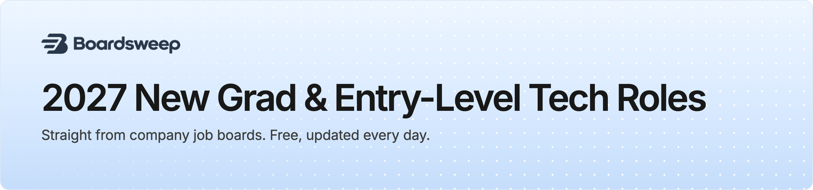

<a href="https://boardsweep.io/?utm_source=github&utm_medium=readme&utm_campaign=new-grad&utm_content=banner"><picture><source media="(prefers-color-scheme: dark)" srcset="assets/banner-newgrad-dark.png"></picture></a>

<a href="https://boardsweep.io/new-grad?utm_source=github&utm_medium=readme&utm_campaign=new-grad&utm_content=cta_email"><picture><source media="(prefers-color-scheme: dark)" srcset="assets/cta-email-dark.png"></picture></a>&nbsp;&nbsp;<a href="https://boardsweep.io/#pricing?utm_source=github&utm_medium=readme&utm_campaign=new-grad&utm_content=cta_instant"><picture><source media="(prefers-color-scheme: dark)" srcset="assets/cta-instant-dark.png"></picture></a>

> [!TIP]
> **This list runs a day behind.** The 48 new grad and entry-level roles we found in the last 24 hours are already in subscribers' inboxes, and appear here tomorrow. [Get a free daily email](https://boardsweep.io/new-grad?utm_source=github&utm_medium=readme&utm_campaign=new-grad&utm_content=tip_email), or [get each one the minute the company posts it](https://boardsweep.io/#pricing?utm_source=github&utm_medium=readme&utm_campaign=new-grad&utm_content=tip_instant) with the season pass (7 days free).

 

## Browse by field

| Field | Open now | New this week | |
| --- | ---: | ---: | --- |
| 💻 **[Software engineering](fields/software.md)** | 1,041 | 103 | [Email me these, free](https://boardsweep.io/new-grad/software?utm_source=github&utm_medium=readme&utm_campaign=new-grad&utm_content=browse_software) |
| 🤖 **[AI, ML and data](fields/aiml.md)** | 645 | 32 | [Email me these, free](https://boardsweep.io/new-grad/aiml?utm_source=github&utm_medium=readme&utm_campaign=new-grad&utm_content=browse_aiml) |
| 📈 **[Quant](fields/quant.md)** | 81 | 5 | [Email me these, free](https://boardsweep.io/new-grad/quant?utm_source=github&utm_medium=readme&utm_campaign=new-grad&utm_content=browse_quant) |
| 🔧 **[Hardware](fields/hardware.md)** | 537 | 48 | [Email me these, free](https://boardsweep.io/new-grad/hardware?utm_source=github&utm_medium=readme&utm_campaign=new-grad&utm_content=browse_hardware) |
| 📱 **[Product](fields/product.md)** | 100 | 8 | [Email me these, free](https://boardsweep.io/new-grad/product?utm_source=github&utm_medium=readme&utm_campaign=new-grad&utm_content=browse_product) |
| 🎨 **[Design](fields/design.md)** | 21 | 6 | [Email me these, free](https://boardsweep.io/new-grad/design?utm_source=github&utm_medium=readme&utm_campaign=new-grad&utm_content=browse_design) |
| 🛡️ **[Security](fields/security.md)** | 32 | 17 | [Email me these, free](https://boardsweep.io/new-grad/security?utm_source=github&utm_medium=readme&utm_campaign=new-grad&utm_content=browse_security) |

 

🔥 Top company &nbsp; ✨ Not on the other public lists &nbsp; ⚡ Minutes from posting to us &nbsp; 🛂 No visa sponsorship &nbsp; 🇺🇸 U.S. citizenship required &nbsp; 🎓 Advanced degree required

 

## Software engineering

This week's 103 of 1,041. <a href="fields/software.md">See all 1,041 (2 pages)</a> · <a href="https://boardsweep.io/new-grad/software?utm_source=github&utm_medium=readme&utm_campaign=new-grad&utm_content=track_software">Get only software engineering new grad and entry-level roles by email, free</a>

| Company | Role | Where and pay | Posted | &nbsp;Apply&nbsp; |
| --- | --- | --- | --- | :---: |
| **Synecsolu** | Software Engineer I 🛂 | Norco,&nbsp;CA $38.29–&#8288;$46.97/hr | Nov&nbsp;26 |  |
| &nbsp; **Deloitte** | Junior Full Stack Java Developer ✨ | - $80,300–&#8288;$134,300/yr | Nov&nbsp;26 |  |
| &nbsp; **Cintas** | Product Developer I ✨ | Chicago,&nbsp;IL $74,800–&#8288;$95,700/yr | Nov&nbsp;26 |  |
| &nbsp; **Blue&nbsp;Origin** | Additive Machine Programmer I (Early Career) 🔥 ✨ 🛂 | Greater Seattle Area $26.59–&#8288;$37.22/hr | Nov&nbsp;26 |  |
| &nbsp; **Siemens** | SW QA Engineer Associate - Simcenter X (AltairOne Apps) ✨ | - | Nov&nbsp;26 |  |
| &nbsp; **Schweitzer Engineering Laboratories** | Project Engineer I - Commissioning ✨ | 4&nbsp;Locations - | Nov&nbsp;26 |  |
| &nbsp; **Repligen** | Associate Network Engineer ✨ | Waltham,&nbsp;MA $70k–&#8288;$85k/yr | Nov&nbsp;26 |  |
| &nbsp; **Charles&nbsp;Schwab** | Junior Full Stack Java Engineer ✨ | - $90k–&#8288;$110k/yr | Nov&nbsp;26 |  |
| &nbsp; **CACI** | Junior Pega Application Developer ✨ | Washington,&nbsp;DC - | Nov&nbsp;26 |  |
| &nbsp; **Visa** | Associate Data Engineer, AI Studio 🔥 ✨ | US&nbsp;-&nbsp;Austin,&nbsp;TX - | Nov&nbsp;26 |  |
| &nbsp; **Northrop&nbsp;Grumman** | Associate Systems Engineer/Systems Engineer 11205-1 ✨ | United States-Utah-Roy - | Nov&nbsp;26 |  |
| **Scout&nbsp;AI** | New Grad Software Engineer, Core Systems | Sunnyvale,&nbsp;CA $135k–&#8288;$190k/yr | Nov&nbsp;26 |  |
| &nbsp; **Mercury&nbsp;Insurance** | Software Engineer I Test ✨ | - $76,829–&#8288;$142,213/yr | Nov&nbsp;25 |  |
| &nbsp; **Early&nbsp;Warning** | DevOps Engineer I ✨ | Chicago $72k–&#8288;$88k/yr | Nov&nbsp;25 |  |
| &nbsp; **Accenture Federal Services** | System Engineer 0 ✨ | Annapolis Junction, MD $83k–&#8288;$151k/yr | Nov&nbsp;25 |  |
| &nbsp; **Bluesight** | Data Engineer | Remote&nbsp;in $110k–&#8288;$130k/yr | Nov&nbsp;25 ⚡&nbsp;41m |  |
| &nbsp; **XPENG** | Software Engineer - Computing Platform (New Graduate) | Santa&nbsp;Clara,&nbsp;CA $124,091–&#8288;$210k/yr | Nov&nbsp;25 ⚡&nbsp;4m |  |
| &nbsp; **Vestwell** | Associate Software Engineer | 4&nbsp;locations $95k–&#8288;$110k/yr | Nov&nbsp;25 |  |
| &nbsp; **Peraton** | Junior Level Test Systems Engineer ✨ | Springfield,&nbsp;VA $86k–&#8288;$138k/yr | Nov&nbsp;25 |  |
| **Wellhealthtechnologiescorp** | Junior Software Developer | Remote $70k–&#8288;$80k/yr | Nov&nbsp;25 |  |
| &nbsp; **Peraton** | RedHat Cloud Engineer (Jr) ✨ | Chantilly,&nbsp;VA $66k–&#8288;$106k/yr | Nov&nbsp;25 |  |
| &nbsp; **Eight&nbsp;Sleep** | New Grad - Engineering (internship) ✨ | New&nbsp;York&nbsp;City - | Nov&nbsp;25 ⚡&nbsp;13m |  |
| **Wellhealthtechnologiescorp** | Junior Software Developer | Remote $70k–&#8288;$80k/yr | Nov&nbsp;25 |  |
| &nbsp; **Eight&nbsp;Sleep** | New Grad - Engineering (full-time) ✨ | New&nbsp;York&nbsp;City - | Nov&nbsp;25 ⚡&nbsp;17m |  |
| &nbsp; **Google** | Network Implementation Engineer, Network Delivery Implementation 🔥 ✨ | Salt Lake City, UT $104k–&#8288;$148k/yr | Nov&nbsp;25 |  |
| &nbsp; **Huntington Ingalls Industries** | Model Based Systems Engineer - Entry Level ✨ 🛂 | Newport&nbsp;News,&nbsp;VA $84k–&#8288;$101k/yr | Nov&nbsp;25 |  |
| &nbsp; **TikTok** | Backend Software Engineer - Data Lifecycle Management 🔥 | San&nbsp;Jose,&nbsp;CA $128k–&#8288;$316,800/yr | Nov&nbsp;25 |  |
| &nbsp; **Capgemini** | Associate Network Engineer ✨ | Irving,&nbsp;TX $56,700–&#8288;$79k/yr | Nov&nbsp;25 |  |
| **Collectors Universe** | Associate Analytics Engineer ✨ | US&nbsp;-&nbsp;Remote - | Nov&nbsp;25 |  |
| &nbsp; **Exelixis** | Engineer I – Client Technology ✨ | Alameda,&nbsp;CA - | Nov&nbsp;25 |  |
| &nbsp; **Cox** | Software Engineer I  - 13851 ✨ | Atlanta,&nbsp;GA - | Nov&nbsp;25 |  |
| &nbsp; **Applied&nbsp;Materials** | Global Software Support Engineer II New College Grad- Master&#x27;s (Phoenix, AZ) ✨ 🎓 | Phoenix,&nbsp;AZ - | Nov&nbsp;25 |  |
| &nbsp; **Metropolitan Transportation Authority** | Application Developer Analyst Levels 1–2 | Queens,&nbsp;NY $57,100–&#8288;$81,572/yr | Nov&nbsp;25 |  |
| &nbsp; **Oracle** | Systems Engineer 1 🔥 | Kansas&nbsp;City,&nbsp;MO - | Nov&nbsp;25 |  |
| &nbsp; **Deloitte** | Software Engineer | Nashville,&nbsp;TN $69,400–&#8288;$142,600/yr | Nov&nbsp;25 |  |
| &nbsp; **Boeing** | Associate Software Engineer–Developer ✨ 🛂 | USA - El Segundo, CA $106,250–&#8288;$143,750/yr | Nov&nbsp;25 |  |
| &nbsp; **Dell&nbsp;Technologies** | Forward Deployed AI Engineer - Technical Program Management - AI Delivery and Enablement | Hopkinton,&nbsp;MA $91,800–&#8288;$118,800/yr | Nov&nbsp;25 |  |
| &nbsp; **Bank&nbsp;of&nbsp;America** | Software Engineer I Java | Pennington $26.84–&#8288;$49.10/hr | Nov&nbsp;25 |  |
| &nbsp; **M&amp;T&nbsp;Bank** | 2027 Technology Development Program - Software Engineering (Commercial Application Development) ✨ | Buffalo,&nbsp;NY - | Nov&nbsp;25 |  |
| ↳ | 2027 Technology Development Program - Software Engineering (AI &amp; Engineering Platforms) ✨ | Buffalo,&nbsp;NY - | Nov&nbsp;25 |  |
| ↳ | 2027 Technology Development Program - Software Engineering (Identity &amp; Risk Technology) ✨ | Buffalo,&nbsp;NY - | Nov&nbsp;25 |  |
| &nbsp; **CodeRabbit** | Software Engineer - New Grad | San&nbsp;Francisco $170k–&#8288;$185k/yr | Nov&nbsp;25 |  |
| &nbsp; **Sonos** | Junior Software Development Engineer - Web 🛂 | 2&nbsp;locations $93k–&#8288;$115,900/yr | Nov&nbsp;25 |  |
| &nbsp; **Parallel Web Systems** | Early Career Software Engineer, Developer Experience | San&nbsp;Francisco $150k–&#8288;$300k/yr | Nov&nbsp;25 |  |
| &nbsp; **SAIC** | Computer Programmer Level 1 | Oklahoma City, OK - | Nov&nbsp;24 |  |
| &nbsp; **Amazon** | Front-End Engineer 🔥 | Seattle,&nbsp;WA - | Nov&nbsp;24 |  |
| &nbsp; **Veeva&nbsp;Systems** | Associate Software Engineer - 2027 Start Dates | North Carolina - Raleigh - | Nov&nbsp;24 ⚡&nbsp;13m |  |
| &nbsp; **CoreWeave** | Business System Engineer 1 🔥 ✨ | Dallas,&nbsp;TX $109k–&#8288;$145k/yr | Nov&nbsp;24 |  |
| **Freedom Consulting** | Junior Software Engineer 817 ✨ | Annapolis Junction, MD $130k–&#8288;$150k/yr | Nov&nbsp;24 ⚡&nbsp;14m |  |
| &nbsp; **NT&nbsp;Concepts** | Associate Test Automation Engineer ✨ | 2&nbsp;locations $77k–&#8288;$117k/yr | Nov&nbsp;24 ⚡&nbsp;4m |  |
| &nbsp; **Rubrik** | Software Engineer - Data Protection | Palo&nbsp;Alto,&nbsp;CA $131,400–&#8288;$197,200/yr | Nov&nbsp;24 |  |
| &nbsp; **Wurl** | Software Engineer I - Remote ✨ | Remote $122k–&#8288;$182k/yr | Nov&nbsp;24 ⚡&nbsp;4m |  |
| &nbsp; **Interstates** | Control Systems Developer I ✨ 🛂 | Sioux&nbsp;Center,&nbsp;IA - | Nov&nbsp;24 ⚡&nbsp;2m |  |
| ↳ | Control Systems Developer I ✨ 🛂 | Omaha,&nbsp;NE - | Nov&nbsp;24 ⚡&nbsp;5m |  |
| &nbsp; **Wyetech** | SWE Software Engineer 0 ✨ 🛂 | Annapolis Junction, MD $70–&#8288;$93/hr | Nov&nbsp;24 |  |
| &nbsp; **General Dynamics Mission Systems** | Systems Engineer – Entry Level ✨ 🛂 | - $85,807–&#8288;$95,193/yr | Nov&nbsp;24 |  |
| ↳ | Systems Engineer – Entry Level Supporting Future Combatants And Mission Systems ✨ 🛂 | - $85,807–&#8288;$95,193/yr | Nov&nbsp;24 |  |
| &nbsp; **Peraton** | Software Engineering (Ignite Innovator Pgm), Associate- Blacksburg, VA | Blacksburg,&nbsp;VA $51k–&#8288;$82k/yr | Nov&nbsp;24 |  |
| ↳ | Software Engineer - Ignite Innovator Pgm | Blacksburg,&nbsp;VA $51k–&#8288;$82k/yr | Nov&nbsp;24 |  |
| &nbsp; **Esri** | Product Engineer I – ArcGIS Online Feature Services ✨ | Redlands,&nbsp;CA $70k–&#8288;$109k/yr | Nov&nbsp;24 ⚡&nbsp;4m |  |
| &nbsp; **Data&nbsp;Lab&nbsp;USA** | Production Programmer - Entry Level SQL Developer | Germantown,&nbsp;MD $65k–&#8288;$75k/yr | Nov&nbsp;24 ⚡&nbsp;15m |  |
| &nbsp; **Microsoft** | Software Engineer-Securing AI 🔥 | Redmond,&nbsp;WA $85,400–&#8288;$168,100/yr | Nov&nbsp;24 |  |
| &nbsp; **ServiceTitan** | Associate Solutions Architect ✨ | US&nbsp;Remote $76,900–&#8288;$115,300/yr | Nov&nbsp;24 |  |
| &nbsp; **Wonder** | Associate Software Engineer, Robotics ✨ | 2&nbsp;Locations - | Nov&nbsp;24 |  |
| &nbsp; **Jonas&nbsp;Software** | Jr. DevOps Engineer ✨ | Remote - | Nov&nbsp;24 |  |
| &nbsp; **State of North Carolina** | Operating Systems Software Programmer I - EHRA ✨ | Wake&nbsp;County,&nbsp;NC - | Nov&nbsp;24 |  |
| &nbsp; **Broadcom** | Supervisor, R&amp;D Software Engineering 🔥 ✨ | USA-IL Lisle Warrenville Road - | Nov&nbsp;24 |  |
| &nbsp; **Peopletec** | Junior Application Specialist ✨ | - | Nov&nbsp;24 |  |
| &nbsp; **Applied&nbsp;Materials** | Software Engineer II New College Grad- Master&#x27;s (Chandler, AZ) ✨ 🎓 | Chandler,&nbsp;AZ - | Nov&nbsp;24 |  |
| &nbsp; **RTX** | Software Engineer I (E2DNY-P1-1) ✨ | Binghamton,&nbsp;NY - | Nov&nbsp;24 |  |
| ↳ | Software Engineer I (E2DVA-P1-1) ✨ | Sterling,&nbsp;VA - | Nov&nbsp;24 |  |
| &nbsp; **Applied&nbsp;Materials** | Software Engineer II New College Grad- Master&#x27;s (Chandler, AZ) ✨ 🎓 | Chandler,&nbsp;AZ $108k–&#8288;$148,500/yr | Nov&nbsp;24 |  |
| &nbsp; **United Launch Alliance** | Systems Engineer 1 ✨ 🛂 | Centennial,&nbsp;CO $67,895–&#8288;$113,159/yr | Nov&nbsp;24 |  |
| &nbsp; **Farmers&nbsp;Insurance** | Client Systems Engineer I- Caledonia, MI (Hybrid) ✨ | Caledonia,&nbsp;MI $72,300–&#8288;$123,090/yr | Nov&nbsp;24 |  |
| &nbsp; **Applied&nbsp;Materials** | Global Software Support Engineer II New College Grad- Master&#x27;s (Phoenix, AZ) ✨ 🎓 | Phoenix,&nbsp;AZ $86,500–&#8288;$119k/yr | Nov&nbsp;24 |  |
| **Beyond New Horizons** | ID&amp;C Software Engineer 🛂 | Tullahoma,&nbsp;TN $94,500–&#8288;$126k/yr | Nov&nbsp;24 |  |
| &nbsp; **Sinclair** | Associate Development Engineer ✨ 🛂 | Hunt&nbsp;Valley,&nbsp;MD $65,600–&#8288;$82k/yr | Nov&nbsp;24 |  |
| **Egud** | Associate Systems Engineer ✨ | Memphis,&nbsp;TN - | Nov&nbsp;24 |  |
| &nbsp; **Peraton** | Software Engineering - Ignite Innovator Pgm | Blacksburg,&nbsp;VA $51k–&#8288;$82k/yr | Nov&nbsp;24 |  |
| &nbsp; **Honeywell** | Application Engineer I ✨ | Bentonville,&nbsp;AR - | Nov&nbsp;24 |  |
| &nbsp; **JPMorgan&nbsp;Chase** | Software Engineer I-Java/Springboot/SQL 🔥 | Newark,&nbsp;DE - | Nov&nbsp;24 |  |
| &nbsp; **Serko** | Software Engineer 1 | Seattle,&nbsp;WA - | Nov&nbsp;24 |  |
| &nbsp; **Wyetech** | Computer Network Operations Analyst/Programmer 1 | Hanover,&nbsp;MD $68.35–&#8288;$98.09/hr | Nov&nbsp;23 |  |
| &nbsp; **Sorenson** | Software Engineer | Salt Lake City, UT - | Nov&nbsp;23 |  |
| &nbsp; **Shield** | Software Engineer I, Hardware Test | Seattle,&nbsp;WA $35–&#8288;$65/hr | Nov&nbsp;23 |  |
| &nbsp; **Accenture Federal Services** | Junior Cloud Administrator/Systems Engineer St. Louis, MO (Onsite or Weekly Travel Required) ✨ | St.&nbsp;Louis,&nbsp;MO $66k–&#8288;$162k/yr | Nov&nbsp;23 ⚡&nbsp;5m |  |
| &nbsp; **Wyetech** | CNO Analyst/Programmer 1 | Hanover,&nbsp;MD $68.35–&#8288;$98.09/hr | Nov&nbsp;23 |  |
| &nbsp; **Iridium Communications** | Software Test Engineer I ✨ | - $65k–&#8288;$81k/yr | Nov&nbsp;23 |  |
| &nbsp; **Inductive Automation** | Software Solutions Engineer I (Hybrid) ✨ | Folsom,&nbsp;CA $85k/yr | Nov&nbsp;23 ⚡&nbsp;5m |  |
| &nbsp; **Wyetech** | Software Engineer Level 1 | Hanover,&nbsp;MD $57.90–&#8288;$83.90/hr | Nov&nbsp;23 |  |
| &nbsp; **DEKA** | Junior Software Engineer ✨ | Manchester,&nbsp;NH - | Nov&nbsp;23 |  |
| &nbsp; **Koddi** | Associate Software Engineer | Fort&nbsp;Worth,&nbsp;TX - | Nov&nbsp;23 ⚡&nbsp;13m |  |
| ↳ | Associate Platform Engineer ✨ | Fort&nbsp;Worth,&nbsp;TX - | Nov&nbsp;23 ⚡&nbsp;14m |  |
| &nbsp; **Apple** | Engineer Evolve An Apple Services Rotation Program 🔥 | - | Nov&nbsp;23 |  |
| &nbsp; **Northrop&nbsp;Grumman** | 2027 Associate Systems Engineer - Roy UT ✨ 🛂 | United States-Utah-Roy $65,800–&#8288;$98,800/yr | Nov&nbsp;23 |  |
| &nbsp; **General Dynamics Mission Systems** | Cwl Systems Engineer – Entry Level ✨ 🛂 | - $85,807–&#8288;$95,193/yr | Nov&nbsp;23 |  |
| &nbsp; **Wyetech** | Software Engineer Level 0 - Full Stack Development | Annapolis Junction, MD $35.97–&#8288;$48.71/hr | Nov&nbsp;23 |  |
| &nbsp; **Boeing** | Associate Software Engineer–Embedded ✨ | USA&nbsp;-&nbsp;Kent,&nbsp;WA - | Nov&nbsp;23 |  |
| &nbsp; **Fidelity National Information Services** | Client Services Analyst I ✨ | Cmh One Riverfront, GA - | Nov&nbsp;23 |  |
| &nbsp; **Sierra Nevada Corporation** | Software Engineer I (Current Military Fellows Only) ✨ | Southern Pines, NC - | Nov&nbsp;23 |  |
| &nbsp; **GlobalFoundries** | Analyst, Data Systems and Automation (2027 New College Graduate) ✨ | Austin,&nbsp;TX - | Nov&nbsp;23 |  |
| &nbsp; **WebAI** | Jr Software Developer | Austin,&nbsp;TX - | Nov&nbsp;23 |  |
| &nbsp; **Calyx&nbsp;Containers** | Junior Software Developer - Print &amp; Packaging | West Valley City, UT - | Nov&nbsp;22 |  |

 

## AI, ML and data

This week's 32 of 645. <a href="fields/aiml.md">See all 645</a> · <a href="https://boardsweep.io/new-grad/aiml?utm_source=github&utm_medium=readme&utm_campaign=new-grad&utm_content=track_aiml">Get only ai, ml and data new grad and entry-level roles by email, free</a>

| Company | Role | Where and pay | Posted | &nbsp;Apply&nbsp; |
| --- | --- | --- | --- | :---: |
| **Mogo** | Junior Full Stack AI Engineer | Remote $65k–&#8288;$85k/yr | Nov&nbsp;26 |  |
| &nbsp; **Mettler&nbsp;Toledo** | Junior Data Scientist - GPO ✨ | - | Nov&nbsp;26 |  |
| &nbsp; **Blackstone** | Data Analyst, Associate - Private Equity Technology ✨ | New&nbsp;York - | Nov&nbsp;26 |  |
| **Scout&nbsp;AI** | AI Engineer, AI/ML and Agent Harnessing (New Grad, 2027) | Sunnyvale,&nbsp;CA $135k–&#8288;$190k/yr | Nov&nbsp;26 ⚡&nbsp;45m |  |
| &nbsp; **United&nbsp;Airlines** | Associate Analyst - Operations Performance &amp; Analytics 🛂 | Chicago,&nbsp;IL - | Nov&nbsp;25 |  |
| &nbsp; **ManTech** | Junior Data Analyst 🛂 | Ashburn,&nbsp;VA $69,900–&#8288;$116,400/yr | Nov&nbsp;25 |  |
| &nbsp; **Booz Allen Hamilton** | Data Scientist, Junior | San&nbsp;Diego,&nbsp;CA - | Nov&nbsp;25 |  |
| &nbsp; **Mass General Brigham** | Data Analyst I ✨ | Boston-MA - | Nov&nbsp;25 |  |
| &nbsp; **Lila&nbsp;Sciences** | ML Scientist - Retrieval &amp; RAG for Scientific Literature 🎓 | 2&nbsp;locations - | Nov&nbsp;25 |  |
| &nbsp; **LSEG** | AI Product &amp; Business Graduate Associate ✨ | New&nbsp;York&nbsp;City - | Nov&nbsp;25 |  |
| &nbsp; **Manulife Financial** | Associate Data Scientist ✨ | 2&nbsp;Locations - | Nov&nbsp;25 |  |
| **Ayo&nbsp;Semiconductor** | Machine Learning Engineer | Boston,&nbsp;MA - | Nov&nbsp;25 |  |
| ↳ | Machine Learning Researcher 🎓 | Boston,&nbsp;MA - | Nov&nbsp;25 |  |
| &nbsp; **Consolidated Edison** | Associate – Research &amp; Development 🎓 | NYC - | Nov&nbsp;24 |  |
| &nbsp; **Navaide** | Junior Data Analyst ✨ 🛂 | D.c.,&nbsp;DC $75k–&#8288;$95k/yr | Nov&nbsp;24 |  |
| &nbsp; **Howmet&nbsp;Aerospace** | AI Engineer 🛂 | Pittsburgh,&nbsp;PA $38k–&#8288;$43k/yr | Nov&nbsp;24 |  |
| &nbsp; **Analytical Mechanics Associates** | AIML Research Associate ✨ | Hampton,&nbsp;VA - | Nov&nbsp;24 |  |
| &nbsp; **X&nbsp;Development** | AI/ML Engineer &amp; Applied Researcher - Early Stage Projects | Mountain View, CA $147k–&#8288;$221k/yr | Nov&nbsp;24 |  |
| &nbsp; **GlobalFoundries** | Corporate Application Engineer, Physical AI (2027 New College Graduate) ✨ | 2&nbsp;Locations $86k–&#8288;$148k/yr | Nov&nbsp;24 |  |
| &nbsp; **Applied&nbsp;Materials** | AI Engineer/Data Scientist NCG- Bachelor&#x27;s (Santa Clara, CA) | Santa&nbsp;Clara,&nbsp;CA $110,500–&#8288;$151,800/yr | Nov&nbsp;24 |  |
| ↳ | AI Engineer/Data Scientist NCG- Bachelor&#x27;s (Santa Clara, CA) ✨ | Santa&nbsp;Clara,&nbsp;CA - | Nov&nbsp;24 |  |
| &nbsp; **Stifel** | Treasury Management Analytics Analyst | St.&nbsp;Louis,&nbsp;MO - | Nov&nbsp;23 |  |
| &nbsp; **Keysight Technologies** | Machine Learning Engineer - Reinforcement Learning &amp; Optimization | 2&nbsp;locations $113k/yr | Nov&nbsp;23 |  |
| &nbsp; **Aon** | Early Careers Health Analytics Specialist | 2&nbsp;locations $63k–&#8288;$80,500/yr | Nov&nbsp;23 |  |
| &nbsp; **Artefact** | AI Applied Engineer – AI Engineer | 135 W 26th Street, New York, NY 10001 - | Nov&nbsp;23 |  |
| &nbsp; **ADUS-Adobe** | 2027 University Graduate - Research Scientist | San&nbsp;Jose - | Nov&nbsp;23 |  |
| &nbsp; **Stifel** | Treasury Management Analytics Analyst | St.&nbsp;Louis,&nbsp;MO - | Nov&nbsp;23 |  |
| &nbsp; **Urban&nbsp;Science** | Analyst | Long&nbsp;Beach,&nbsp;CA $70,304–&#8288;$81,260/yr | Nov&nbsp;23 |  |
| &nbsp; **Adobe** | 2027 University Graduate - Research Scientist 🔥 ✨ | San&nbsp;Jose,&nbsp;CA - | Nov&nbsp;23 |  |
| &nbsp; **Enterprise Holdings** | Data Scientist 1 | St.&nbsp;Louis,&nbsp;MO - | Nov&nbsp;23 |  |
| &nbsp; **Hewlett Packard Enterprise** | AI Automation Engineer Graduate ✨ | Spring,&nbsp;TX - | Nov&nbsp;22 |  |
| ↳ | AI Automation Engineer Graduate ✨ | Spring,&nbsp;TX - | Nov&nbsp;22 |  |

 

## Quant

This week's 5 of 81. <a href="fields/quant.md">See all 81</a> · <a href="https://boardsweep.io/new-grad/quant?utm_source=github&utm_medium=readme&utm_campaign=new-grad&utm_content=track_quant">Get only quant new grad and entry-level roles by email, free</a>

| Company | Role | Where and pay | Posted | &nbsp;Apply&nbsp; |
| --- | --- | --- | --- | :---: |
| &nbsp; **Two&nbsp;Sigma** | New York New York United States Quantitative Trader Full Time Campus Hire 🔥 | - $250k/yr | Nov&nbsp;26 |  |
| &nbsp; **USAA** | Quantitative Risk Analyst I – Financial Risk ✨ 🛂 | 4&nbsp;Locations $93,770–&#8288;$179,240/yr | Nov&nbsp;26 |  |
| &nbsp; **Two&nbsp;Sigma** | Quantitative Trader 🔥 | NYC $250k/yr | Nov&nbsp;25 |  |
| ↳ | Quantitative Trader - Full-Time Campus Hire 🔥 ✨ | - $250k/yr | Nov&nbsp;25 |  |
| &nbsp; **DV&nbsp;Trading** | Junior Trading Operations Analyst ✨ | Chicago $80k–&#8288;$100k/yr | Nov&nbsp;24 ⚡&nbsp;7m |  |

 

## Hardware

This week's 48 of 537. <a href="fields/hardware.md">See all 537</a> · <a href="https://boardsweep.io/new-grad/hardware?utm_source=github&utm_medium=readme&utm_campaign=new-grad&utm_content=track_hardware">Get only hardware new grad and entry-level roles by email, free</a>

| Company | Role | Where and pay | Posted | &nbsp;Apply&nbsp; |
| --- | --- | --- | --- | :---: |
| &nbsp; **Duke&nbsp;University** | Electrical Engineer I ✨ | Durham,&nbsp;NC - | Nov&nbsp;26 |  |
| &nbsp; **Lear** | Controls Engineer I - 2nd Shift ✨ | Auburn&nbsp;Hills,&nbsp;MI - | Nov&nbsp;26 |  |
| &nbsp; **The&nbsp;Toro&nbsp;Company** | Test Engineer I ✨ 🛂 | Riverside,&nbsp;CA $73,100–&#8288;$91,400/yr | Nov&nbsp;26 |  |
| &nbsp; **Sargent &amp; Lundy** | Electrical Engineer 1 (Entry Level) Mission Critical ✨ 🛂 | - $62,998–&#8288;$90,586/yr | Nov&nbsp;26 |  |
| &nbsp; **Carrier&nbsp;Global** | Associate Manufacturing Test Engineer (2nd shift) ✨ | CAG10: ALC HQ, 1025 Cobb Place Boulevard, Ke - | Nov&nbsp;26 |  |
| &nbsp; **Qualcomm** | Microprocessor Silicon Validation and Optimization Engineer - ASICS Engineering 🔥 | San&nbsp;Diego,&nbsp;CA $101,400–&#8288;$152,200/yr | Nov&nbsp;25 |  |
| **Synecsolu** | Engineering Technician I ✨ 🛂 | Norco,&nbsp;CA $30.38–&#8288;$35.34/hr | Nov&nbsp;25 |  |
| &nbsp; **Mayo&nbsp;Clinic** | Embedded Analog Electrical Engineer 🛂 | Rochester,&nbsp;MN - | Nov&nbsp;25 |  |
| &nbsp; **Space Dynamics Laboratory** | Entry-Level Electrical Engineer ✨ 🛂 | North&nbsp;Logan,&nbsp;UT $66,500–&#8288;$118,500/yr | Nov&nbsp;25 |  |
| &nbsp; **Enercon&nbsp;Services** | New Graduate- Associate Electrical Engineer - Data Center Mission Critical Team ✨ 🛂 | Kennesaw,&nbsp;GA $85k–&#8288;$87k/yr | Nov&nbsp;25 |  |
| ↳ | New Graduate- Associate Transmission Engineer - Power Delivery Team ✨ 🛂 | Kennesaw,&nbsp;GA $82k–&#8288;$85k/yr | Nov&nbsp;25 |  |
| ↳ | New Graduate- Associate Substation Engineer - Power Delivery Team ✨ 🛂 | Overland Park, KS $82k–&#8288;$85k/yr | Nov&nbsp;25 |  |
| &nbsp; **Panasonic** | Controls Engineering Technician I -  Nights ✨ | De&nbsp;Soto,&nbsp;KS - | Nov&nbsp;25 |  |
| &nbsp; **Renesas Electronics** | Digital Engineer 🎓 | Duluth,&nbsp;GA - | Nov&nbsp;25 |  |
| &nbsp; **X&nbsp;Development** | PhD / Master&#x27;s Resident - Revolutionary Nanodevice Measurement and Characterization - Early Stage Project 🎓 | Mountain View, CA $125k–&#8288;$147k/yr | Nov&nbsp;25 |  |
| &nbsp; **CityAndCountyOfSanFrancisco1** | Junior Engineer (Electrical) [5201] - Citywide - (Eligible List ID # C00497) ✨ | San&nbsp;Francisco - | Nov&nbsp;25 |  |
| &nbsp; **Stvinc** | Junior Electrical Engineer ✨ | 2&nbsp;Locations - | Nov&nbsp;25 |  |
| &nbsp; **Broadcom** | R&amp;D Engineer IC Design 3 🔥 ✨ | USA-CA Irvine Alton Parkway Bldg 2 - | Nov&nbsp;25 |  |
| ↳ | Design automation STA engineer 🔥 ✨ | Fort&nbsp;Collins,&nbsp;CO - | Nov&nbsp;25 |  |
| &nbsp; **Applied&nbsp;Materials** | Junior Systems Engineer ✨ | Center District, IL - | Nov&nbsp;25 |  |
| &nbsp; **Rocket&nbsp;Lab** | RF Design Engineer I | Long&nbsp;Beach,&nbsp;CA $88k–&#8288;$121k/yr | Nov&nbsp;24 ⚡&nbsp;&lt;1m |  |
| &nbsp; **Keysight Technologies** | R&amp;D BS / MS Electrical Engineer Power Electronics Hardware Design 🎓 | Mt&nbsp;Olive,&nbsp;NJ $76k/yr | Nov&nbsp;24 |  |
| &nbsp; **Northrop&nbsp;Grumman** | 2027 Associate Electromechanical Engineer / Electromechanical Engineer - Manhattan Beach CA ✨ | United States-California-Manhattan Beach - | Nov&nbsp;24 |  |
| &nbsp; **Johnson &amp; Johnson** | Associate Manufacturing Engineer ✨ | Jacksonville,&nbsp;FL - | Nov&nbsp;24 |  |
| &nbsp; **Meso Scale Diagnostics** | Project Engineer I, Automation ✨ | Gaithersburg,&nbsp;MD - | Nov&nbsp;24 |  |
| &nbsp; **PG&amp;E** | Grid Asset Performance Engineer, Associate ✨ | San&nbsp;Ramon,&nbsp;CA $43.27/hr | Nov&nbsp;24 |  |
| &nbsp; **Boston&nbsp;Scientific** | Systems Test Engineer I - PCIG Systems ✨ 🛂 | Maple&nbsp;Grove,&nbsp;MN $59,900/yr | Nov&nbsp;24 |  |
| &nbsp; **Applied&nbsp;Materials** | New College Grad Test Engineer I  (Bachelors - Gloucester, MA) ✨ | Gloucester,&nbsp;MA - | Nov&nbsp;24 |  |
| &nbsp; **Broadcom** | R&amp;D Hardware Engineer (High Speed Analog) 🔥 ✨ | USA-CA Irvine Alton Parkway Bldg 2 - | Nov&nbsp;24 |  |
| ↳ | Embedded Firmware Engineer 🔥 ✨ | 2&nbsp;Locations - | Nov&nbsp;24 |  |
| ↳ | PIC Characterization Engineer 🔥 ✨ | 2&nbsp;Locations - | Nov&nbsp;24 |  |
| ↳ | R&amp;D analog/mixed signal engineer 🔥 ✨ | USA-CA Irvine Alton Parkway Bldg 2 - | Nov&nbsp;24 |  |
| ↳ | Physical Design Engineer, IREM 🔥 ✨ | USA-CA San Jose Innovation Drive - | Nov&nbsp;24 |  |
| ↳ | Optoelectronics Design Engineer 🔥 ✨ | Breinigsville, PA - | Nov&nbsp;24 |  |
| ↳ | Analog Layout Designer 🔥 ✨ | USA-CA Irvine Alton Parkway Bldg 2 - | Nov&nbsp;24 |  |
| &nbsp; **Northrop&nbsp;Grumman** | 2027 Associate Electronics Engineer / Electronics Engineer - Manhattan Beach CA ✨ 🛂 | United States-California-Manhattan Beach $78,500–&#8288;$118k/yr | Nov&nbsp;24 |  |
| ↳ | 2027 Associate Electronics Engineer / Electronics Engineer - Azusa CA ✨ 🛂 | United States-California-Azusa $78,500–&#8288;$118k/yr | Nov&nbsp;24 |  |
| ↳ | 2027 Associate Digital Engineer / Digital Engineer - Manhattan Beach CA ✨ | United States-California-Manhattan Beach - | Nov&nbsp;24 |  |
| ↳ | 2027 Associate Electronics Engineer / Electronics Engineer - Gilbert AZ ✨ | United States-Arizona-Gilbert - | Nov&nbsp;24 |  |
| &nbsp; **United Launch Alliance** | Systems Test Engineer 1 ✨ 🛂 | Pueblo,&nbsp;CO $64,740–&#8288;$107,900/yr | Nov&nbsp;24 |  |
| &nbsp; **onsemi** | Silicon Architect - Product and IP 🎓 | Scottsdale,&nbsp;AZ - | Nov&nbsp;23 |  |
| &nbsp; **General&nbsp;Matter** | Design Reliability Engineer (New Grad) ✨ | Los&nbsp;Angeles,&nbsp;CA $85k–&#8288;$106k/yr | Nov&nbsp;23 ⚡&nbsp;3m |  |
| &nbsp; **Scientific Research Corporation** | Engineer I ✨ | - | Nov&nbsp;23 |  |
| &nbsp; **Sargent &amp; Lundy** | Electrical Analytical Engineer 2 (Entry Level) ✨ | - $69,298–&#8288;$99,644/yr | Nov&nbsp;23 |  |
| &nbsp; **Microchip Technology** | Engineer I- Applications ✨ | Austin,&nbsp;TX - | Nov&nbsp;23 |  |
| &nbsp; **Corning** | Controls &amp; Automation Engineer I ✨ 🛂 | Hemlock, MI, US, 48626 $82,974–&#8288;$114,090/yr | Nov&nbsp;23 |  |
| **Icfcjb** | Electrical Engineer I ✨ 🛂 | Torrance,&nbsp;CA $70,900–&#8288;$88,450/yr | Nov&nbsp;23 |  |
| &nbsp; **SpaceX** | New Graduate Engineer, Electrical (Starfall) 🔥 | Hawthorne,&nbsp;CA $105k–&#8288;$140k/yr | Nov&nbsp;21 ⚡&nbsp;1m |  |

 

## Product

This week's 8 of 100. <a href="fields/product.md">See all 100</a> · <a href="https://boardsweep.io/new-grad/product?utm_source=github&utm_medium=readme&utm_campaign=new-grad&utm_content=track_product">Get only product new grad and entry-level roles by email, free</a>

| Company | Role | Where and pay | Posted | &nbsp;Apply&nbsp; |
| --- | --- | --- | --- | :---: |
| &nbsp; **NewsBreak** | Ventures, General Management Rotation Program (AI Growth Architect) ✨ | Mountain View, CA $150k–&#8288;$210k/yr | Nov&nbsp;25 |  |
| &nbsp; **Voya&nbsp;Financial** | IM Entry Level Analyst Program - Product Management Analyst ✨ | New&nbsp;York,&nbsp;NY - | Nov&nbsp;25 |  |
| **Plug&nbsp;Motors** | Product Analyst | LA $36–&#8288;$46/hr | Nov&nbsp;25 |  |
| &nbsp; **Ultima&nbsp;Genomics** | Product Engineer I ✨ | Fremont,&nbsp;CA $85k–&#8288;$92k/yr | Nov&nbsp;23 ⚡&nbsp;11m |  |
| &nbsp; **Koddi** | Associate Program Analyst | Fort&nbsp;Worth,&nbsp;TX - | Nov&nbsp;23 |  |
| ↳ | Associate Technical Program Analyst | Fort&nbsp;Worth,&nbsp;TX - | Nov&nbsp;23 ⚡&nbsp;13m |  |
| &nbsp; **M&amp;T&nbsp;Bank** | 2027 Management Development Program - Commercial Product Management (Buffalo, NY) ✨ | Buffalo,&nbsp;NY - | Nov&nbsp;23 |  |
| &nbsp; **JPMorgan&nbsp;Chase** | 2027 Chase Leadership Development Program — Full-Time Analyst (Winter Cohort) Consumer &amp; Community Banking Consumer Bank Financial Product Focused - (NY Metro &amp; Columbus) 🔥 🛂 | New&nbsp;York,&nbsp;NY - | Nov&nbsp;23 |  |

 

## Design

This week's 6 of 21. <a href="fields/design.md">See all 21</a> · <a href="https://boardsweep.io/new-grad/design?utm_source=github&utm_medium=readme&utm_campaign=new-grad&utm_content=track_design">Get only design new grad and entry-level roles by email, free</a>

| Company | Role | Where and pay | Posted | &nbsp;Apply&nbsp; |
| --- | --- | --- | --- | :---: |
| &nbsp; **Eversource&nbsp;Energy** | Field Engineering Designer I (Hybrid Schedule) ✨ 🛂 | East&nbsp;Hampton,&nbsp;CT $37.03/hr | Nov&nbsp;25 |  |
| &nbsp; **AECOM** | Entry-Level Architecture Designer ✨ 🛂 | North&nbsp;Charleston - | Nov&nbsp;24 |  |
| &nbsp; **Entergy** | Distribution Designer I ✨ | Hot&nbsp;Springs,&nbsp;AR - | Nov&nbsp;24 |  |
| &nbsp; **Huntington Ingalls Industries** | DESIGNER 1- ET&amp;D HIRING EVENT ✨ 🛂 | Newport&nbsp;News,&nbsp;VA $49k–&#8288;$62k/yr | Nov&nbsp;24 |  |
| &nbsp; **Thinkingbox** | Junior Designer - Thinkingbox ✨ | New&nbsp;York&nbsp;City $50k–&#8288;$60k/yr | Nov&nbsp;23 ⚡&nbsp;12m |  |
| &nbsp; **Koddi** | Associate UI/UX Product Designer ✨ | Fort&nbsp;Worth,&nbsp;TX - | Nov&nbsp;23 ⚡&nbsp;13m |  |

 

## Security

This week's 17 of 32. <a href="fields/security.md">See all 32</a> · <a href="https://boardsweep.io/new-grad/security?utm_source=github&utm_medium=readme&utm_campaign=new-grad&utm_content=track_security">Get only security new grad and entry-level roles by email, free</a>

| Company | Role | Where and pay | Posted | &nbsp;Apply&nbsp; |
| --- | --- | --- | --- | :---: |
| &nbsp; **Radiance Technologies** | Junior DevSecOps Administrator ✨ 🛂 | Huntsville,&nbsp;AL - | Nov&nbsp;26 |  |
| &nbsp; **RTX** | Jr. Information Systems Security Officer (SAP ISSO) ✨ 🛂 | Cedar&nbsp;Rapids,&nbsp;IA - | Nov&nbsp;26 |  |
| &nbsp; **Boeing** | Associate Product Security Engineer ✨ | USA - Berkeley, MO - | Nov&nbsp;26 |  |
| &nbsp; **GovCIO** | Jr Cyber Security Eng ✨ | San&nbsp;Antonio,&nbsp;TX $105k–&#8288;$110k/yr | Nov&nbsp;25 |  |
| &nbsp; **H&amp;R&nbsp;Block** | Associate Security Analyst ✨ | KANSAS&nbsp;CITY,&nbsp;MO - | Nov&nbsp;25 |  |
| &nbsp; **City&nbsp;of&nbsp;New&nbsp;York** | Associate IAM Engineer ✨ | Brooklyn - | Nov&nbsp;25 |  |
| &nbsp; **University System of New Hampshire** | Cybersecurity GRC, DR/BC Analyst ✨ | 3&nbsp;Locations $60,360–&#8288;$107,920/yr | Nov&nbsp;25 |  |
| &nbsp; **Broadcom** | IC and Software Security Architect 🔥 ✨ | 2&nbsp;Locations - | Nov&nbsp;25 |  |
| &nbsp; **Securitas** | Entry Level Security Officer &#124; $250 Sign-on Bonus after 90 days! ✨ | Florence,&nbsp;KY $17–&#8288;$21/hr | Nov&nbsp;25 |  |
| &nbsp; **GDIT** | Application Security Engineer Junior ✨ | Ashburn - 22001 Loudoun County Pkwy (vac106), VA - | Nov&nbsp;24 |  |
| &nbsp; **Northrop&nbsp;Grumman** | 2027 Associate Cyber Systems Engineer - San Diego CA ✨ 🛂 | United States-California-San Diego $86,500–&#8288;$129,500/yr | Nov&nbsp;24 |  |
| &nbsp; **Saliense** | System Security Status Reporting/Metrics Engineer | Tysons,&nbsp;VA - | Nov&nbsp;23 |  |
| &nbsp; **Pendo** | Associate Security Engineer ✨ | Raleigh,&nbsp;NC $88,800–&#8288;$106,500/yr | Nov&nbsp;23 ⚡&nbsp;14m |  |
| &nbsp; **Wyetech** | CNO Reverse Engineer Level 1 ✨ | Hanover,&nbsp;MD $53.62–&#8288;$76.96/hr | Nov&nbsp;23 |  |
| &nbsp; **Accenture Federal Services** | Splunk Jr. Developer ✨ | Washington,&nbsp;DC $86k–&#8288;$176k/yr | Nov&nbsp;23 ⚡&nbsp;3m |  |
| &nbsp; **Koddi** | Associate Security Engineer ✨ | Fort&nbsp;Worth,&nbsp;TX - | Nov&nbsp;23 ⚡&nbsp;13m |  |
| **Eihu** | Junior Cybersecurity Specialist ✨ 🛂 | Remote&nbsp;Work,&nbsp;AZ - | Nov&nbsp;23 |  |

---

**Missing a role, or a link that's wrong?** [Tell us](../../issues/new/choose): every report helps us read more company boards.

**Ask your AI assistant for roles:** add Boardsweep to Claude, ChatGPT or Claude Code with [our free connector](https://github.com/Boardsweep/mcp).

Also see: [Summer 2027 internships](https://github.com/Boardsweep/summer-2027-internships) · [Every role, filterable, on boardsweep.io](https://boardsweep.io/new-grad?utm_source=github&utm_medium=readme&utm_campaign=new-grad&utm_content=footer)

⚡ is measured from the time the company published the posting, where its job board gives one. Updated Nov 28, 2026 at 07:58 UTC. Not affiliated with any company listed.

