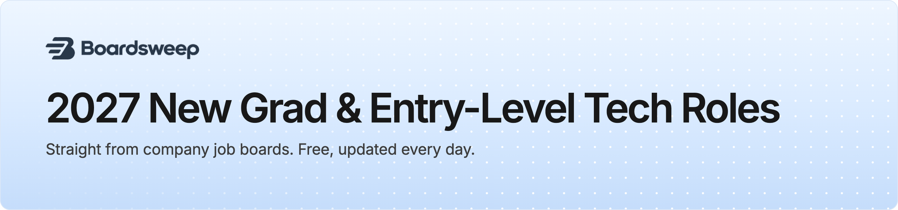

<a href="https://boardsweep.io/?utm_source=github&utm_medium=readme&utm_campaign=new-grad&utm_content=banner"><picture><source media="(prefers-color-scheme: dark)" srcset="assets/banner-newgrad-dark.png"></picture></a>

<a href="https://boardsweep.io/new-grad?utm_source=github&utm_medium=readme&utm_campaign=new-grad&utm_content=cta_email"><picture><source media="(prefers-color-scheme: dark)" srcset="assets/cta-email-dark.png"></picture></a>&nbsp;&nbsp;<a href="https://boardsweep.io/#pricing?utm_source=github&utm_medium=readme&utm_campaign=new-grad&utm_content=cta_instant"><picture><source media="(prefers-color-scheme: dark)" srcset="assets/cta-instant-dark.png"></picture></a>

> [!TIP]
> **This list runs a day behind.** The 139 new grad and entry-level roles we found in the last 24 hours are already in subscribers' inboxes, and appear here tomorrow. [Get a free daily email](https://boardsweep.io/new-grad?utm_source=github&utm_medium=readme&utm_campaign=new-grad&utm_content=tip_email), or [get each one the minute the company posts it](https://boardsweep.io/#pricing?utm_source=github&utm_medium=readme&utm_campaign=new-grad&utm_content=tip_instant) with the season pass (7 days free).

 

## Browse by field

| Field | Open now | New this week | |
| --- | ---: | ---: | --- |
| 💻 **[Software engineering](fields/software.md)** | 1,171 | 169 | [Email me these, free](https://boardsweep.io/new-grad/software?utm_source=github&utm_medium=readme&utm_campaign=new-grad&utm_content=browse_software) |
| 🤖 **[AI, ML and data](fields/aiml.md)** | 753 | 40 | [Email me these, free](https://boardsweep.io/new-grad/aiml?utm_source=github&utm_medium=readme&utm_campaign=new-grad&utm_content=browse_aiml) |
| 📈 **[Quant](fields/quant.md)** | 92 | 4 | [Email me these, free](https://boardsweep.io/new-grad/quant?utm_source=github&utm_medium=readme&utm_campaign=new-grad&utm_content=browse_quant) |
| 🔧 **[Hardware](fields/hardware.md)** | 687 | 137 | [Email me these, free](https://boardsweep.io/new-grad/hardware?utm_source=github&utm_medium=readme&utm_campaign=new-grad&utm_content=browse_hardware) |
| 📱 **[Product](fields/product.md)** | 101 | 13 | [Email me these, free](https://boardsweep.io/new-grad/product?utm_source=github&utm_medium=readme&utm_campaign=new-grad&utm_content=browse_product) |
| 🎨 **[Design](fields/design.md)** | 28 | 15 | [Email me these, free](https://boardsweep.io/new-grad/design?utm_source=github&utm_medium=readme&utm_campaign=new-grad&utm_content=browse_design) |
| 🛡️ **[Security](fields/security.md)** | 23 | 17 | [Email me these, free](https://boardsweep.io/new-grad/security?utm_source=github&utm_medium=readme&utm_campaign=new-grad&utm_content=browse_security) |

 

🔥 Top company &nbsp; ✨ Not on the other public lists &nbsp; ⚡ Minutes from posting to us &nbsp; 🛂 No visa sponsorship &nbsp; 🇺🇸 U.S. citizenship required &nbsp; 🎓 Advanced degree required

 

## Software engineering

This week's 169 of 1,171. <a href="fields/software.md">See all 1,171 (2 pages)</a> · <a href="https://boardsweep.io/new-grad/software?utm_source=github&utm_medium=readme&utm_campaign=new-grad&utm_content=track_software">Get only software engineering new grad and entry-level roles by email, free</a>

| Company | Role | Where and pay | Posted | &nbsp;Apply&nbsp; |
| --- | --- | --- | --- | :---: |
| &nbsp; **RTX** | Scrum Master –Software Engineer II ✨ 🛂 | Woburn,&nbsp;MA - | Nov&nbsp;4 |  |
| &nbsp; **Captivation Software** | Artificial Intelligence Machine Learning Engineer 1 - C++/Marian/Java/AWS/PyTorch/Python ✨ 🛂 | Annapolis Junction, MD $130k–&#8288;$270k/yr | Nov&nbsp;4 ⚡&nbsp;24m |  |
| ↳ | Software Engineer 1 - Python/PySpark/AWS ✨ 🛂 | Annapolis Junction, MD $130k–&#8288;$270k/yr | Nov&nbsp;4 ⚡&nbsp;31m |  |
| ↳ | Software Engineer 1 - Python/Kotlin/Java/Terraform/Elasticsearch/Opensearch/AWS ✨ 🛂 | Annapolis Junction, MD $130k–&#8288;$270k/yr | Nov&nbsp;4 ⚡&nbsp;32m |  |
| ↳ | Software Engineer 1 - Java/Confluence/Jira/AWS/Maven/MapReduce ✨ 🛂 | Annapolis Junction, MD $130k–&#8288;$270k/yr | Nov&nbsp;4 ⚡&nbsp;33m |  |
| &nbsp; **Empower&nbsp;Pharmacy** | Associate Software Engineer – Full Stack | Houston,&nbsp;TX - | Nov&nbsp;4 |  |
| &nbsp; **Daifuku** | Ilus Software Support Specialist I ✨ | - $65k–&#8288;$70k/yr | Nov&nbsp;4 |  |
| ↳ | Ilus Software Support Specialist I ✨ | - $65k–&#8288;$70k/yr | Nov&nbsp;4 |  |
| &nbsp; **Sun&nbsp;Life** | ServiceNow Associate Software Engineer ✨ | 2&nbsp;Locations - | Nov&nbsp;4 |  |
| **HardinDesign** | Web Developer - Entry Level 🛂 | Madison $55k–&#8288;$70k/yr | Nov&nbsp;4 |  |
| &nbsp; **Keenfinity** | Associate DevOps Software Engineer ✨ | Fairport $80k–&#8288;$87k/yr | Nov&nbsp;4 |  |
| &nbsp; **M&amp;T&nbsp;Bank** | 2027 Technology Development Program - Cloud Storage &amp; Data Protection Engineer ✨ | Buffalo,&nbsp;NY $29.57–&#8288;$43.99/hr | Nov&nbsp;4 |  |
| &nbsp; **RTX** | Platform Engineer I ✨ 🛂 | Woburn,&nbsp;MA - | Nov&nbsp;4 |  |
| &nbsp; **Northrop&nbsp;Grumman** | 2027 Associate Systems Engineer – Sykesville MD ✨ 🛂 | United States-Maryland-Sykesville $72,700–&#8288;$109,100/yr | Nov&nbsp;4 |  |
| &nbsp; **Cotiviti** | Associate Software Engineer ✨ | - $77k–&#8288;$92k/yr | Nov&nbsp;4 |  |
| &nbsp; **AbbVie** | Associate DevSecOps Engineer, Platform and Tooling ✨ | Mettawa - | Nov&nbsp;4 |  |
| &nbsp; **Riverside Research** | Jr Software Engineer ✨ 🛂 | - $75k–&#8288;$95k/yr | Nov&nbsp;4 |  |
| ↳ | Jr Software Engineer ✨ | - $75k–&#8288;$95k/yr | Nov&nbsp;4 |  |
| &nbsp; **Northrop&nbsp;Grumman** | 2027 Converting Associate Embedded Software Engineer - Roy UT 🛂 | United States-Utah-Roy $65,800–&#8288;$98,800/yr | Nov&nbsp;4 |  |
| &nbsp; **Great American Insurance Company** | Associate Application Analyst &amp; Developer 🛂 | Lakeland,&nbsp;FL - | Nov&nbsp;4 |  |
| &nbsp; **Amazon** | Software Dev Engineer I, Security Platform 🔥 ✨ | San Francisco, CA - | Nov&nbsp;4 |  |
| &nbsp; **Northrop&nbsp;Grumman** | 2027 Associate S/W Embedded Engineer – Sykesville MD 🛂 | United States-Maryland-Sykesville $72,700–&#8288;$109,100/yr | Nov&nbsp;4 |  |
| &nbsp; **Endeavor&nbsp;AI** | Forward Deployed Engineer, 2027 Graduate | Chicago $140k/yr | Nov&nbsp;4 ⚡&nbsp;59m |  |
| &nbsp; **Medtronic** | Engineer I ✨ | Plymouth,&nbsp;MN $74,400–&#8288;$111,600/yr | Nov&nbsp;3 |  |
| ↳ | Engineer I ✨ | Plymouth,&nbsp;MN $74,400–&#8288;$111,600/yr | Nov&nbsp;3 |  |
| &nbsp; **Boston&nbsp;Scientific** | Software Engineer 1 - Engineering 🛂 | Maple&nbsp;Grove,&nbsp;MN $59,900/yr | Nov&nbsp;3 |  |
| &nbsp; **RTX** | Sr. Systems Engineer - Guidance, Navigation, and Control Engineer ✨ 🛂 | Tucson,&nbsp;AZ - | Nov&nbsp;3 |  |
| &nbsp; **L3Harris** | Associate Systems Engineering | Forest,&nbsp;VA $62k–&#8288;$115k/yr | Nov&nbsp;3 |  |
| &nbsp; **RTX** | Sr. Systems Engineer - Modeling Simulation &amp; Analysis Engineer ✨ 🛂 | Tucson,&nbsp;AZ - | Nov&nbsp;3 |  |
| ↳ | Systems Engineer II - Modeling Simulation &amp; Analysis Engineer ✨ 🛂 | Tucson,&nbsp;AZ - | Nov&nbsp;3 |  |
| &nbsp; **Google** | Ads Solutions Engineer, gTech Agency and Partner Engineering 🔥 ✨ | 2&nbsp;locations $102k–&#8288;$144k/yr | Nov&nbsp;3 |  |
| &nbsp; **Rocket&nbsp;Lab** | AI Software Engineer I | Long&nbsp;Beach,&nbsp;CA $45–&#8288;$52/hr | Nov&nbsp;3 ⚡&nbsp;3m |  |
| &nbsp; **Socure** | Associate Solution Consultant, SLED ✨ | Hub - San Francisco $110k–&#8288;$130k/yr | Nov&nbsp;3 ⚡&nbsp;52m |  |
| &nbsp; **Skyward** | Software Engineer - Entry Level | Stevens&nbsp;Point $65,544.18–&#8288;$72,098.60/yr | Nov&nbsp;3 |  |
| &nbsp; **RTX** | High Performance Computing System Administrator, Analyst, Onsite Tucson AZ ✨ 🛂 | Tucson,&nbsp;AZ - | Nov&nbsp;3 |  |
| &nbsp; **Captivation Software** | Software Engineer 1 - MongoDB/Scala/Java/AWS ✨ 🛂 | Annapolis Junction, MD $130k–&#8288;$270k/yr | Nov&nbsp;3 ⚡&nbsp;46m |  |
| &nbsp; **SoFi** | Associate – Finance Engineer - Data and Analytics 🛂 | Cottonwood Heights, UT - | Nov&nbsp;3 |  |
| &nbsp; **Esri** | Software Development Engineer I – Agentic AI, ArcGIS Enterprise ✨ | Redlands,&nbsp;CA $79k–&#8288;$133k/yr | Nov&nbsp;3 |  |
| &nbsp; **Sierra Nevada Corporation** | Systems Engineer I ✨ | Lone&nbsp;Tree,&nbsp;CO $86,141.20–&#8288;$118,444.15/yr | Nov&nbsp;3 |  |
| &nbsp; **RTX** | Space Simulation and Analysis Engineering ✨ 🛂 | El&nbsp;Segundo,&nbsp;CA - | Nov&nbsp;3 |  |
| &nbsp; **SambaNova&nbsp;Systems** | Machine Learning Engineer New Grad | 2&nbsp;locations $131,200–&#8288;$196,800/yr | Nov&nbsp;3 |  |
| &nbsp; **RTX** | Workflow Developer (SharePoint/Nintex/AgilePoint) (Puerto Rico) ✨ 🛂 | 2&nbsp;Locations - | Nov&nbsp;3 |  |
| &nbsp; **Duolingo University Recruitment** | QA Specialist I, New Graduate ✨ | 2&nbsp;locations $68k–&#8288;$78k/yr | Nov&nbsp;3 ⚡&nbsp;3m |  |
| &nbsp; **Duolingo** | QA Specialist I, New Graduate 🔥 ✨ | 2&nbsp;locations $68k–&#8288;$78k/yr | Nov&nbsp;3 ⚡&nbsp;3m |  |
| &nbsp; **Alarm.com** | Software Rotation Program Associate | Tysons,&nbsp;VA $105k–&#8288;$110k/yr | Nov&nbsp;3 |  |
| &nbsp; **Parsons** | Software Engineer I - Top Secret ✨ | - $88,400–&#8288;$154,700/yr | Nov&nbsp;3 |  |
| &nbsp; **Maxar** | Junior Data Engineer (TS/SCI) ✨ 🛂 | Herndon,&nbsp;VA $115k–&#8288;$155k/yr | Nov&nbsp;3 |  |
| &nbsp; **Arcfield** | Systems Engineer-Navy Submarine Combat Systems | Newport,&nbsp;RI - | Nov&nbsp;3 |  |
| &nbsp; **RTX** | Platform Engineer I (Onsite) ✨ 🛂 | Tewksbury,&nbsp;MA - | Nov&nbsp;3 |  |
| &nbsp; **Baker&nbsp;Hughes** | Software Engineer | Minden,&nbsp;NV $67,690–&#8288;$125,860/yr | Nov&nbsp;3 |  |
| &nbsp; **WEX** | Software Development Engineer 1 ✨ | 2&nbsp;Locations - | Nov&nbsp;3 |  |
| &nbsp; **Centene** | Cloud Platform Engineer I ✨ | 28&nbsp;Locations $30.58–&#8288;$55.09/hr | Nov&nbsp;3 |  |
| &nbsp; **GDIT** | Junior DS Engineer (Travel) ✨ 🛂 | Any Location / Remote $79,900–&#8288;$108,100/yr | Nov&nbsp;3 |  |
| &nbsp; **Torch Technologies** | Jr. Software Analyst ✨ 🛂 | Huntsville,&nbsp;AL - | Nov&nbsp;3 |  |
| &nbsp; **M&amp;T&nbsp;Bank** | Technology Development Program - Software Engineering - Consumer &amp; Marketing Application Development | Buffalo,&nbsp;NY $29.57–&#8288;$43.99/hr | Nov&nbsp;3 |  |
| ↳ | 2027 Technology Development Program - Software Engineering (Data Engineering) | Buffalo,&nbsp;NY $29.57–&#8288;$43.99/hr | Nov&nbsp;3 |  |
| ↳ | 2027 Technology Development Program - Software Engineering (Digital Banking Applications &amp; Platforms) | Buffalo,&nbsp;NY $29.57–&#8288;$43.99/hr | Nov&nbsp;3 |  |
| &nbsp; **Amazon** | Software Development Engineer (Embedded Systems) Early Career - 2027 (US) 🔥 | Seattle,&nbsp;WA - | Nov&nbsp;3 |  |
| &nbsp; **NVIDIA** | GPU System and Scheduling Architect – New College Grad 2026 🔥 | US, CA, Santa Clara - | Nov&nbsp;3 |  |
| &nbsp; **Northrop&nbsp;Grumman** | 2027 Associate Flight Software Engineer - Manhattan Beach CA 🛂 | United States-California-Manhattan Beach $76,200–&#8288;$114,400/yr | Nov&nbsp;3 |  |
| &nbsp; **RELX** | Tech Accelerate Graduate Program | Alpharetta,&nbsp;GA $59,200–&#8288;$98,600/yr | Nov&nbsp;3 |  |
| ↳ | Tech Accelerate Graduate Program | Alpharetta,&nbsp;GA $59,200–&#8288;$98,600/yr | Nov&nbsp;3 |  |
| &nbsp; **Amentum** | Software Tools Developer, Entry Level 🛂 | Huntsville,&nbsp;AL - | Nov&nbsp;3 |  |
| &nbsp; **RTX** | Software Engineer l - Embedded, Onsite 🛂 | Goleta,&nbsp;CA - | Nov&nbsp;3 |  |
| ↳ | Leadership Development Program – Engineering, Software Discipline (Starts June 2027) 🛂 | Arlington,&nbsp;VA - | Nov&nbsp;3 |  |
| &nbsp; **Micron&nbsp;Technology** | New College Grad: Engineer, Edge Systems Architecture 🔥 | Boise, ID - Main Site - | Nov&nbsp;3 |  |
| &nbsp; **Boeing** | ICBM Minuteman Flight Control Systems Engineer , Early Career ✨ 🛂 | USA - Hill Afb, UT $75,650–&#8288;$102,350/yr | Nov&nbsp;2 |  |
| &nbsp; **Banner&nbsp;Health** | Technical Solution Architect I ✨ | Remote&nbsp;Arizona $51.13–&#8288;$85.21/hr | Nov&nbsp;2 |  |
| &nbsp; **Capgemini** | Full Stack Developer | Newark,&nbsp;NJ $69k–&#8288;$80k/yr | Nov&nbsp;2 |  |
| &nbsp; **Anduril** | Space Orbital Software Engineer, Emerging Talent 🔥 | Costa&nbsp;Mesa,&nbsp;CA $132k–&#8288;$149k/yr | Nov&nbsp;2 |  |
| &nbsp; **DTCC** | Software Engineer - Python &amp; AI Solutions | 3&nbsp;locations - | Nov&nbsp;2 |  |
| &nbsp; **Fidelity National Information Services** | Workforce Architect Analyst I, FIS University Program ✨ | Jax&nbsp;347,&nbsp;FL - | Nov&nbsp;2 |  |
| &nbsp; **CHIRP&nbsp;Robotics** | Junior Software Engineer - Drone Autonomy and Flight Systems ✨ 🛂 | Torrance,&nbsp;CA $150k–&#8288;$200k/yr | Nov&nbsp;2 |  |
| &nbsp; **RTX** | Program Quality Engineer - Woburn, MA ✨ 🛂 | Woburn,&nbsp;MA - | Nov&nbsp;2 |  |
| **Aurora&nbsp;Operations** | Developer Support Engineer I ✨ | Pittsburgh,&nbsp;PA $88k–&#8288;$132k/yr | Nov&nbsp;2 ⚡&nbsp;49m |  |
| &nbsp; **RTX** | Software Quality and Process Assurance Engineer (Hybrid - Windsor Locks, CT) ✨ 🛂 | Windsor Locks, CT - | Nov&nbsp;2 |  |
| &nbsp; **Smartsheet** | Software Engineer I (Remote Eligible) ✨ | REMOTE $108k–&#8288;$148k/yr | Nov&nbsp;2 ⚡&nbsp;26m |  |
| &nbsp; **AbbVie** | Associate Device Software Engineer | Pleasanton - | Nov&nbsp;2 |  |
| &nbsp; **Cursor** | Software Engineer New Grad 2027 🔥 | - | Nov&nbsp;2 |  |
| &nbsp; **Torc&nbsp;Robotics** | Application Integration Engineer 1 ✨ | Remote $89,600–&#8288;$107,500/yr | Nov&nbsp;2 ⚡&nbsp;50m |  |
| &nbsp; **Qualtrics** | Software Development Engineer I - Data Platform | Seattle,&nbsp;WA $96k–&#8288;$116k/yr | Nov&nbsp;2 |  |
| &nbsp; **Microsoft** | Software Engineer IC2 🔥 | Redmond,&nbsp;WA - | Nov&nbsp;2 |  |
| &nbsp; **Verkada** | Backend Software Engineer - University Graduate 2027 🔥 | San&nbsp;Mateo,&nbsp;CA $120k–&#8288;$140k/yr | Nov&nbsp;2 ⚡&nbsp;2m |  |
| &nbsp; **Globus&nbsp;Medical** | Associate Software Engineer | Methuen,&nbsp;MA - | Nov&nbsp;2 |  |
| &nbsp; **Qualtrics** | Software Engineer I - XMD | Seattle,&nbsp;WA $96k–&#8288;$116k/yr | Nov&nbsp;2 |  |
| &nbsp; **Schweitzer Engineering Laboratories** | Project Engineer I - Automation ✨ | 6&nbsp;Locations - | Nov&nbsp;2 |  |
| &nbsp; **RTX** | Systems Engineer II - Processing, Guidance, &amp; Controls Engineers ✨ 🛂 | Tucson,&nbsp;AZ - | Nov&nbsp;2 |  |
| &nbsp; **Genuine Parts Company** | DevOps Engineer I ✨ 🛂 | Birmingham,&nbsp;AL - | Nov&nbsp;2 |  |
| &nbsp; **Early&nbsp;Warning** | Site Reliability Engineer I - Paze ✨ | 3&nbsp;Locations $97k–&#8288;$124k/yr | Nov&nbsp;2 |  |
| &nbsp; **RTX** | Digital Factory Software Architect ✨ 🛂 | 4&nbsp;Locations - | Nov&nbsp;2 |  |
| &nbsp; **Element&nbsp;Solutions** | Junior Data Engineer | Remote&nbsp;in $75k–&#8288;$95k/yr | Nov&nbsp;2 ⚡&nbsp;56m |  |
| &nbsp; **Huntington Ingalls Industries** | IT Software Engineer 1 - Robotic Process Automation 🛂 | Newport&nbsp;News,&nbsp;VA $71k–&#8288;$89k/yr | Nov&nbsp;2 |  |
| &nbsp; **Google** | Software Engineer Ii Early Career 🔥 | 12&nbsp;locations $123k–&#8288;$174k/yr | Nov&nbsp;2 |  |
| &nbsp; **RTX** | Systems Engineer II - Business &amp; Regional Avionics (Onsite) ✨ | Cedar&nbsp;Rapids,&nbsp;IA - | Nov&nbsp;2 |  |
| ↳ | Systems Engineer I - Business &amp; Regional Programs (Onsite) ✨ | Cedar&nbsp;Rapids,&nbsp;IA - | Nov&nbsp;2 |  |
| &nbsp; **Lineage&nbsp;Logistics** | Associate Report Developer | Remote&nbsp;in - | Nov&nbsp;2 |  |
| **Eihu** | COMSEC Operations Junior ✨ 🛂 | Springfield,&nbsp;VA - | Nov&nbsp;2 |  |
| ↳ | Automation Engineer Junior ✨ 🛂 | Ashburn,&nbsp;VA - | Nov&nbsp;2 |  |
| ↳ | Java Backend Developer Junior ✨ 🛂 | Ashburn,&nbsp;VA - | Nov&nbsp;2 |  |
| &nbsp; **Southern&nbsp;Company** | Documentum Developer, Jr ✨ | Birmingham,&nbsp;AL - | Nov&nbsp;2 |  |
| &nbsp; **Fortinet** | Early Careers: Embedded Software Developer 🛂 | Sunnyvale,&nbsp;CA $110k–&#8288;$180k/yr | Nov&nbsp;2 |  |
| ↳ | Software Dev QA Engineer (Early Career/NPI) ✨ | Sunnyvale,&nbsp;CA $75k–&#8288;$120k/yr | Nov&nbsp;2 |  |
| **Martin&#x27;s Point Health Care** | Associate Enterprise Data Engineer - Remote | Portland,&nbsp;ME $86,926.10–&#8288;$107,379.30/yr | Nov&nbsp;2 |  |
| &nbsp; **Philips** | Associate Data &amp; AI Engineer - Medical Imaging (Bedford, MA) | Bedford,&nbsp;MA $100k–&#8288;$158k/yr | Nov&nbsp;2 |  |
| &nbsp; **American&nbsp;Express** | Software Engineer I - Java, Python , GCP , NoSQL - GMNST ✨ | Phoenix,&nbsp;AZ - | Nov&nbsp;2 |  |
| &nbsp; **Thermo Fisher Scientific** | Associate Systems Developer ✨ | 2&nbsp;Locations - | Nov&nbsp;1 |  |
| **Brown &amp; Brown Insurance** | Junior HubSpot Developer | Plano,&nbsp;TX - | Nov&nbsp;1 |  |
| &nbsp; **Northrop&nbsp;Grumman** | 2027 Associate Software Engineer - Bellevue (NE) 🛂 | United States-Alabama-Huntsville $65,800–&#8288;$98,800/yr | Nov&nbsp;1 |  |
| &nbsp; **Sparksoft** | Junior Technical Engineer ✨ | Remote/Hybrid if local to Maryland - | Oct&nbsp;31 ⚡&nbsp;23m |  |
| &nbsp; **Verizon Communications** | Archt I-Solutions Archt ✨ | 2&nbsp;Locations - | Oct&nbsp;31 |  |
| ↳ | Archt I-DevOps ✨ | 2&nbsp;Locations - | Oct&nbsp;31 |  |
| ↳ | Archt I-DevOps ✨ | 2&nbsp;Locations - | Oct&nbsp;31 |  |
| &nbsp; **BlackRock** | Associate, Application Deployment Engineer ✨ | Atlanta,&nbsp;GA $112k–&#8288;$140k/yr | Oct&nbsp;31 |  |
| &nbsp; **Parsons** | Linux Systems Administrator - Junior ✨ | - $88,400–&#8288;$154,700/yr | Oct&nbsp;31 |  |
| &nbsp; **RTX** | Sr Software Engineer - Airborne Radar Systems, Onsite ✨ 🛂 | El&nbsp;Segundo,&nbsp;CA - | Oct&nbsp;31 |  |
| &nbsp; **Northrop&nbsp;Grumman** | Associate Software Engineer - Hollywood (MD) 🛂 | United States-Maryland-Hollywood $76,200–&#8288;$114,400/yr | Oct&nbsp;31 |  |
| &nbsp; **Inductive Automation** | Software Solutions Engineer I ✨ | Columbia,&nbsp;MD $82k–&#8288;$95k/yr | Oct&nbsp;30 ⚡&nbsp;52m |  |
| &nbsp; **Rocket&nbsp;Lab** | Business Systems Engineer I | Long&nbsp;Beach,&nbsp;CA $67k–&#8288;$84k/yr | Oct&nbsp;30 ⚡&nbsp;2m |  |
| &nbsp; **USAA** | Data Engineer - Intermediate ✨ 🛂 | 3&nbsp;Locations $85,040–&#8288;$162,550/yr | Oct&nbsp;30 |  |
| &nbsp; **Rockwell Automation** | EDGE, Information Technology Rotational Program ✨ 🛂 | Milwaukee,&nbsp;WI - | Oct&nbsp;30 |  |
| ↳ | EDGE, Information Technology Rotational Program ✨ 🛂 | Milwaukee,&nbsp;WI - | Oct&nbsp;30 |  |
| **GetBuilt** | Innovation Software Engineer 1 | Nashville,&nbsp;TN $80k–&#8288;$110k/yr | Oct&nbsp;30 |  |
| &nbsp; **PDI&nbsp;Technologies** | Solutions Engineer I ✨ | Alpharetta,&nbsp;GA - | Oct&nbsp;30 ⚡&nbsp;59m |  |
| &nbsp; **RTX** | Systems Engineer I - Tac Comm - Onsite ✨ 🛂 | Cedar&nbsp;Rapids,&nbsp;IA - | Oct&nbsp;30 |  |
| ↳ | Embedded Software Engineer ✨ 🛂 | Cedar&nbsp;Rapids,&nbsp;IA - | Oct&nbsp;30 |  |
| ↳ | Software Engineer II - Advanced System Tools ✨ | Cedar&nbsp;Rapids,&nbsp;IA - | Oct&nbsp;30 |  |
| &nbsp; **Arm** | Graduate Software Engineer &amp;#x2013; System Test Graphics 🔥 ✨ 🎓 | - | Oct&nbsp;30 |  |
| &nbsp; **Businessolver** | Business Analyst I (Remote) ✨ | Remote - | Oct&nbsp;30 |  |
| &nbsp; **RTX** | Software Engineer II - Embedded Platform Software, Onsite ✨ 🛂 | Cedar&nbsp;Rapids,&nbsp;IA - | Oct&nbsp;30 |  |
| &nbsp; **Roblox** | [2027] Senior Software Engineer - Data Acquisition PhD Early Career 🔥 ✨ 🎓 | San&nbsp;Mateo,&nbsp;CA $197k–&#8288;$243k/yr | Oct&nbsp;30 ⚡&nbsp;3m |  |
| &nbsp; **American Century Investments** | Software Engineer Associate ✨ 🛂 | Kansas&nbsp;City,&nbsp;MO - | Oct&nbsp;30 |  |
| &nbsp; **RTX** | Software Security Engineer II ✨ 🛂 | El&nbsp;Segundo,&nbsp;CA - | Oct&nbsp;30 |  |
| &nbsp; **Onto&nbsp;Innovation** | Systems Engineer 1 ✨ | Wilmington-MA $60,080–&#8288;$90,120/yr | Oct&nbsp;30 |  |
| &nbsp; **BodySpec** | Junior Software Engineer | Austin,&nbsp;TX $70,170/yr | Oct&nbsp;30 |  |
| &nbsp; **Arm** | Graduate Program - Engineering Pathways 🔥 ✨ | - | Oct&nbsp;30 |  |
| &nbsp; **Bodyspec** | Junior Developer ✨ | Austin,&nbsp;TX $70,170/yr | Oct&nbsp;30 |  |
| &nbsp; **Cambridge Associates** | Jr. Developer ✨ | 2&nbsp;Locations - | Oct&nbsp;30 |  |
| &nbsp; **RTX** | Embedded Software Security Engineer II (S3E) ✨ 🛂 | Tucson,&nbsp;AZ - | Oct&nbsp;30 |  |
| ↳ | Electrical Engineer II - Test Software ✨ 🛂 | Plano,&nbsp;TX - | Oct&nbsp;30 |  |
| ↳ | Eng II, A2G Graphics Software Engineering (Onsite) ✨ 🛂 | Cedar&nbsp;Rapids,&nbsp;IA - | Oct&nbsp;30 |  |
| ↳ | Cyber Software Engineer II ✨ 🛂 | Anaheim,&nbsp;CA - | Oct&nbsp;30 |  |
| ↳ | Software Engineer II (Cybersecurity &#124; Networking) ✨ 🛂 | Annapolis Junction, MD - | Oct&nbsp;30 |  |
| &nbsp; **Saab** | Associate Software Engineer ✨ 🛂 | East Syracuse, NY $72k–&#8288;$90k/yr | Oct&nbsp;30 |  |
| &nbsp; **Formlabs** | Embedded Software Engineer - Entry Level | Boston,&nbsp;MA $110k–&#8288;$140k/yr | Oct&nbsp;30 |  |
| &nbsp; **Citi** | Junior Application Developer ✨ | Tampa&nbsp;Florida $76,560–&#8288;$106,840/yr | Oct&nbsp;30 |  |
| &nbsp; **State&nbsp;of&nbsp;Nebraska** | Data Visualization Engineer 🛂 | Lincoln,&nbsp;NE $30/hr | Oct&nbsp;30 |  |
| &nbsp; **The Aerospace Corporation** | Software Integration Engineer New Grad 🛂 | Chantilly,&nbsp;VA $70,100–&#8288;$105,100/yr | Oct&nbsp;30 |  |
| &nbsp; **Intel** | Software Application Development Engineer New Grad 🔥 | 2&nbsp;locations $85,950–&#8288;$141,950/yr | Oct&nbsp;30 |  |
| &nbsp; **Amazon** | Software Development Engineer (Database) Early Career- 2027 (US) 🔥 | Seattle,&nbsp;WA - | Oct&nbsp;30 |  |
| &nbsp; **Urban&nbsp;Science** | Associate Software Engineer 🛂 | Detroit,&nbsp;MI - | Oct&nbsp;30 |  |
| **Eihu** | Systems Engineer Associate 🛂 | Panama City Beach, FL - | Oct&nbsp;30 |  |
| &nbsp; **RTX** | Entry-Level Software Developer - Application Support &amp; Sustainment (Remote) 🛂 | Cedar&nbsp;Rapids,&nbsp;IA - | Oct&nbsp;30 |  |
| &nbsp; **State&nbsp;of&nbsp;Nebraska** | Data Engineer 🛂 | Lincoln,&nbsp;NE $30/hr | Oct&nbsp;30 |  |
| &nbsp; **Verizon Communications** | Engineer I-Systems Engineering | Temple Terrace, FL - | Oct&nbsp;30 |  |
| &nbsp; **CoStar&nbsp;Group** | Software Engineer I (C#/.NET) ✨ | US-VA&nbsp;Arlington $108k–&#8288;$154k/yr | Oct&nbsp;29 |  |
| &nbsp; **Analog&nbsp;Devices** | Associate Central Applications Engineer ✨ | US, MA, Wilmington $87,188–&#8288;$119,906/yr | Oct&nbsp;29 |  |
| &nbsp; **Amazon** | Software Privacy Engineer - Multiple Teams 🔥 | Bellevue,&nbsp;WA - | Oct&nbsp;29 |  |
| ↳ | Software Development Engineer 🔥 | Cupertino,&nbsp;CA - | Oct&nbsp;29 |  |
| &nbsp; **Captivation Software** | Radio Frequency Software Engineer 1 - C++/Linux/Python/DSP ✨ 🛂 | Annapolis Junction, MD $130k–&#8288;$270k/yr | Oct&nbsp;29 ⚡&nbsp;16m |  |
| &nbsp; **Fuku** | Software Engineer / Member of Technical Staff | Austin,&nbsp;TX - | Oct&nbsp;29 |  |
| **Intelliforce-IT Solutions Group** | Junior Software Engineer - Prime 🛂 | Annapolis Junction, MD $101k–&#8288;$129k/yr | Oct&nbsp;29 |  |
| &nbsp; **RTX** | Program Quality Engineer I, Woburn, MA ✨ 🛂 | Woburn,&nbsp;MA - | Oct&nbsp;29 |  |
| ↳ | Systems Operations Engineer - Onsite ✨ 🛂 | Springfield,&nbsp;VA - | Oct&nbsp;29 |  |
| ↳ | Quality Engineer ✨ 🛂 | Merrimack,&nbsp;NH - | Oct&nbsp;29 |  |
| &nbsp; **Johns&nbsp;Hopkins&nbsp;APL** | 2027 Graduate - Software Systems Engineer | Laurel,&nbsp;MD $85k/yr | Oct&nbsp;29 |  |
| &nbsp; **Lawrence Livermore National Laboratory** | Geographic Information System Software Developer | Livermore,&nbsp;CA $121,830–&#8288;$154,500/yr | Oct&nbsp;29 |  |
| &nbsp; **RTX** | Systems Engineer II ✨ 🛂 | Tucson,&nbsp;AZ - | Oct&nbsp;29 |  |
| &nbsp; **Moog** | Associate Software Engineer 🛂 | Santa Barbara, CA $80k–&#8288;$114,500/yr | Oct&nbsp;29 |  |
| &nbsp; **Axon** | Unity Software Engineer I - Internal Tools ✨ | Seattle,&nbsp;WA $107k–&#8288;$170k/yr | Oct&nbsp;29 ⚡&nbsp;38m |  |

 

## AI, ML and data

This week's 40 of 753. <a href="fields/aiml.md">See all 753</a> · <a href="https://boardsweep.io/new-grad/aiml?utm_source=github&utm_medium=readme&utm_campaign=new-grad&utm_content=track_aiml">Get only ai, ml and data new grad and entry-level roles by email, free</a>

| Company | Role | Where and pay | Posted | &nbsp;Apply&nbsp; |
| --- | --- | --- | --- | :---: |
| &nbsp; **General&nbsp;Motors** | Machine Learning Systems Engineer - Data Labeling Engineering | Sunnyvale,&nbsp;CA - | Nov&nbsp;5 |  |
| &nbsp; **ShadowDragon** | Junior AI/Machine Learning Engineer | 2&nbsp;locations - | Nov&nbsp;4 |  |
| &nbsp; **Sony** | Associate Data Analyst | San&nbsp;Diego $76,375–&#8288;$101,834/yr | Nov&nbsp;4 |  |
| &nbsp; **Pacific Northwest National Laboratory** | Post-Masters Research Associate - Large Language Models 🎓 | - $80,500/yr | Nov&nbsp;3 |  |
| &nbsp; **ByteDance** | Video/Image AI/ML Software Engineer - Graduate (Video and Edge, Multimedia Lab) - 2027 Start (PhD) 🔥 🎓 | San&nbsp;Jose $128k–&#8288;$316,800/yr | Nov&nbsp;3 |  |
| &nbsp; **LinkedIn** | Data Scientist 🔥 | Mountain View, CA $101k–&#8288;$167k/yr | Nov&nbsp;3 |  |
| &nbsp; **RTX** | Data Analyst ✨ 🛂 | Remote,&nbsp;TX - | Nov&nbsp;3 |  |
| &nbsp; **Precisely** | Associate Software Engineer (Python AI) ✨ | - | Nov&nbsp;3 ⚡&nbsp;55m |  |
| &nbsp; **Vestwell** | Data Analyst | 4&nbsp;locations $70k–&#8288;$80k/yr | Nov&nbsp;3 |  |
| &nbsp; **Jobgether** | Associate Machine Learning Engineer ✨ | - $106,900–&#8288;$152,700/yr | Nov&nbsp;3 |  |
| &nbsp; **Brillio** | Data Acquisition Analyst | Frisco,&nbsp;TX $30–&#8288;$35/hr | Nov&nbsp;3 ⚡&nbsp;&lt;1m |  |
| &nbsp; **Equifax** | Data Scientist - Alternative Finance 🛂 🎓 | 2&nbsp;locations - | Nov&nbsp;3 |  |
| &nbsp; **Smithfield&nbsp;Foods** | Career Foundation Program (CFP) - Data Analytics - May/Spring 2027 Graduates | Smithfield,&nbsp;VA $21.63–&#8288;$31.25/hr | Nov&nbsp;3 |  |
| &nbsp; **FICO** | Analytic Scientist I | San&nbsp;Rafael,&nbsp;CA $88k–&#8288;$121k/yr | Nov&nbsp;3 |  |
| &nbsp; **Fujifilm** | Junior Sales Enablement Analyst | Santa&nbsp;Ana,&nbsp;CA $55,919.90–&#8288;$72,884.70/yr | Nov&nbsp;3 |  |
| &nbsp; **American&nbsp;Express** | Campus Undergraduate Full-Time Engineer - 2027 AI Engineer I, Enterprise Technology Services- Phoenix, AZ | Phoenix,&nbsp;AZ - | Nov&nbsp;3 |  |
| ↳ | Campus Graduate Masters Full-Time Engineer - 2027 AI Engineer I, Enterprise Technology Services- Phoenix, AZ | Phoenix,&nbsp;AZ - | Nov&nbsp;3 |  |
| &nbsp; **Aprio** | Campus AI &amp; Automation Associate - ATL | Atlanta,&nbsp;GA - | Nov&nbsp;2 |  |
| &nbsp; **Thermo Fisher Scientific** | Entry Level Scientist ✨ 🛂 | Middleton,&nbsp;WI - | Nov&nbsp;2 |  |
| &nbsp; **Bottom&nbsp;Line** | AI Enablement Analyst | Portsmouth,&nbsp;NH - | Nov&nbsp;2 |  |
| &nbsp; **Yes&nbsp;Energy** | Forecasting Analyst I ✨ | Richmond,&nbsp;VA $55k–&#8288;$75k/yr | Nov&nbsp;2 ⚡&nbsp;26m |  |
| &nbsp; **AbbVie** | AI Engineer | North Chicago, IL - | Nov&nbsp;2 |  |
| **Integration Innovation** | Junior Machine Learning Engineer ✨ 🛂 | - $93k–&#8288;$210k/yr | Nov&nbsp;2 |  |
| &nbsp; **Citizens** | Business Insights Analyst: Branch Network Distribution | - $80k–&#8288;$106k/yr | Nov&nbsp;2 |  |
| &nbsp; **Sperry&nbsp;Rail** | Data Analyst 1 | Olathe,&nbsp;KS - | Nov&nbsp;2 |  |
| **I3&nbsp;Corps** | Junior Machine Learning Engineer 🛂 | Arlington,&nbsp;VA $93k–&#8288;$210k/yr | Nov&nbsp;2 |  |
| &nbsp; **Citadel Securities** | Machine Learning Researcher – PhD Graduate (US) 🔥 🎓 | Miami,&nbsp;FL - | Nov&nbsp;2 |  |
| &nbsp; **Uber** | Data Analyst I, Tech 🔥 ✨ | San Francisco, CA $113k–&#8288;$125k/yr | Nov&nbsp;2 |  |
| ↳ | Data Analyst I, Tech 🔥 ✨ | San Francisco, CA $113k–&#8288;$125k/yr | Nov&nbsp;2 |  |
| &nbsp; **Cooper Norcross Health** | Reporting and Analytics Developer | Camden,&nbsp;NJ - | Nov&nbsp;1 |  |
| &nbsp; **Steampunk** | Associate Data Scientist | Mclean,&nbsp;VA - | Nov&nbsp;1 |  |
| &nbsp; **Bristol-Myers Squibb** | Associate Engineer, Analytical AI Engineering | Princeton&nbsp;-&nbsp;NJ $81,260–&#8288;$98,468/yr | Oct&nbsp;31 |  |
| &nbsp; **Texas A&amp;M University System** | Licensing Associate - Software and AI ✨ | College Station, TX $5,667.67–&#8288;$8,250/mo | Oct&nbsp;30 |  |
| &nbsp; **Thermo Fisher Scientific** | Associate Research Scientist, Proteins ✨ | Lawrenceville, NJ $87k–&#8288;$97k/yr | Oct&nbsp;30 |  |
| &nbsp; **Cleveland&nbsp;Clinic** | Research Data Scientist I ✨ | Remote&nbsp;Location - | Oct&nbsp;30 |  |
| &nbsp; **Jobgether** | Business Data Analyst 1 ✨ | - $60k–&#8288;$75k/yr | Oct&nbsp;30 |  |
| &nbsp; **DaVita** | People Analytics Analyst | 05555 - Casa del Mundo Office $57,784–&#8288;$85k/yr | Oct&nbsp;30 |  |
| &nbsp; **Cooper Norcross Health** | Data Specialist | Voorhees Township, NJ - | Oct&nbsp;30 |  |
| &nbsp; **Coherent** | Data Analyst - Project Management Support | Mt&nbsp;Olive,&nbsp;NJ - | Oct&nbsp;29 |  |
| &nbsp; **Lawrence Livermore National Laboratory** | SI/ML Computational Biologist - Academic Graduate Appointee ✨ 🎓 | Livermore $6,748–&#8288;$7,718/mo | Oct&nbsp;29 |  |

 

## Quant

This week's 4 of 92. <a href="fields/quant.md">See all 92</a> · <a href="https://boardsweep.io/new-grad/quant?utm_source=github&utm_medium=readme&utm_campaign=new-grad&utm_content=track_quant">Get only quant new grad and entry-level roles by email, free</a>

| Company | Role | Where and pay | Posted | &nbsp;Apply&nbsp; |
| --- | --- | --- | --- | :---: |
| &nbsp; **Xcel&nbsp;Energy** | Trading Associate Analyst or Analyst ✨ | Denver, CO, 80205 $84,900–&#8288;$138,600/yr | Nov&nbsp;4 |  |
| &nbsp; **Citadel Securities** | Quantitative Research Engineer – PhD Graduate (US) 🔥 🎓 | Miami,&nbsp;FL - | Nov&nbsp;2 |  |
| &nbsp; **BlackRock** | Associate, Quant Research ✨ | San Francisco, CA $132,500–&#8288;$162k/yr | Oct&nbsp;31 |  |
| &nbsp; **Chicago Trading Company** | Quant Trading Associate - Options Theory Intensive 🔥 | Chicago,&nbsp;IL $200k/yr | Oct&nbsp;30 |  |

 

## Hardware

This week's 137 of 687. <a href="fields/hardware.md">See all 687</a> · <a href="https://boardsweep.io/new-grad/hardware?utm_source=github&utm_medium=readme&utm_campaign=new-grad&utm_content=track_hardware">Get only hardware new grad and entry-level roles by email, free</a>

| Company | Role | Where and pay | Posted | &nbsp;Apply&nbsp; |
| --- | --- | --- | --- | :---: |
| &nbsp; **RTX** | Antenna &amp; TRIMM and Module Section Leader ✨ 🛂 | Mckinney,&nbsp;TX - | Nov&nbsp;4 |  |
| ↳ | Chemical Material Verification Technician 1 &#124; Fri-Sun, 7A-7P &#124; Onsite ✨ 🛂 | Clayville,&nbsp;NY $21/hr | Nov&nbsp;4 |  |
| ↳ | Test Solutions Electrical Engineer II ✨ 🛂 | Tewksbury,&nbsp;MA - | Nov&nbsp;4 |  |
| &nbsp; **Northrop&nbsp;Grumman** | 2027 Associate Electrical Engineer - Dulles VA or McLean VA ✨ 🛂 | 2&nbsp;Locations $76,200–&#8288;$114,400/yr | Nov&nbsp;4 |  |
| ↳ | 2027 Associate Electrical Engineer - Dulles VA ✨ 🛂 | United States-Virginia-Dulles $76,200–&#8288;$114,400/yr | Nov&nbsp;4 |  |
| &nbsp; **Rocket&nbsp;Lab** | Fluid Systems Engineer I | Long&nbsp;Beach,&nbsp;CA $91k–&#8288;$143k/yr | Nov&nbsp;4 |  |
| &nbsp; **Camstex** | Entry-Level Electrical Engineer ✨ | Houston,&nbsp;TX $70k–&#8288;$90k/yr | Nov&nbsp;4 |  |
| **F7d8749a 72d6 407c Bf98 292ea630c73a** | Electrical Engineer I, X-BAT (New Grad) | Seattle,&nbsp;WA - | Nov&nbsp;4 |  |
| &nbsp; **RTX** | Chemical Material Verification Technician 1 &#124; M-Th, 6A-4P &#124; Onsite ✨ 🛂 | Clayville,&nbsp;NY $21/hr | Nov&nbsp;4 |  |
| ↳ | Chemical Materials Verification Technician I &#124; M–Th, 2P–12A &#124; Onsite ✨ 🛂 | Clayville,&nbsp;NY $21/hr | Nov&nbsp;4 |  |
| ↳ | Electrical Engineer I - Test Solutions - Onsite 🛂 | 2&nbsp;Locations - | Nov&nbsp;4 |  |
| &nbsp; **Shield&nbsp;AI** | Electrical Engineer I, X-BAT (New Grad) 🔥 | Seattle,&nbsp;WA $103k–&#8288;$155k/yr | Nov&nbsp;4 |  |
| &nbsp; **RTX** | Systems Engineer 1 ✨ 🛂 | Tucson,&nbsp;AZ - | Nov&nbsp;4 |  |
| &nbsp; **Keysight Technologies** | Recent Graduate-Process Engineer – Semiconductor Wafer Fabrication ✨ 🛂 | Santa&nbsp;Rosa,&nbsp;CA $76,870/yr | Nov&nbsp;4 |  |
| ↳ | Recent Graduate-Process Engineer – Advanced Semiconductor Packaging ✨ 🛂 | Santa&nbsp;Rosa,&nbsp;CA $76,870/yr | Nov&nbsp;4 |  |
| &nbsp; **RTX** | Engineering Development Program, Test Equipment Design, Engineer I (Onsite) ✨ 🛂 | East Hartford, CT - | Nov&nbsp;4 |  |
| &nbsp; **Thorlabs** | Design Engineer I ✨ | Sparta,&nbsp;NJ - | Nov&nbsp;4 |  |
| &nbsp; **Ford Motor Company** | Thermal Firmware Integration Engineer - Early Career Program, Advanced EV ✨ 🛂 | Palo&nbsp;Alto,&nbsp;CA - | Nov&nbsp;4 |  |
| &nbsp; **Analog&nbsp;Devices** | Associate Field Robotics Systems Engineer | Wilmington,&nbsp;MA $87,188–&#8288;$119,906/yr | Nov&nbsp;4 |  |
| &nbsp; **Ford Motor Company** | Thermal Test Engineer - Early Career Program, Advanced EV ✨ 🛂 | Long&nbsp;Beach,&nbsp;CA - | Nov&nbsp;4 |  |
| &nbsp; **RTX** | Test Solutions Northeast Electrical Engineer I 🛂 | 2&nbsp;Locations - | Nov&nbsp;4 |  |
| &nbsp; **Northrop&nbsp;Grumman** | 2027 Associate H/W Electronics Engineer – Sykesville MD 🛂 | United States-Maryland-Sykesville $72,700–&#8288;$109,100/yr | Nov&nbsp;4 |  |
| &nbsp; **Medtronic** | Quality Engineer I  (CAS), Rice Creek, MN ✨ | Minneapolis,&nbsp;MN $66,400–&#8288;$99,600/yr | Nov&nbsp;3 |  |
| &nbsp; **Moog** | Associate Manufacturing Engineer ✨ | Arvada,&nbsp;CO $75k–&#8288;$90k/yr | Nov&nbsp;3 |  |
| &nbsp; **Medtronic** | Reliability Engineer I - Hardware / Electrical | Mounds&nbsp;View,&nbsp;MN $69,600–&#8288;$104,400/yr | Nov&nbsp;3 |  |
| &nbsp; **RTX** | Systems Engineer II – Guidance, Navigation, and Control Engineer ✨ 🛂 | Tucson,&nbsp;AZ - | Nov&nbsp;3 |  |
| ↳ | Signal Processing Systems Engineer II ✨ 🛂 | Tucson,&nbsp;AZ - | Nov&nbsp;3 |  |
| ↳ | Sr. Systems Engineer - Signal and Sensor Modeling Engineer ✨ 🛂 | Tucson,&nbsp;AZ - | Nov&nbsp;3 |  |
| ↳ | Sr. Signal Processing Systems Engineer ✨ 🛂 | Tucson,&nbsp;AZ - | Nov&nbsp;3 |  |
| ↳ | Systems Engineering- (Onsite) ✨ 🛂 | Burnsville,&nbsp;MN - | Nov&nbsp;3 |  |
| ↳ | Systems Engineer II - Signal and Sensor Modeling Engineer ✨ 🛂 | Tucson,&nbsp;AZ - | Nov&nbsp;3 |  |
| &nbsp; **Northrop&nbsp;Grumman** | 2027 Associate Electrical RF Engineer - Plymouth MN ✨ 🛂 | United States-Minnesota-Plymouth $72,700–&#8288;$109,100/yr | Nov&nbsp;3 |  |
| &nbsp; **Flexential** | Critical Facilities Engineer I ✨ | Atlanta,&nbsp;GA $34–&#8288;$36/hr | Nov&nbsp;3 ⚡&nbsp;28m |  |
| &nbsp; **Micron&nbsp;Technology** | New College Grad - AMHS Equipment Engineer - ID1 🔥 ✨ | Boise,&nbsp;ID&nbsp;-&nbsp;ID1 - | Nov&nbsp;3 |  |
| &nbsp; **Northrop&nbsp;Grumman** | 2027 Associate Electrical Engineer - San Diego CA ✨ 🛂 | United States-California-San Diego $76,200–&#8288;$114,400/yr | Nov&nbsp;3 |  |
| &nbsp; **RTX** | Analog &amp; Power Electrical Engineer II - Onsite ✨ 🛂 | Marlborough,&nbsp;MA - | Nov&nbsp;3 |  |
| &nbsp; **Microchip Technology** | Engineer I- Equipment (Photo/Metrology) ✨ | Colorado Springs, CO - | Nov&nbsp;3 |  |
| &nbsp; **KION&nbsp;Group** | Controls Engineer (New Graduate/Early Career) ✨ | 3&nbsp;Locations $79k–&#8288;$116,400/yr | Nov&nbsp;3 |  |
| ↳ | Controls Engineer (New Graduate/Early Career) ✨ | 3&nbsp;Locations $79k–&#8288;$116,400/yr | Nov&nbsp;3 |  |
| &nbsp; **RTX** | RF Systems Engineer II (Onsite) ✨ 🛂 | Mckinney,&nbsp;TX - | Nov&nbsp;3 |  |
| **Mdtkangaroo** | Product Engineer I ✨ | Juncos, Puerto Rico - | Nov&nbsp;3 |  |
| &nbsp; **RTX** | AN/TPY-2 Hardware Maintainer ✨ 🛂 | El&nbsp;Paso,&nbsp;TX - | Nov&nbsp;3 |  |
| &nbsp; **Boeing** | Associate Electrical &amp; Test Engineer ✨ 🛂 | USA - Huntsville, AL $91,800–&#8288;$124,200/yr | Nov&nbsp;3 |  |
| &nbsp; **General&nbsp;Dynamics** | Engineer I Ii Systems Embedded Engineer ✨ | - | Nov&nbsp;3 |  |
| &nbsp; **Broadcom** | # AI/ML Silicon Accelerator Memory Architect 🔥 ✨ 🎓 | USA-CA San Jose Innovation Drive - | Nov&nbsp;3 |  |
| &nbsp; **Symbotic** | New Grad- Quality Engineer ✨ | USA Wilmington, MA - ITC $79,500–&#8288;$116,600/yr | Nov&nbsp;3 |  |
| &nbsp; **Moog** | Associate Reliability Engineer ✨ | Buffalo,&nbsp;NY - | Nov&nbsp;3 |  |
| &nbsp; **RTX** | Project Engineer – F135 Military Program – Control &amp; Diagnostic System – P3 (Onsite) ✨ | East Hartford, CT - | Nov&nbsp;3 |  |
| ↳ | Electric Propulsion Systems Engineer II (Onsite) ✨ 🛂 | East Hartford, CT - | Nov&nbsp;3 |  |
| ↳ | Radiation Effects Engineering II ✨ 🛂 | El&nbsp;Segundo,&nbsp;CA - | Nov&nbsp;3 |  |
| &nbsp; **Airbus** | Stress Engineer I ✨ 🛂 | Wichita,&nbsp;KS - | Nov&nbsp;3 |  |
| &nbsp; **Terex** | Electrical Engineer - Entry Level ✨ | US-MI Charlotte L02 - | Nov&nbsp;3 |  |
| &nbsp; **Northrop&nbsp;Grumman** | Optical Subsystem I&amp;T Engineer - Level 1 🛂 | United States-Arizona-Chandler $72,400–&#8288;$108,600/yr | Nov&nbsp;3 |  |
| ↳ | Associate Electrical Engineer 🛂 | Plymouth,&nbsp;MN $72,700–&#8288;$109,100/yr | Nov&nbsp;3 |  |
| &nbsp; **Medtronic** | Reliability Engineer I - Hardware / Electrical | Mounds&nbsp;View,&nbsp;MN $69,600–&#8288;$104,400/yr | Nov&nbsp;3 |  |
| &nbsp; **Dell&nbsp;Technologies** | ISG Hardware Engineer 1 - Material Science ✨ | Round&nbsp;Rock,&nbsp;TX $85,502–&#8288;$110,649/yr | Nov&nbsp;3 |  |
| &nbsp; **NVIDIA** | PCIe Post-Silicon Validation Engineer - New College Grad 2027 🔥 | US, CA, Santa Clara - | Nov&nbsp;3 |  |
| **Eihu** | Junior Hardware Engineer ✨ | Huntsville,&nbsp;AL - | Nov&nbsp;3 |  |
| **Ehtl** | Firmware Engineer I ✨ | Golden Valley, MN - | Nov&nbsp;3 |  |
| &nbsp; **Vertiv** | Associate Engineer Electrical &amp; Electronics Engineering VIII ✨ | Westerville,&nbsp;OH - | Nov&nbsp;3 |  |
| &nbsp; **Intel** | Physical Design Clocking Engineer 🔥 | Santa&nbsp;Clara,&nbsp;CA $105,650–&#8288;$149,150/yr | Nov&nbsp;3 |  |
| &nbsp; **Ginkgo&nbsp;Bioworks** | Mechatronics Engineer I ✨ | Boston,&nbsp;MA - | Nov&nbsp;2 |  |
| &nbsp; **Proper&nbsp;Voltage** | Associate Electrical Engineer 🛂 | Carlsbad,&nbsp;CA $70k–&#8288;$90k/yr | Nov&nbsp;2 |  |
| &nbsp; **Chirp&nbsp;Robotics** | Junior Hardware Engineer ✨ | Torrance,&nbsp;CA $100k–&#8288;$125k/yr | Nov&nbsp;2 |  |
| &nbsp; **Northrop&nbsp;Grumman** | 2027 Associate Systems Engineer - San Diego CA ✨ 🛂 | United States-California-San Diego $76,200–&#8288;$114,400/yr | Nov&nbsp;2 |  |
| &nbsp; **RTX** | Microelectronics Operator C - 3rd Shift ✨ 🛂 | Andover,&nbsp;MA $20.50/hr | Nov&nbsp;2 |  |
| ↳ | Microelectronics Operator C - 1st Shift ✨ 🛂 | Andover,&nbsp;MA $20.50/hr | Nov&nbsp;2 |  |
| ↳ | Microelectronics Operator C - 2nd Shift ✨ 🛂 | Andover,&nbsp;MA $20.50/hr | Nov&nbsp;2 |  |
| &nbsp; **Micron&nbsp;Technology** | New College Grad- Dry Etch Equipment Engineer 🔥 ✨ | Boise, ID - Main Site - | Nov&nbsp;2 |  |
| &nbsp; **Applied&nbsp;Materials** | Applications Engineer New College Grad- Bachelor&#x27;s/Master&#x27;s (Santa Clara/Austin) ✨ | 2&nbsp;Locations $86,500–&#8288;$119k/yr | Nov&nbsp;2 |  |
| &nbsp; **RTX** | Navigation /IMU Engineer II (On-Site) ✨ 🛂 | Tucson,&nbsp;AZ - | Nov&nbsp;2 |  |
| ↳ | Sr. Systems Engineer - Processing, Guidance, &amp; Controls Engineers ✨ 🛂 | Tucson,&nbsp;AZ - | Nov&nbsp;2 |  |
| &nbsp; **Metropolitan Transportation Authority** | Junior Engineer - Signal Design ✨ | Queens,&nbsp;NY $38.12/hr | Nov&nbsp;2 |  |
| &nbsp; **Symbotic** | New Grad- Manufacturing Engineer ✨ | USA Wilmington, MA - ITC $79,500–&#8288;$116,600/yr | Nov&nbsp;2 |  |
| &nbsp; **Johnson&nbsp;Controls** | Electrical Engineering Associate ✨ | New Freedom-Pennsylvania-United States of Am - | Nov&nbsp;2 |  |
| &nbsp; **RTX** | X-ray Computed Tomography Engineer (Onsite) ✨ 🛂 | East Hartford, CT - | Nov&nbsp;2 |  |
| ↳ | Sr Test and Validation Engineer - 4th Shift ✨ 🛂 | Andover,&nbsp;MA - | Nov&nbsp;2 |  |
| &nbsp; **Hitachi** | Controls Engineer I ✨ | Greenville,&nbsp;SC - | Nov&nbsp;2 |  |
| &nbsp; **Johnson &amp; Johnson** | Associate Electrical Engineer, Capital Equipment, R&amp;D - MedTech ✨ | Cincinnati,&nbsp;OH - | Nov&nbsp;2 |  |
| &nbsp; **Thermo Fisher Scientific** | Field Service Engineer I - IC/LC/GCMS ✨ | Remote,&nbsp;MD $26.39–&#8288;$39.59/hr | Nov&nbsp;2 |  |
| &nbsp; **RTX** | Elektroniker / Mechatroniker (m/f/d) ✨ | 2&nbsp;Locations - | Nov&nbsp;2 |  |
| &nbsp; **Qualcomm** | Associate Calibration Engineer - Calibration Engineering 🔥 | San&nbsp;Diego,&nbsp;CA $32.30–&#8288;$48.50/hr | Nov&nbsp;2 |  |
| &nbsp; **Intel** | Graduate Talent (CPU-SoC Silicon Design) 🔥 ✨ | 2&nbsp;Locations - | Nov&nbsp;2 |  |
| ↳ | Graduate Talent (CPU-SoC Silicon Design) 🔥 ✨ | 2&nbsp;Locations - | Nov&nbsp;2 |  |
| ↳ | Graduate Talent (CPU-SoC Silicon Design) 🔥 ✨ | 2&nbsp;Locations - | Nov&nbsp;2 |  |
| ↳ | Graduate Talent (CPU-SoC Silicon Design) 🔥 ✨ | 2&nbsp;Locations - | Nov&nbsp;2 |  |
| ↳ | Graduate Talent (CPU-SoC Silicon Design) 🔥 ✨ | 2&nbsp;Locations - | Nov&nbsp;2 |  |
| &nbsp; **Draper** | System Integration and Test Engineer | Cambridge,&nbsp;MA $62,500–&#8288;$140k/yr | Nov&nbsp;2 |  |
| &nbsp; **GlobalFoundries** | Design Verification Engineer (2027 New College Graduate) | Richardson,&nbsp;TX $86k–&#8288;$148k/yr | Nov&nbsp;2 |  |
| &nbsp; **ASML** | System Integration and Test Engineer | San&nbsp;Diego,&nbsp;CA $86,063–&#8288;$126,225/yr | Nov&nbsp;2 |  |
| &nbsp; **RTX** | RF Test Systems Engineer 1 - Onsite McKinney TX 🛂 | Mckinney,&nbsp;TX - | Nov&nbsp;2 |  |
| ↳ | AEGS Pro Electrical Engineer I (On-Site) 🛂 | Tucson,&nbsp;AZ - | Nov&nbsp;2 |  |
| &nbsp; **Thorlabs** | Photonics Engineer I ✨ | Ann&nbsp;Arbor,&nbsp;MI - | Nov&nbsp;2 |  |
| &nbsp; **Northrop&nbsp;Grumman** | Associate Hardware Engineer 🛂 | San&nbsp;Diego,&nbsp;CA $69,400–&#8288;$104k/yr | Nov&nbsp;2 |  |
| &nbsp; **Amazon** | Hardware Development Engineer 1 - Drone Engineering 🔥 | Seattle,&nbsp;WA - | Oct&nbsp;31 |  |
| &nbsp; **NVIDIA** | ASIC Design Verification Engineer 🔥 🎓 | Austin,&nbsp;TX - | Oct&nbsp;31 |  |
| &nbsp; **Sargent &amp; Lundy** | Electrical Engineer 1 (Entry Level) Nuclear (Summer 2027) ✨ | - $62,998–&#8288;$90,586/yr | Oct&nbsp;31 |  |
| &nbsp; **The Aerospace Corporation** | 2027 Entry Level DSP &amp; SDR Engineer ✨ 🛂 | Chantilly,&nbsp;VA $90k–&#8288;$140k/yr | Oct&nbsp;31 |  |
| **Pocket** | Firmware Engineer | SF $160k–&#8288;$250k/yr | Oct&nbsp;31 |  |
| &nbsp; **Carrier&nbsp;Global** | Associate Controls Engineer ✨ | CAF43: AL Florida , 7305 Greenbriar Parkway, $53k–&#8288;$106k/yr | Oct&nbsp;30 |  |
| &nbsp; **RTX** | Engineer II, Automated Test Systems (Onsite) ✨ 🛂 | Largo,&nbsp;FL - | Oct&nbsp;30 |  |
| &nbsp; **Broadcom** | ASIC Design Engineer 🔥 ✨ | Fort&nbsp;Collins,&nbsp;CO - | Oct&nbsp;30 |  |
| ↳ | ASIC Design Automation Engineer 🔥 ✨ | Fort&nbsp;Collins,&nbsp;CO - | Oct&nbsp;30 |  |
| &nbsp; **Arm** | Graduate Engineer &amp;#x2013; Systems Engineering 🔥 ✨ | - | Oct&nbsp;30 |  |
| &nbsp; **Sandvik** | Junior Regulatory Engineer, Brier Hill, PA ✨ | USA, PA, Brier Hill $73k–&#8288;$85k/yr | Oct&nbsp;30 |  |
| &nbsp; **Micron&nbsp;Technology** | New College Grad - Manufacturing Development Engineering (MDE) Shift Engineer 🔥 ✨ | Boise, ID - Main Site - | Oct&nbsp;30 |  |
| &nbsp; **RTX** | Electrical Technician ✨ 🛂 | Cambridge,&nbsp;MA - | Oct&nbsp;30 |  |
| ↳ | Engineer I, MCAD Drafting Services &amp; Product Definition (Hybrid) ✨ 🛂 | Santa&nbsp;Isabel,&nbsp;PR - | Oct&nbsp;30 |  |
| &nbsp; **Tokyo&nbsp;Electron** | Process Engineer II - ES - New College Grads ✨ 🛂 | Boise - | Oct&nbsp;30 |  |
| &nbsp; **Kairos&nbsp;Power** | Firmware Development Engineer | Alameda,&nbsp;CA $92,454–&#8288;$108,769/yr | Oct&nbsp;30 |  |
| &nbsp; **RTX** | Electrical Assembler III - 1st Shift ✨ 🛂 | Phoenix,&nbsp;AZ - | Oct&nbsp;30 |  |
| &nbsp; **Applied&nbsp;Materials** | Physicist/Scientist, Doctorate Degree, New College Grad (Spring 2027) ✨ 🎓 | Santa&nbsp;Clara,&nbsp;CA $138k–&#8288;$190k/yr | Oct&nbsp;30 |  |
| &nbsp; **INFICON2** | Jr. Electrical Engineer ✨ | East&nbsp;Syracuse $80k–&#8288;$95k/yr | Oct&nbsp;30 |  |
| &nbsp; **Duke&nbsp;Energy** | Engineer I OR Engineer II - Nuclear Fuels - Brunswick and Oconee Nuclear Design Team ✨ | 3&nbsp;Locations - | Oct&nbsp;30 |  |
| &nbsp; **RTX** | Electrical Assembler I - 3rd Shift (Onsite) ✨ 🛂 | Bellevue,&nbsp;IA - | Oct&nbsp;30 |  |
| ↳ | Model Maker II (Onsite) ✨ 🛂 | Winston Salem, NC - | Oct&nbsp;30 |  |
| ↳ | Electrical Engineer II, Computing Products  (Onsite) ✨ | Cedar&nbsp;Rapids,&nbsp;IA - | Oct&nbsp;30 |  |
| &nbsp; **Johns&nbsp;Hopkins&nbsp;APL** | 2027 PhD Graduate - Electronic Warfare Engineer/Analyst ✨ 🎓 | Laurel,&nbsp;MD $105k/yr | Oct&nbsp;30 |  |
| &nbsp; **Prime&nbsp;Healthcare** | Biomed Engineer I ✨ | - $26–&#8288;$35.10/hr | Oct&nbsp;30 |  |
| &nbsp; **Caterpillar** | Associate Design Engineer ✨ 🛂 | Rapid&nbsp;City,&nbsp;SD - | Oct&nbsp;30 |  |
| &nbsp; **Formlabs** | Robotic Systems Integration Engineer - Entry Level (SLA &amp; SLS) | Boston,&nbsp;MA $110k–&#8288;$140k/yr | Oct&nbsp;30 |  |
| ↳ | R&amp;D Engineer - Entry Level ✨ | Boston,&nbsp;MA $110k–&#8288;$140k/yr | Oct&nbsp;30 |  |
| ↳ | R&amp;D Reliability/Test Engineer - Entry Level | Boston,&nbsp;MA $100k–&#8288;$140k/yr | Oct&nbsp;30 |  |
| ↳ | Mechanical Engineer - Entry Level ✨ | Boston,&nbsp;MA $110k–&#8288;$140k/yr | Oct&nbsp;30 |  |
| &nbsp; **Zipline** | Manufacturing Engineer, Early Career 🔥 ✨ | South San Francisco, CA - | Oct&nbsp;30 ⚡&nbsp;5m |  |
| &nbsp; **Analog&nbsp;Devices** | Associate Design Evaluation Engineer | US, MA, Wilmington $71,989–&#8288;$99,006/yr | Oct&nbsp;30 |  |
| &nbsp; **Moog** | Associate Electrical Design Engineer | Buffalo,&nbsp;NY $75k–&#8288;$100k/yr | Oct&nbsp;30 |  |
| &nbsp; **RTX** | RF Test Systems Engineer II - Onsite McKinney, TX ✨ 🛂 | Mckinney,&nbsp;TX - | Oct&nbsp;29 |  |
| &nbsp; **Under Control Robotics** | Electrical Engineer  (Early Career) | Sunnyvale,&nbsp;CA $120k–&#8288;$150k/yr | Oct&nbsp;29 |  |
| &nbsp; **RTX** | Test Solution Electrical Engineer II ✨ 🛂 | Tucson,&nbsp;AZ - | Oct&nbsp;29 |  |
| &nbsp; **Voyager Technologies** | Electrical Hardware Engineer I 🛂 | Pittsburgh,&nbsp;PA - | Oct&nbsp;29 ⚡&nbsp;36m |  |
| &nbsp; **Micron&nbsp;Technology** | New College Grad - HBM PYE Product Development Failure Analysis Enginee 🔥 ✨ | Boise, ID - Main Site - | Oct&nbsp;29 |  |
| &nbsp; **RTX** | Electrical Assembler II - 1st Shift (Onsite) ✨ 🛂 | Bellevue,&nbsp;IA - | Oct&nbsp;29 |  |
| &nbsp; **Sargent &amp; Lundy** | Electrical Analytical Engineer 1 (Entry Level) ✨ 🎓 | - $30–&#8288;$43/hr | Oct&nbsp;29 |  |
| &nbsp; **IMEG** | Electrical Engineering New Graduate &#124; St. Louis, MO ✨ | St.&nbsp;Louis,&nbsp;MO - | Oct&nbsp;29 |  |
| ↳ | Electrical Engineering New Graduate &#124; Kansas City, MO ✨ | Kansas&nbsp;City,&nbsp;MO - | Oct&nbsp;29 |  |
| &nbsp; **RTX** | 2nd Shift - Operations Quality Engineer ✨ 🛂 | Andover,&nbsp;MA - | Oct&nbsp;29 |  |

 

## Product

This week's 13 of 101. <a href="fields/product.md">See all 101</a> · <a href="https://boardsweep.io/new-grad/product?utm_source=github&utm_medium=readme&utm_campaign=new-grad&utm_content=track_product">Get only product new grad and entry-level roles by email, free</a>

| Company | Role | Where and pay | Posted | &nbsp;Apply&nbsp; |
| --- | --- | --- | --- | :---: |
| &nbsp; **RTX** | Product Definition Analyst (Onsite) ✨ 🛂 | East Hartford, CT - | Nov&nbsp;4 |  |
| &nbsp; **Mohawk** | Product Management Associate | Calhoun,&nbsp;GA - | Nov&nbsp;3 |  |
| &nbsp; **Boeing** | Associate Production Specialist ✨ 🛂 | USA - Huntsville, AL $71,400–&#8288;$96,600/yr | Nov&nbsp;3 |  |
| &nbsp; **Blackhawk&nbsp;Network** | Associate Product Manager - Technology | Pleasanton,&nbsp;CA $105,300–&#8288;$136,916/yr | Nov&nbsp;3 |  |
| &nbsp; **Deluxe** | Technical Product Analyst I ✨ | 3&nbsp;Locations $17.50–&#8288;$19/hr | Nov&nbsp;3 |  |
| &nbsp; **GAF** | Product Management Rotational Associate | Parsippany,&nbsp;NJ $57,600–&#8288;$79,200/yr | Nov&nbsp;3 |  |
| ↳ | Product Management Rotational Associate | Parsippany,&nbsp;NJ $57,600–&#8288;$79,200/yr | Nov&nbsp;3 |  |
| &nbsp; **Blackhawk&nbsp;Network** | Associate Product Manager - Technology | Pleasanton,&nbsp;CA $105,300–&#8288;$136,916/yr | Nov&nbsp;3 |  |
| &nbsp; **Fiserv** | Product Analyst I ✨ | Omaha,&nbsp;NE - | Nov&nbsp;2 |  |
| **AWE** | Graduate- Project Management ✨ | - | Nov&nbsp;2 |  |
| &nbsp; **TikTok** | Product Solutions And Operations - Graduate (Global Monetization Product and Technology) - 2027 Start 🔥 | San&nbsp;Jose,&nbsp;CA $76k–&#8288;$128k/yr | Oct&nbsp;30 |  |
| &nbsp; **Wise** | Graduate Analyst ✨ 🛂 | Austin - | Oct&nbsp;30 |  |
| &nbsp; **Formlabs** | Technical Program Manager - Entry Level ✨ | Boston,&nbsp;MA $110k–&#8288;$140k/yr | Oct&nbsp;30 |  |

 

## Design

This week's 15 of 28. <a href="fields/design.md">See all 28</a> · <a href="https://boardsweep.io/new-grad/design?utm_source=github&utm_medium=readme&utm_campaign=new-grad&utm_content=track_design">Get only design new grad and entry-level roles by email, free</a>

| Company | Role | Where and pay | Posted | &nbsp;Apply&nbsp; |
| --- | --- | --- | --- | :---: |
| &nbsp; **Two Six Technologies** | Junior Product Designer ✨ | Remote $25–&#8288;$45/hr | Nov&nbsp;4 |  |
| &nbsp; **Ryan&nbsp;Companies** | Designer I ✨ | Minneapolis $58k–&#8288;$65k/yr | Nov&nbsp;3 |  |
| &nbsp; **Maxar** | Junior UI/UX Designer (Secret) ✨ 🛂 | Herndon,&nbsp;VA $60k–&#8288;$85k/yr | Nov&nbsp;3 |  |
| &nbsp; **Heliosww** | Junior Digital Graphic Designer ✨ | Santa&nbsp;Monica,&nbsp;CA - | Nov&nbsp;3 |  |
| &nbsp; **Meijer** | Designer I ✨ | Grand&nbsp;Rapids,&nbsp;MI - | Nov&nbsp;3 |  |
| &nbsp; **ITC&nbsp;Federal** | Graphic Designer Instructional Developer (Junior) Doj Eoir ✨ | - | Nov&nbsp;3 |  |
| &nbsp; **KPFFConsultingEngineers** | Entry Level - Structural Designer ✨ | Los&nbsp;Angeles $77k–&#8288;$87k/yr | Nov&nbsp;3 |  |
| &nbsp; **Johnson&nbsp;Controls** | Controls Systems Designer I ✨ | Horsham-Pennsylvania-United States of Americ $26–&#8288;$37/hr | Nov&nbsp;3 |  |
| &nbsp; **Terex** | Designer I - Engineering ✨ | US-PA Nesquehoning - | Nov&nbsp;3 |  |
| &nbsp; **OpenArt** | Product UI/UX Designer - Junior Level ✨ | San&nbsp;Francisco $150k–&#8288;$200k/yr | Nov&nbsp;2 |  |
| &nbsp; **GAP** | Associate Graphic Designer, Digital ✨ | NY&nbsp;55&nbsp;Thomas&nbsp;St - | Nov&nbsp;2 |  |
| &nbsp; **Atkinsréalis** | Graduate Graphic Designer ✨ | 2&nbsp;Locations - | Nov&nbsp;2 |  |
| &nbsp; **L.L.Bean** | Associate Designer Hardgoods ✨ | Freeport,&nbsp;ME $65,800–&#8288;$82,200/yr | Oct&nbsp;30 |  |
| &nbsp; **IXL&nbsp;Learning** | Associate Math Curriculum Designer, Takeoff ✨ | Raleigh,&nbsp;NC - | Oct&nbsp;30 ⚡&nbsp;41m |  |
| &nbsp; **Formlabs** | Industrial Designer - Entry Level ✨ | Boston,&nbsp;MA $90k–&#8288;$120k/yr | Oct&nbsp;30 |  |

 

## Security

This week's 17 of 23. <a href="fields/security.md">See all 23</a> · <a href="https://boardsweep.io/new-grad/security?utm_source=github&utm_medium=readme&utm_campaign=new-grad&utm_content=track_security">Get only security new grad and entry-level roles by email, free</a>

| Company | Role | Where and pay | Posted | &nbsp;Apply&nbsp; |
| --- | --- | --- | --- | :---: |
| &nbsp; **M&amp;T&nbsp;Bank** | 2027 Technology Development Program - Cybersecurity (Cloud Security Operations) ✨ | Buffalo,&nbsp;NY $29.57–&#8288;$43.99/hr | Nov&nbsp;4 |  |
| ↳ | 2027 Technology Development Program - Cybersecurity (Encryption Services) ✨ | Buffalo,&nbsp;NY $29.57–&#8288;$43.99/hr | Nov&nbsp;4 |  |
| ↳ | 2027 Technology Development Program - Cybersecurity (Insider Threat) ✨ | Buffalo,&nbsp;NY $29.57–&#8288;$43.99/hr | Nov&nbsp;4 |  |
| ↳ | 2027 Technology Development Program - Cybersecurity (Vulnerability Risk Management) ✨ | Buffalo,&nbsp;NY $29.57–&#8288;$43.99/hr | Nov&nbsp;4 |  |
| ↳ | 2027 Technology Development Program - Cybersecurity (Workforce Identity &amp; Access Management) ✨ | Buffalo,&nbsp;NY $29.57–&#8288;$43.99/hr | Nov&nbsp;4 |  |
| &nbsp; **Captivation Software** | Information Systems Security Engineer 1 ✨ 🛂 | Annapolis Junction, MD $130k–&#8288;$270k/yr | Nov&nbsp;3 ⚡&nbsp;57m |  |
| &nbsp; **RTX** | Cybersecurity Data Analyst ✨ 🛂 | Remote,&nbsp;AZ - | Nov&nbsp;3 |  |
| ↳ | Information Systems Security Officer (Onsite) ✨ 🛂 | Cedar&nbsp;Rapids,&nbsp;IA - | Nov&nbsp;3 |  |
| &nbsp; **PricewaterhouseCoopers** | Associate - Cyber Security Consultant ✨ | 2&nbsp;Locations - | Nov&nbsp;3 |  |
| **Fa Euwp Saasfaprod1** | HTM Associate Information Security Engineer ✨ | Eau&nbsp;Claire,&nbsp;WI - | Nov&nbsp;3 |  |
| &nbsp; **Clarity Innovations** | Junior Reverse Engineering/Vulnerability Research Engineer ✨ | Columbus,&nbsp;OH $102k–&#8288;$173k/yr | Nov&nbsp;2 |  |
| &nbsp; **TSYS** | Info Sec Engineering Analyst I ✨ | COLUMBUS,&nbsp;GA - | Nov&nbsp;2 |  |
| &nbsp; **Guidehouse** | Consultant - Defense &amp; Security - IT Controls - Campus 2027 ✨ 🛂 | US&nbsp;-&nbsp;VA,&nbsp;McLean $56k–&#8288;$94k/yr | Nov&nbsp;2 |  |
| &nbsp; **Bluestaq** | Cybersecurity Engineering Residency Program 🛂 | Colorado&nbsp;Springs $40/hr | Oct&nbsp;30 |  |
| &nbsp; **Cobalt** | Associate Security Researcher ✨ | Remote $55k–&#8288;$70k/yr | Oct&nbsp;30 |  |
| &nbsp; **SouthState&nbsp;Bank** | Security Posture Analyst I (Remote) ✨ | Remote Opportunity - VA, NC, SC, GA,  FL, AL $87,282–&#8288;$139,425/yr | Oct&nbsp;30 |  |
| &nbsp; **RTX** | Information Assurance Analyst ✨ | 5&nbsp;Locations - | Oct&nbsp;30 |  |

---

**Missing a role, or a link that's wrong?** [Tell us](../../issues/new/choose): every report helps us read more company boards.

**Ask your AI assistant for roles:** add Boardsweep to Claude, ChatGPT or Claude Code with [our free connector](https://github.com/Boardsweep/mcp).

Also see: [Summer 2027 internships](https://github.com/Boardsweep/summer-2027-internships) · [Every role, filterable, on boardsweep.io](https://boardsweep.io/new-grad?utm_source=github&utm_medium=readme&utm_campaign=new-grad&utm_content=footer)

⚡ is measured from the time the company published the posting, where its job board gives one. Updated Nov 05, 2026 at 19:14 UTC. Not affiliated with any company listed.

