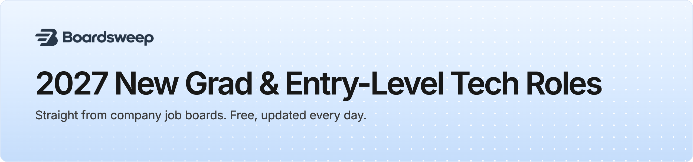

<a href="https://boardsweep.io/?utm_source=github&utm_medium=readme&utm_campaign=new-grad&utm_content=banner"><picture><source media="(prefers-color-scheme: dark)" srcset="assets/banner-newgrad-dark.png"></picture></a>

<a href="https://boardsweep.io/new-grad?utm_source=github&utm_medium=readme&utm_campaign=new-grad&utm_content=cta_email"><picture><source media="(prefers-color-scheme: dark)" srcset="assets/cta-email-dark.png"></picture></a>&nbsp;&nbsp;<a href="https://boardsweep.io/#pricing?utm_source=github&utm_medium=readme&utm_campaign=new-grad&utm_content=cta_instant"><picture><source media="(prefers-color-scheme: dark)" srcset="assets/cta-instant-dark.png"></picture></a>

> [!TIP]
> **This list runs a day behind.** The 90 new grad and entry-level roles we found in the last 24 hours are already in subscribers' inboxes, and appear here tomorrow. [Get a free daily email](https://boardsweep.io/new-grad?utm_source=github&utm_medium=readme&utm_campaign=new-grad&utm_content=tip_email), or [get each one the minute the company posts it](https://boardsweep.io/#pricing?utm_source=github&utm_medium=readme&utm_campaign=new-grad&utm_content=tip_instant) with the season pass (7 days free).

 

## Browse by field

| Field | Open now | New this week | |
| --- | ---: | ---: | --- |
| 💻 **[Software engineering](fields/software.md)** | 1,127 | 188 | [Email me these, free](https://boardsweep.io/new-grad/software?utm_source=github&utm_medium=readme&utm_campaign=new-grad&utm_content=browse_software) |
| 🤖 **[AI, ML and data](fields/aiml.md)** | 755 | 44 | [Email me these, free](https://boardsweep.io/new-grad/aiml?utm_source=github&utm_medium=readme&utm_campaign=new-grad&utm_content=browse_aiml) |
| 📈 **[Quant](fields/quant.md)** | 89 | 5 | [Email me these, free](https://boardsweep.io/new-grad/quant?utm_source=github&utm_medium=readme&utm_campaign=new-grad&utm_content=browse_quant) |
| 🔧 **[Hardware](fields/hardware.md)** | 654 | 137 | [Email me these, free](https://boardsweep.io/new-grad/hardware?utm_source=github&utm_medium=readme&utm_campaign=new-grad&utm_content=browse_hardware) |
| 📱 **[Product](fields/product.md)** | 101 | 9 | [Email me these, free](https://boardsweep.io/new-grad/product?utm_source=github&utm_medium=readme&utm_campaign=new-grad&utm_content=browse_product) |
| 🎨 **[Design](fields/design.md)** | 22 | 10 | [Email me these, free](https://boardsweep.io/new-grad/design?utm_source=github&utm_medium=readme&utm_campaign=new-grad&utm_content=browse_design) |
| 🛡️ **[Security](fields/security.md)** | 24 | 12 | [Email me these, free](https://boardsweep.io/new-grad/security?utm_source=github&utm_medium=readme&utm_campaign=new-grad&utm_content=browse_security) |

 

🔥 Top company &nbsp; ✨ Not on the other public lists &nbsp; ⚡ Minutes from posting to us &nbsp; 🛂 No visa sponsorship &nbsp; 🇺🇸 U.S. citizenship required &nbsp; 🎓 Advanced degree required

 

## Software engineering

This week's 188 of 1,127. <a href="fields/software.md">See all 1,127 (2 pages)</a> · <a href="https://boardsweep.io/new-grad/software?utm_source=github&utm_medium=readme&utm_campaign=new-grad&utm_content=track_software">Get only software engineering new grad and entry-level roles by email, free</a>

| Company | Role | Where and pay | Posted | &nbsp;Apply&nbsp; |
| --- | --- | --- | --- | :---: |
| &nbsp; **RTX** | Cyber Software Engineer II ✨ 🛂 | Anaheim,&nbsp;CA - | Oct&nbsp;30 |  |
| ↳ | Software Engineer II (Cybersecurity &#124; Networking) ✨ 🛂 | Annapolis Junction, MD - | Oct&nbsp;30 |  |
| &nbsp; **Saab** | Associate Software Engineer ✨ 🛂 | East Syracuse, NY $72k–&#8288;$90k/yr | Oct&nbsp;30 |  |
| &nbsp; **Formlabs** | Embedded Software Engineer - Entry Level | Boston,&nbsp;MA $110k–&#8288;$140k/yr | Oct&nbsp;30 |  |
| &nbsp; **Citi** | Junior Application Developer ✨ | Tampa&nbsp;Florida $76,560–&#8288;$106,840/yr | Oct&nbsp;30 |  |
| &nbsp; **Verizon Communications** | Engineer I-Systems Engineering | Temple Terrace, FL - | Oct&nbsp;30 |  |
| &nbsp; **CoStar&nbsp;Group** | Software Engineer I (C#/.NET) ✨ | US-VA&nbsp;Arlington $108k–&#8288;$154k/yr | Oct&nbsp;29 |  |
| &nbsp; **Analog&nbsp;Devices** | Associate Central Applications Engineer ✨ | US, MA, Wilmington $87,188–&#8288;$119,906/yr | Oct&nbsp;29 |  |
| &nbsp; **Amazon** | Software Privacy Engineer - Multiple Teams 🔥 | Bellevue,&nbsp;WA - | Oct&nbsp;29 |  |
| ↳ | Software Development Engineer 🔥 | Cupertino,&nbsp;CA - | Oct&nbsp;29 |  |
| &nbsp; **Captivation Software** | Radio Frequency Software Engineer 1 - C++/Linux/Python/DSP ✨ 🛂 | Annapolis Junction, MD $130k–&#8288;$270k/yr | Oct&nbsp;29 ⚡&nbsp;16m |  |
| &nbsp; **Fuku** | Software Engineer / Member of Technical Staff | Austin,&nbsp;TX - | Oct&nbsp;29 |  |
| **Intelliforce-IT Solutions Group** | Junior Software Engineer - Prime 🛂 | Annapolis Junction, MD $101k–&#8288;$129k/yr | Oct&nbsp;29 |  |
| &nbsp; **RTX** | Program Quality Engineer I, Woburn, MA ✨ 🛂 | Woburn,&nbsp;MA - | Oct&nbsp;29 |  |
| ↳ | Systems Operations Engineer - Onsite ✨ 🛂 | Springfield,&nbsp;VA - | Oct&nbsp;29 |  |
| ↳ | Quality Engineer ✨ 🛂 | Merrimack,&nbsp;NH - | Oct&nbsp;29 |  |
| &nbsp; **Johns&nbsp;Hopkins&nbsp;APL** | 2027 Graduate - Software Systems Engineer | Laurel,&nbsp;MD $85k/yr | Oct&nbsp;29 |  |
| &nbsp; **Lawrence Livermore National Laboratory** | Geographic Information System Software Developer | Livermore,&nbsp;CA $121,830–&#8288;$154,500/yr | Oct&nbsp;29 |  |
| &nbsp; **RTX** | Systems Engineer II ✨ 🛂 | Tucson,&nbsp;AZ - | Oct&nbsp;29 |  |
| &nbsp; **Moog** | Associate Software Engineer 🛂 | Santa Barbara, CA $80k–&#8288;$114,500/yr | Oct&nbsp;29 |  |
| &nbsp; **Axon** | Unity Software Engineer I - Internal Tools ✨ | Seattle,&nbsp;WA $107k–&#8288;$170k/yr | Oct&nbsp;29 ⚡&nbsp;38m |  |
| &nbsp; **Clorox** | Cloud Ops FinOps Associate Engineer ✨ | Durham,&nbsp;NC - | Oct&nbsp;29 |  |
| &nbsp; **WGU** | Associate Assessment Developer ✨ | Salt Lake City, UT $60,600–&#8288;$90,900/yr | Oct&nbsp;29 |  |
| **Interco** | Junior Software Developer ✨ 🛂 | St.&nbsp;Louis $60k–&#8288;$65k/yr | Oct&nbsp;29 |  |
| &nbsp; **Cleveland&nbsp;Clinic** | Beaker CPI Systems Analyst I ✨ | Remote&nbsp;Location - | Oct&nbsp;29 |  |
| &nbsp; **Northwood&nbsp;Space** | Software, Platform (Early Career) ✨ | Torrance,&nbsp;CA $123k–&#8288;$140k/yr | Oct&nbsp;29 |  |
| &nbsp; **RTX** | Production Engineer (Onsite) ✨ 🛂 | Tinker,&nbsp;OK - | Oct&nbsp;29 |  |
| &nbsp; **General&nbsp;Dynamics** | Systems Engineer I Ii ✨ | - | Oct&nbsp;29 |  |
| &nbsp; **Northrop&nbsp;Grumman** | 2027 Associate Embedded Software Engineer Beavercreek Ohio ✨ 🛂 | United States-Ohio-Beavercreek $69,300–&#8288;$103,900/yr | Oct&nbsp;29 |  |
| &nbsp; **Thoughtworks** | Associate (Graduate) Developer ✨ | Chicago,&nbsp;IL - | Oct&nbsp;29 |  |
| &nbsp; **Rit** | NTID Junior Full Stack Engineer ✨ | Rochester,&nbsp;NY $59,900–&#8288;$95,800/yr | Oct&nbsp;29 |  |
| &nbsp; **Jobgether** | Junior SAP ABAP Developer ✨ 🛂 | - $63,500–&#8288;$105,900/yr | Oct&nbsp;29 |  |
| &nbsp; **Booz Allen Hamilton** | Digital Engineer, Junior ✨ 🛂 | Wharton,&nbsp;NJ $53k–&#8288;$108k/yr | Oct&nbsp;29 |  |
| &nbsp; **Decisionpointcorp** | Configuration Support Specialist (Junior) ✨ 🛂 | - | Oct&nbsp;29 |  |
| &nbsp; **iPipeline** | Java Software Developer (Entry Level) ✨ | - | Oct&nbsp;29 |  |
| &nbsp; **RTX** | Systems Engineer II, Systems Engineer ✨ 🛂 | Huntsville,&nbsp;AL - | Oct&nbsp;29 |  |
| &nbsp; **Caterpillar** | 2027 IT Analyst - Entry Level ✨ 🛂 | 2&nbsp;Locations $81,370–&#8288;$122,060/yr | Oct&nbsp;29 |  |
| &nbsp; **Boeing** | Entry-Level F-15 Flight Test Data Engineer 🛂 | USA - Eglin Afb, FL $71,400–&#8288;$96,600/yr | Oct&nbsp;29 |  |
| &nbsp; **Raydar** | Junior Software Engineer ✨ | - | Oct&nbsp;29 |  |
| &nbsp; **Morningstar** | Associate Software Engineer (Central Tech AI) | Chicago,&nbsp;IL $92,143/yr | Oct&nbsp;29 |  |
| &nbsp; **TSC** | Junior Software Engineer (UAS) | Arlington,&nbsp;VA $81k–&#8288;$116k/yr | Oct&nbsp;29 |  |
| &nbsp; **Trend&nbsp;Micro** | Business Intelligence Engineer 🛂 | Irving,&nbsp;TX - | Oct&nbsp;29 |  |
| &nbsp; **Argonne National Laboratory** | Robotics Software Developer Postbaccalaureate Appointee - Rapid Prototyping Laboratory | Lemont,&nbsp;IL $58,656–&#8288;$92,273/yr | Oct&nbsp;29 |  |
| &nbsp; **Booz Allen Hamilton** | Software Developer 🛂 | 11&nbsp;locations $53k–&#8288;$108k/yr | Oct&nbsp;29 |  |
| &nbsp; **Exelixis** | Associate Engineer- AI and Agentics | Alameda,&nbsp;CA $115k–&#8288;$145k/yr | Oct&nbsp;29 |  |
| &nbsp; **Maxar** | Geospatial Analyst (entry level) 🛂 | Tampa,&nbsp;FL $53k–&#8288;$113k/yr | Oct&nbsp;29 |  |
| &nbsp; **Exelixis** | Associate AI and Agentic Engineer | Alameda,&nbsp;CA $115k–&#8288;$145k/yr | Oct&nbsp;29 |  |
| ↳ | Associate AI and Agentic Engineer | Alameda,&nbsp;CA $115k–&#8288;$145k/yr | Oct&nbsp;29 |  |
| &nbsp; **Northrop&nbsp;Grumman** | 2027 Associate Cyber Software Engineer - Pathways Program - Aurora CO 🛂 | United States-Colorado-Aurora $83,800–&#8288;$125,800/yr | Oct&nbsp;29 |  |
| &nbsp; **Dell&nbsp;Technologies** | Test Engineer 1 (2nd Shift) | Franklin,&nbsp;MA $69,360–&#8288;$95,370/yr | Oct&nbsp;29 |  |
| ↳ | Test Engineer 1 (3rd Shift) | Franklin,&nbsp;MA $69,360–&#8288;$95,370/yr | Oct&nbsp;29 |  |
| &nbsp; **KLA&nbsp;Corporation** | System Software Engineer - Distributed Computing | Milpitas,&nbsp;CA $114,800–&#8288;$195,200/yr | Oct&nbsp;29 |  |
| &nbsp; **TSC** | Software Engineer I 🛂 | Plymouth,&nbsp;MA - | Oct&nbsp;29 |  |
| &nbsp; **RTX** | Software Security Engineer I 🛂 | El&nbsp;Segundo,&nbsp;CA - | Oct&nbsp;29 |  |
| &nbsp; **KLA** | System Software Engineer - Distributed Computing 🎓 | Milpitas,&nbsp;CA $114,800–&#8288;$195,200/yr | Oct&nbsp;29 |  |
| &nbsp; **Pure** | iOS / UI Engineer | NYC $120k–&#8288;$250k/yr | Oct&nbsp;29 |  |
| &nbsp; **Abbott** | Bioinformatics Quality Engineer I ✨ | United States - California - La Jolla $81,500–&#8288;$141,300/yr | Oct&nbsp;28 |  |
| &nbsp; **Northrop&nbsp;Grumman** | 2027 Associate Systems Engineer / Systems Engineer ✨ 🛂 | United States-Oklahoma-Oklahoma City $62,300–&#8288;$93,500/yr | Oct&nbsp;28 |  |
| &nbsp; **Brookfield** | Junior Analytics Engineer ✨ | New&nbsp;York,&nbsp;NY - | Oct&nbsp;28 |  |
| &nbsp; **ChampionX** | Application Engineer I ✨ | Midland Regional, TX - | Oct&nbsp;28 |  |
| &nbsp; **Csiweb** | Systems Engineer I &#124; Remote &#124; Up to 30–40% Travel ✨ 🛂 | Remote - | Oct&nbsp;28 |  |
| &nbsp; **Anduril** | 2027 New Grad GNC Engineer 🔥 ✨ | Costa&nbsp;Mesa,&nbsp;CA $117k–&#8288;$154k/yr | Oct&nbsp;28 ⚡&nbsp;5m |  |
| &nbsp; **Rubrik** | Software Engineer - Entra ID | Palo&nbsp;Alto,&nbsp;CA $122,800–&#8288;$184,200/yr | Oct&nbsp;28 |  |
| &nbsp; **Boeing** | Advanced Technologist - Associate Cloud Engineer ✨ 🛂 | USA - Hazelwood, MO $97,750–&#8288;$132,250/yr | Oct&nbsp;28 |  |
| ↳ | Advanced Information Technologist – Associate Cloud Engineer ✨ 🛂 | USA - Hazelwood, MO $97,750–&#8288;$132,250/yr | Oct&nbsp;28 |  |
| &nbsp; **Northrop&nbsp;Grumman** | Associate Systems Engineer - Pathways Program - Aurora CO ✨ 🛂 | United States-Colorado-Aurora $76,200–&#8288;$114,400/yr | Oct&nbsp;28 |  |
| &nbsp; **Sonos** | Junior CI/CD Engineer ✨ 🛂 | Boston,&nbsp;MA $93k–&#8288;$115,900/yr | Oct&nbsp;28 |  |
| &nbsp; **RTX** | Embedded Software Development Sr. Engineer P3 (Onsite) ✨ 🛂 | East Hartford, CT - | Oct&nbsp;28 |  |
| ↳ | Patriot Software Engineer II, Python Development ✨ 🛂 | Tewksbury,&nbsp;MA - | Oct&nbsp;28 |  |
| &nbsp; **AMD** | Distributed Systems Software Engineer - Collectives 🔥 🛂 | 2&nbsp;locations - | Oct&nbsp;28 |  |
| &nbsp; **Cleveland&nbsp;Clinic** | ITD Web Technical Developer ✨ | Cleveland Clinic Main Campus - | Oct&nbsp;28 |  |
| &nbsp; **Guidehouse** | Junior Developer ✨ | US - IL, Scott Air Force Base $68k–&#8288;$113k/yr | Oct&nbsp;28 |  |
| &nbsp; **Epicor** | Associate Solution Engineer &#124; SaaS Conversions ✨ | US,&nbsp;Remote $62k/yr | Oct&nbsp;28 |  |
| &nbsp; **Cambridge Mobile Telematics** | Software Engineer, Cloud | Cambridge,&nbsp;MA $92,900–&#8288;$116,100/yr | Oct&nbsp;28 |  |
| &nbsp; **Glean** | Software Engineer, University Grad 🔥 | Mountain View, CA $115k–&#8288;$150k/yr | Oct&nbsp;28 ⚡&nbsp;31m |  |
| &nbsp; **ExtraHop** | Software Engineer I &#124; Cloud ✨ 🛂 | Seattle,&nbsp;WA $110k–&#8288;$125k/yr | Oct&nbsp;28 ⚡&nbsp;45m |  |
| &nbsp; **Veolia** | Junior Manufacturing Software Engineer ✨ | Boulder $78k–&#8288;$90k/yr | Oct&nbsp;28 |  |
| &nbsp; **State&nbsp;Street** | Junior Software Engineer - SA ✨ | 2&nbsp;Locations - | Oct&nbsp;28 |  |
| &nbsp; **Eaton** | Early Career Leadership Development Program: Information Technology ✨ | 2&nbsp;locations $82k/yr | Oct&nbsp;28 |  |
| **Nightwing Intelligence Solutions** | Jr. Computational Engineer ✨ | Annapolis Junction, MD $64k–&#8288;$128k/yr | Oct&nbsp;28 |  |
| &nbsp; **AspenTech** | DevOps Engineer I ✨ | Bedford,&nbsp;MA $85,900–&#8288;$107,400/yr | Oct&nbsp;28 |  |
| &nbsp; **Box** | Associate Technical Consultant ✨ | San Francisco, CA $98k–&#8288;$123k/yr | Oct&nbsp;28 ⚡&nbsp;42m |  |
| &nbsp; **Rocket&nbsp;Mortgage** | Software Engineer I ✨ | 2&nbsp;Locations - | Oct&nbsp;28 |  |
| &nbsp; **Old Mission Capital** | Junior Trading Operations/DevOps Engineer 🔥 | Chicago,&nbsp;IL $150k–&#8288;$200k/yr | Oct&nbsp;28 |  |
| **F7d8749a 72d6 407c Bf98 292ea630c73a** | Engineer I, Software - Factory Team (R6235) 🛂 | Washington,&nbsp;D.C. - | Oct&nbsp;28 |  |
| &nbsp; **RTX** | Leadership Development Program - Digital (Starts June 2027) ✨ 🛂 | Arlington,&nbsp;VA - | Oct&nbsp;28 |  |
| &nbsp; **G2** | Associate GTM Engineer ✨ | Chicago,&nbsp;IL $110k–&#8288;$130k/yr | Oct&nbsp;28 ⚡&nbsp;32m |  |
| &nbsp; **Oxbridge&nbsp;Health** | AI Engineer | Norwalk,&nbsp;CT - | Oct&nbsp;28 |  |
| &nbsp; **GRVTY** | Junior Software Engineer ✨ | Sterling,&nbsp;VA $100k–&#8288;$160k/yr | Oct&nbsp;28 |  |
| &nbsp; **RTX** | Engineer II, Systems Engineering (Onsite) ✨ 🛂 | Middletown,&nbsp;CT - | Oct&nbsp;28 |  |
| &nbsp; **Kyndryl** | Associate Consultant in Network Platforms, Automation &amp; AI Operations ✨ | 2&nbsp;Locations - | Oct&nbsp;28 |  |
| &nbsp; **Arm** | Graduate ML Software Engineer 🔥 ✨ | - | Oct&nbsp;28 |  |
| &nbsp; **Techtronic Industries** | Platform Engineer I- 2nd Shift ✨ 🛂 | Olive&nbsp;Branch,&nbsp;MS - | Oct&nbsp;28 |  |
| &nbsp; **StarTree** | Software Engineer I | - | Oct&nbsp;28 ⚡&nbsp;33m |  |
| &nbsp; **Relativity&nbsp;Space** | GNC Performance Engineer I ✨ | Long&nbsp;Beach,&nbsp;CA $106k–&#8288;$160k/yr | Oct&nbsp;28 ⚡&nbsp;37m |  |
| &nbsp; **Humble&nbsp;Robotics** | Autonomy Engineer - Data | SF - | Oct&nbsp;28 ⚡&nbsp;54m |  |
| &nbsp; **Priceline** | Junior Software Engineer | NYC $80k–&#8288;$100k/yr | Oct&nbsp;28 |  |
| &nbsp; **Motorola Solutions** | Software Engineer - Java / Python 🛂 | 2&nbsp;locations $80k–&#8288;$100k/yr | Oct&nbsp;28 |  |
| &nbsp; **Northrop&nbsp;Grumman** | Associate Software Engineer - Pathways Program - Aurora CO 🛂 | United States-Colorado-Aurora $76,200–&#8288;$114,400/yr | Oct&nbsp;28 |  |
| &nbsp; **Dell&nbsp;Technologies** | Quality Engineer 1 ✨ | Franklin,&nbsp;MA - | Oct&nbsp;28 |  |
| &nbsp; **Tyson&nbsp;Foods** | Data Engineer I  (Onsite) | Springdale,&nbsp;AR - | Oct&nbsp;28 |  |
| &nbsp; **USAA** | Software Engineer - Entry Level 🛂 | 2&nbsp;Locations $63,590–&#8288;$121,530/yr | Oct&nbsp;28 |  |
| &nbsp; **Northrop&nbsp;Grumman** | 2027 Associate Software Engineer / Software Engineer - Huntsville AL 🛂 | United States-Alabama-Huntsville $72,700–&#8288;$109,100/yr | Oct&nbsp;28 |  |
| &nbsp; **Agile&nbsp;Defense** | Software Engineer I | Mclean,&nbsp;VA - | Oct&nbsp;27 |  |
| &nbsp; **Emerson&nbsp;Electric** | Software Engineer | Austin,&nbsp;TX - | Oct&nbsp;27 |  |
| &nbsp; **RainFocus** | Junior UI Developer | Remote&nbsp;in - | Oct&nbsp;27 ⚡&nbsp;47m |  |
| &nbsp; **Amazon** | Software Developer Engineer 1 - Graviton Software - Annapurna Labs 🔥 | Austin,&nbsp;TX - | Oct&nbsp;27 |  |
| &nbsp; **Shield&nbsp;AI** | Engineer II, Flight Test (R6222) - New Grad 🔥 ✨ | San&nbsp;Diego,&nbsp;CA $92k–&#8288;$140k/yr | Oct&nbsp;27 |  |
| ↳ | Engineer II, Integration (R6202) - New Grad 🔥 ✨ | Washington,&nbsp;D.C. $92k–&#8288;$130k/yr | Oct&nbsp;27 |  |
| ↳ | Engineer II, Software Test and Automation (R6221) - New Grad 🔥 | Washington,&nbsp;D.C. $92k–&#8288;$140k/yr | Oct&nbsp;27 |  |
| &nbsp; **bioMérieux** | Connected Systems Specialist I ✨ | Salt Lake City, UT $66,500–&#8288;$99,800/yr | Oct&nbsp;27 |  |
| &nbsp; **University Corporation for Atmospheric Research** | Systems Administrator I ✨ 🛂 | Boulder,&nbsp;CO $63,290–&#8288;$79,120/yr | Oct&nbsp;27 |  |
| &nbsp; **Insperity** | Associate Software Implementation Analyst ✨ | Kingwood,&nbsp;TX - | Oct&nbsp;27 |  |
| **F7d8749a 72d6 407c Bf98 292ea630c73a** | Engineer II, Software Test and Automation (R6221) - New Grad | Washington,&nbsp;D.C. - | Oct&nbsp;27 |  |
| ↳ | Engineer II, Integration (R6202) - New Grad ✨ | Washington,&nbsp;D.C. - | Oct&nbsp;27 |  |
| ↳ | Engineer I, Software Test and Automation (R6216) - New Grad | Washington,&nbsp;D.C. - | Oct&nbsp;27 |  |
| &nbsp; **TSC** | Systems Engineer I ✨ 🛂 | Silver Spring, MD $83k–&#8288;$108k/yr | Oct&nbsp;27 |  |
| &nbsp; **Northrop&nbsp;Grumman** | Associate Systems Engineer - Colorado Springs ✨ 🛂 | United States-Colorado-Colorado Springs $69,300–&#8288;$103,900/yr | Oct&nbsp;27 |  |
| &nbsp; **AspenTech** | Associate Project Engineer ✨ | Medina,&nbsp;MN $65,400–&#8288;$81,800/yr | Oct&nbsp;27 |  |
| ↳ | Associate Project Engineer ✨ | Medina,&nbsp;MN $65,400–&#8288;$81,800/yr | Oct&nbsp;27 |  |
| &nbsp; **Accenture Federal Services** | Junior Cloud Engineer ✨ | Reston,&nbsp;VA $75k–&#8288;$139k/yr | Oct&nbsp;27 ⚡&nbsp;33m |  |
| &nbsp; **SambaNova&nbsp;Systems** | ML Infrastructure Engineer New Grad | 2&nbsp;locations $131,200–&#8288;$196,800/yr | Oct&nbsp;27 |  |
| ↳ | Runtime Engineer New Grad | 2&nbsp;locations $131,200–&#8288;$196,200/yr | Oct&nbsp;27 |  |
| ↳ | Compiler Engineer New Grad | 2&nbsp;locations $131,200–&#8288;$196,800/yr | Oct&nbsp;27 |  |
| &nbsp; **RTX** | Sr Systems Engineer – Integration and Test ✨ 🛂 | Aurora,&nbsp;CO - | Oct&nbsp;27 |  |
| &nbsp; **Pacific Northwest National Laboratory** | Software Engineer 1 | - $83,100/yr | Oct&nbsp;27 |  |
| &nbsp; **Esri** | DevOps Engineer I – Azure ✨ | Redlands,&nbsp;CA $79k–&#8288;$133k/yr | Oct&nbsp;27 ⚡&nbsp;54m |  |
| &nbsp; **RTX** | System Engineer II (Hybrid - Aguadilla, PR) ✨ 🛂 | Aguadilla,&nbsp;PR - | Oct&nbsp;27 |  |
| &nbsp; **Nationwide Children&#x27;s Hospital** | IT Project Scientist I - Research Data Navigation ✨ | Columbus,&nbsp;OH - | Oct&nbsp;27 |  |
| &nbsp; **Frost&nbsp;Bank** | Quality Automation Engineer I - Playwright ✨ | San Antonio, TX - One Frost - | Oct&nbsp;27 |  |
| &nbsp; **CrossCountry Consulting** | Forward Deployed Software Engineer (Recent Graduate) - DC Metro | Chicago,&nbsp;IL - | Oct&nbsp;27 |  |
| ↳ | Forward Deployed Software Engineer (Recent Graduate) - Chicago | Chicago,&nbsp;IL - | Oct&nbsp;27 |  |
| &nbsp; **RTX** | Flight Control Software Engineer I (Onsite) | Cedar&nbsp;Rapids,&nbsp;IA - | Oct&nbsp;27 |  |
| &nbsp; **Baker&nbsp;Tilly** | Associate Data Engineer ✨ | 5&nbsp;Locations - | Oct&nbsp;27 |  |
| &nbsp; **Under&nbsp;Armour** | Footwear Developer I ✨ 🛂 | Baltimore, MD, US, 21230 $65k–&#8288;$90k/yr | Oct&nbsp;27 |  |
| &nbsp; **Light &amp; Wonder** | Associate QA Engineer, Software ✨ | Chicago,&nbsp;IL - | Oct&nbsp;27 |  |
| &nbsp; **Cadmus&nbsp;Group** | Jr. Full Stack Developer ✨ | - $80k–&#8288;$100k/yr | Oct&nbsp;27 |  |
| &nbsp; **U-Haul** | Software Developer - Junior ✨ | Phoenix,&nbsp;AZ $60k–&#8288;$90k/yr | Oct&nbsp;27 |  |
| &nbsp; **General Dynamics Mission Systems** | Systems Test Engineer – Entry Level ✨ 🛂 | - $77,843–&#8288;$86,358/yr | Oct&nbsp;27 |  |
| &nbsp; **Lawrence Livermore National Laboratory** | Data Visualization Software Engineer | Livermore,&nbsp;CA $121,830–&#8288;$154,500/yr | Oct&nbsp;27 |  |
| **F7d8749a 72d6 407c Bf98 292ea630c73a** | Engineer II, Software - Factory (R6217) - New Grad 🛂 | Washington,&nbsp;D.C. - | Oct&nbsp;27 |  |
| ↳ | Software Development Engineer - New Graduate | San&nbsp;Diego,&nbsp;CA - | Oct&nbsp;27 |  |
| ↳ | Engineer I, Software Integration (R6214) - New Grad | Washington,&nbsp;D.C. - | Oct&nbsp;27 |  |
| &nbsp; **AT&amp;T** | AI-Native Software Engineer Analyst - Full-Stack Python | 3&nbsp;locations $77,800–&#8288;$130,800/yr | Oct&nbsp;27 |  |
| &nbsp; **Cadence Design Systems** | Lead Software Engineer - Mesh Generation 🔥 🎓 | San&nbsp;Jose,&nbsp;CA $119k–&#8288;$221k/yr | Oct&nbsp;27 |  |
| ↳ | Lead Software Engineer - Mesh Generation 🔥 🎓 | San&nbsp;Jose,&nbsp;CA $119k–&#8288;$221k/yr | Oct&nbsp;27 |  |
| &nbsp; **Northrop&nbsp;Grumman** | Associate Software Engineer - Colorado Springs 🛂 | United States-Colorado-Colorado Springs $69,300–&#8288;$103,900/yr | Oct&nbsp;27 |  |
| ↳ | Associate Software Engineer (BM/SRM) (26-464) 🛂 | United States-Alabama-Huntsville $72,700–&#8288;$109,100/yr | Oct&nbsp;27 |  |
| ↳ | 2027 Associate Software Engineer - Boulder CO 🛂 | United States-Colorado-Boulder $76,200–&#8288;$114,400/yr | Oct&nbsp;27 |  |
| **Eihu** | Software Engineer Associate 🛂 | Crane,&nbsp;IN - | Oct&nbsp;27 |  |
| &nbsp; **Sigma&nbsp;Defense** | 1742 - Junior System Administrator ✨ | Wahiawa,&nbsp;HI - | Oct&nbsp;27 |  |
| &nbsp; **Northrop&nbsp;Grumman** | 2027 Associate Software Engineer - Azusa CA 🛂 | United States-California-Azusa $76,200–&#8288;$114,400/yr | Oct&nbsp;27 |  |
| &nbsp; **Amentum** | Software Engineer Junior | Vandenberg Afb, CA $70k–&#8288;$85k/yr | Oct&nbsp;27 |  |
| &nbsp; **Agave** | Full-Stack Software Engineer (New Grad) | San&nbsp;Francisco $130k–&#8288;$160k/yr | Oct&nbsp;27 |  |
| &nbsp; **Vertiv** | Junior System Engineer ✨ | Greenville,&nbsp;SC - | Oct&nbsp;27 |  |
| &nbsp; **Northrop&nbsp;Grumman** | 2027 Associate Software Engineer / Software Engineer - Colorado Springs CO 🛂 | United States-Colorado-Colorado Springs $69,900–&#8288;$103,900/yr | Oct&nbsp;27 |  |
| &nbsp; **Travelers** | Data Engineer I (AWS, Databricks) ✨ | Atlanta,&nbsp;GA $112k–&#8288;$184,800/yr | Oct&nbsp;26 |  |
| &nbsp; **Reply** | Edge AI/Computer Vision Engineer | 2&nbsp;locations - | Oct&nbsp;26 ⚡&nbsp;40m |  |
| &nbsp; **ServiceNow** | Software Engineer Graduate AI ML Moveworks 🔥 | - | Oct&nbsp;26 |  |
| **Clark** | 2027 Engineering Talent | New&nbsp;York&nbsp;City - | Oct&nbsp;26 |  |
| &nbsp; **Anduril** | Early Career Software Engineer, Battlespace Awareness 🔥 | 2&nbsp;locations $97k–&#8288;$129k/yr | Oct&nbsp;26 ⚡&nbsp;4m |  |
| &nbsp; **Sierra Nevada Corporation** | DevOps Engineer I ✨ 🛂 | Folsom,&nbsp;CA $86,141.20–&#8288;$118,444.15/yr | Oct&nbsp;26 |  |
| &nbsp; **CrossCountry Consulting** | Forward Deployed Software Engineer (Recent Graduate) - New York | NYC - | Oct&nbsp;26 |  |
| &nbsp; **Amentum** | Junior Web Developer ✨ | Dahlgren,&nbsp;VA - | Oct&nbsp;26 |  |
| &nbsp; **Toyota** | Software Engineer (Early Career Professional) | Plano,&nbsp;TX - | Oct&nbsp;26 |  |
| &nbsp; **Boeing** | Entry-level Software Engineer–Developers 🛂 | USA - El Segundo, CA $83,300–&#8288;$112,700/yr | Oct&nbsp;26 |  |
| &nbsp; **Abacus&nbsp;Insights** | Associate Data QA Engineer ✨ | - $30/hr | Oct&nbsp;26 |  |
| ↳ | Associate Data Engineer | - $30/hr | Oct&nbsp;26 |  |
| &nbsp; **Epiq&nbsp;Systems** | Associate Forward Deployment Engineer ✨ | Chicago,&nbsp;IL - | Oct&nbsp;26 |  |
| &nbsp; **Northrop&nbsp;Grumman** | 2027 Associate Systems Engineer - Baltimore MD ✨ 🛂 | United States-Maryland-Baltimore $72,700–&#8288;$109,100/yr | Oct&nbsp;26 |  |
| ↳ | 2027 Associate Systems Engineer - Bethpage NY ✨ 🛂 | United States-New York-Bethpage $76,200–&#8288;$114,400/yr | Oct&nbsp;26 |  |
| &nbsp; **RTX** | Quality Engineer I (Onsite) ✨ 🛂 | Goleta,&nbsp;CA - | Oct&nbsp;26 |  |
| &nbsp; **Google** | Associate Partner Solutions Engineer, gTech Ads Sellside 🔥 ✨ | 2&nbsp;locations $102k–&#8288;$144k/yr | Oct&nbsp;26 |  |
| &nbsp; **Hearst** | AI Newsroom Developer Fellow 🛂 | SF - | Oct&nbsp;26 |  |
| &nbsp; **Eaton** | Development Program: Power Systems Engineer ✨ | 2&nbsp;locations $82k/yr | Oct&nbsp;26 |  |
| &nbsp; **Jobgether** | Salesforce Developer I ✨ | - $135k–&#8288;$140k/yr | Oct&nbsp;26 |  |
| ↳ | Associate Software Engineer ✨ | - | Oct&nbsp;26 |  |
| &nbsp; **Everfox** | Software Engineer 1 | Richardson,&nbsp;TX $74,100–&#8288;$107,300/yr | Oct&nbsp;26 |  |
| &nbsp; **Nordstrom** | Engineer 1 - POS+ | Seattle,&nbsp;WA $104,500–&#8288;$162,500/yr | Oct&nbsp;26 |  |
| &nbsp; **T-Mobile** | Associate Software Engineer: Billing Platform | 3&nbsp;locations $73,590–&#8288;$132,660/yr | Oct&nbsp;26 |  |
| &nbsp; **RTX** | Systems Engineer I - Datalinks - Onsite 🛂 | Cedar&nbsp;Rapids,&nbsp;IA - | Oct&nbsp;26 |  |
| &nbsp; **Applied&nbsp;Materials** | Algorithm Developer II - New College Grad (Masters - Santa Clara, CA) 🎓 | Santa&nbsp;Clara,&nbsp;CA $131k–&#8288;$180k/yr | Oct&nbsp;26 |  |
| &nbsp; **Nokia** | Customer Engineering Associate ✨ | - | Oct&nbsp;26 |  |
| &nbsp; **Amentum** | Entry Level Software Engineer - SECRET 🛂 | Dahlgren,&nbsp;VA - | Oct&nbsp;26 |  |
| &nbsp; **Fortinet** | Early Careers: Software Development Engineer 🛂 | Sunnyvale,&nbsp;CA $92,300–&#8288;$153,900/yr | Oct&nbsp;26 |  |
| &nbsp; **Ciena** | Software Engineer (Security) - New Grad | Atlanta $69,900–&#8288;$111,700/yr | Oct&nbsp;26 |  |
| &nbsp; **Evolent** | Associate Software Engineer | Remote&nbsp;in - | Oct&nbsp;26 |  |
| &nbsp; **Northrop&nbsp;Grumman** | 2027 Associate Embedded Software Engineer - Morrisville NC 🛂 | United States-North Carolina-Morrisville $72,700–&#8288;$109,100/yr | Oct&nbsp;25 |  |

 

## AI, ML and data

This week's 44 of 755. <a href="fields/aiml.md">See all 755</a> · <a href="https://boardsweep.io/new-grad/aiml?utm_source=github&utm_medium=readme&utm_campaign=new-grad&utm_content=track_aiml">Get only ai, ml and data new grad and entry-level roles by email, free</a>

| Company | Role | Where and pay | Posted | &nbsp;Apply&nbsp; |
| --- | --- | --- | --- | :---: |
| &nbsp; **Jobgether** | Business Data Analyst 1 ✨ | - $60k–&#8288;$75k/yr | Oct&nbsp;30 |  |
| &nbsp; **Coherent** | Data Analyst - Project Management Support | Mt&nbsp;Olive,&nbsp;NJ - | Oct&nbsp;29 |  |
| &nbsp; **Lawrence Livermore National Laboratory** | SI/ML Computational Biologist - Academic Graduate Appointee ✨ 🎓 | Livermore $6,748–&#8288;$7,718/mo | Oct&nbsp;29 |  |
| &nbsp; **Cisco** | Data Science Analyst 1 | San&nbsp;Jose,&nbsp;CA $107,800–&#8288;$136,800/yr | Oct&nbsp;29 |  |
| &nbsp; **American&nbsp;Fidelity** | Actuarial Analytics Support Analyst I ✨ | Oklahoma City, OK - | Oct&nbsp;29 |  |
| &nbsp; **Zoom** | AI Engineer | Seattle,&nbsp;WA $137,700–&#8288;$275,400/yr | Oct&nbsp;29 |  |
| &nbsp; **Hitachi** | Data Analyst | Norman,&nbsp;OK $53k–&#8288;$70k/yr | Oct&nbsp;29 |  |
| &nbsp; **Washington University** | Statistical Data Analyst - Infectious Diseases | St.&nbsp;Louis,&nbsp;MO $53,100–&#8288;$90,600/yr | Oct&nbsp;29 |  |
| &nbsp; **Morningstar** | Structured Finance Analytics Analyst - Methodology &amp; AI Solutions | NYC $75,182–&#8288;$91,848.66/yr | Oct&nbsp;29 |  |
| &nbsp; **Micron&nbsp;Technology** | New College Grad - Data Scientist, AI for Business Functions 🔥 | Boise, ID - Main Site - | Oct&nbsp;29 |  |
| &nbsp; **Northrop&nbsp;Grumman** | Associate Data Scientist - Pathways - Aurora CO 🛂 | United States-Colorado-Aurora $83,800–&#8288;$125,800/yr | Oct&nbsp;29 |  |
| &nbsp; **Ring&nbsp;Power** | AI Engineer I (In Office) ✨ | - | Oct&nbsp;28 |  |
| &nbsp; **EXL** | Data Analyst | Jersey&nbsp;City,&nbsp;NJ - | Oct&nbsp;28 |  |
| &nbsp; **Bass&nbsp;Pro&nbsp;Shops** | CLUB Data Analyst I ✨ | Lincoln,&nbsp;NE - | Oct&nbsp;28 |  |
| &nbsp; **CharterUP** | Data Analyst 🛂 | Atlanta,&nbsp;GA $70k–&#8288;$75k/yr | Oct&nbsp;28 |  |
| &nbsp; **Guidehouse** | Program Analytics &amp; Data Visualization Specialist I ✨ | 6&nbsp;Locations $70k–&#8288;$116k/yr | Oct&nbsp;28 |  |
| &nbsp; **Arm** | Graduate Machine Learning Engineer - Central Technology 🔥 ✨ | - | Oct&nbsp;28 |  |
| &nbsp; **onsemi** | AI Engineer | Scottsdale,&nbsp;AZ - | Oct&nbsp;28 |  |
| &nbsp; **GlobalFoundries** | AI Enabled Device Modeling | 2&nbsp;locations $58,400–&#8288;$100,800/yr | Oct&nbsp;28 |  |
| &nbsp; **Marsh** | Data Analyst | Louisville,&nbsp;KY - | Oct&nbsp;28 |  |
| &nbsp; **Iowa State University** | Data Analyst I 🛂 | Ames,&nbsp;IA - | Oct&nbsp;28 |  |
| &nbsp; **Cisco** | Data Science Analyst 1 - United States GSC/SCT ETR | San&nbsp;Jose,&nbsp;CA $107,800–&#8288;$136,800/yr | Oct&nbsp;28 |  |
| &nbsp; **RTX** | Sr. Systems Engineer - SM-3 Data Analyst ✨ 🛂 | Tucson,&nbsp;AZ - | Oct&nbsp;27 |  |
| &nbsp; **Corebridge Financial** | Associate Data Scientist ✨ | Jersey&nbsp;City,&nbsp;NJ $80k–&#8288;$90k/yr | Oct&nbsp;27 |  |
| &nbsp; **Home&nbsp;Depot** | Associate Data Scientist, Merchandise Execution Team (MET) ✨ | STORE SUPPORT CENTER, ATLANTA - 9090 - | Oct&nbsp;27 |  |
| &nbsp; **GE&nbsp;Vernova** | Data Scientist 🛂 | Greenville,&nbsp;SC $70,400–&#8288;$105,600/yr | Oct&nbsp;27 |  |
| ↳ | Data Scientist 🛂 | Greenville,&nbsp;SC $70,400–&#8288;$105,600/yr | Oct&nbsp;27 |  |
| ↳ | AI Engineer New Grad 🛂 | Greenville,&nbsp;SC $73,600–&#8288;$110,400/yr | Oct&nbsp;27 |  |
| ↳ | AI Engineer New Grad 🛂 | Greenville,&nbsp;SC $73,600–&#8288;$110,400/yr | Oct&nbsp;27 |  |
| ↳ | New Technology Introduction Leader | Greenville,&nbsp;SC $81,700–&#8288;$136,700/yr | Oct&nbsp;27 |  |
| &nbsp; **NVIDIA** | Deep Learning Performance Architect - New College Grad 2027 🔥 | US, CA, Santa Clara - | Oct&nbsp;27 |  |
| &nbsp; **JPMorgan&nbsp;Chase** | 2027 Machine Learning Center of Excellence - Time Series and Reinforcement Learning (TSRL) - Summer Associate 🔥 | New&nbsp;York,&nbsp;NY - | Oct&nbsp;27 |  |
| &nbsp; **Lawrence Livermore National Laboratory** | Ab Initio Nuclear Theory Postdoctoral Researcher Intern 🎓 | Livermore,&nbsp;CA $123,048/yr | Oct&nbsp;26 |  |
| &nbsp; **Atlassian** | AI Researcher, 2027 Graduate U.S. 🔥 ✨ 🎓 | San Francisco, CA $178,200–&#8288;$232,650/yr | Oct&nbsp;26 |  |
| &nbsp; **KeyBank** | Quant Analytics Assoc. | 2&nbsp;Locations $69k–&#8288;$105k/yr | Oct&nbsp;26 |  |
| &nbsp; **Fermilab** | Artificial Intelligence Associate | Batavia,&nbsp;IL $70,800–&#8288;$93,200/yr | Oct&nbsp;26 |  |
| &nbsp; **Internet&nbsp;Brands** | Associate AI Research &amp; Operations Analyst | El&nbsp;Segundo,&nbsp;CA $60k/yr | Oct&nbsp;26 |  |
| &nbsp; **American Electric Power** | Data Scientist 🛂 | Tulsa,&nbsp;OK $74,551–&#8288;$151,132.50/yr | Oct&nbsp;26 |  |
| &nbsp; **Marathon Petroleum** | Data Analyst | Findlay,&nbsp;OH - | Oct&nbsp;26 |  |
| &nbsp; **Invenergy** | Analyst – Geospatial - GIS | Denver,&nbsp;CO $65k–&#8288;$79k/yr | Oct&nbsp;26 |  |
| &nbsp; **JPMorgan&nbsp;Chase** | 2027 Machine Learning Center of Excellence (Quant AI) - Summer Associate 🔥 | Palo&nbsp;Alto,&nbsp;CA - | Oct&nbsp;26 |  |
| &nbsp; **UL&nbsp;Solutions** | Associate Sustainability Data Analyst ✨ | Northbrook,&nbsp;IL $58,800–&#8288;$72k/yr | Oct&nbsp;26 |  |
| &nbsp; **Booz Allen Hamilton** | Data Scientist, Junior 🛂 | Washington,&nbsp;DC $62k–&#8288;$141k/yr | Oct&nbsp;26 |  |
| **Fa Euwp Saasfaprod1** | Graduate Research Appointment - supplemental  Neurology - Remote - Limited Tenure ✨ | Rochester,&nbsp;MN - | Oct&nbsp;26 |  |

 

## Quant

This week's 5 of 89. <a href="fields/quant.md">See all 89</a> · <a href="https://boardsweep.io/new-grad/quant?utm_source=github&utm_medium=readme&utm_campaign=new-grad&utm_content=track_quant">Get only quant new grad and entry-level roles by email, free</a>

| Company | Role | Where and pay | Posted | &nbsp;Apply&nbsp; |
| --- | --- | --- | --- | :---: |
| &nbsp; **Glencore** | Junior Trade Analyst ✨ | New&nbsp;York $75k–&#8288;$95k/yr | Oct&nbsp;29 |  |
| &nbsp; **Akuna&nbsp;Capital** | Junior Trader, 2027 &#124; Carnegie Mellon University 🔥 | Chicago $145k/yr | Oct&nbsp;29 |  |
| &nbsp; **Penta&nbsp;Group** | Quantitative Research Associate | Washington,&nbsp;D.C. $67k–&#8288;$77k/yr | Oct&nbsp;28 |  |
| &nbsp; **Old Mission Capital** | Junior Quantitative Trader (Asian Market Hours) 🔥 | Chicago,&nbsp;IL $125k–&#8288;$150k/yr | Oct&nbsp;28 |  |
| **Aquatic Capital Management** | Software Engineer, Early Career | 2&nbsp;locations $150k–&#8288;$200k/yr | Oct&nbsp;26 |  |

 

## Hardware

This week's 137 of 654. <a href="fields/hardware.md">See all 654</a> · <a href="https://boardsweep.io/new-grad/hardware?utm_source=github&utm_medium=readme&utm_campaign=new-grad&utm_content=track_hardware">Get only hardware new grad and entry-level roles by email, free</a>

| Company | Role | Where and pay | Posted | &nbsp;Apply&nbsp; |
| --- | --- | --- | --- | :---: |
| &nbsp; **RTX** | Electrical Engineer II, Computing Products  (Onsite) ✨ | Cedar&nbsp;Rapids,&nbsp;IA - | Oct&nbsp;30 |  |
| &nbsp; **Johns&nbsp;Hopkins&nbsp;APL** | 2027 PhD Graduate - Electronic Warfare Engineer/Analyst ✨ 🎓 | Laurel,&nbsp;MD $105k/yr | Oct&nbsp;30 |  |
| &nbsp; **Prime&nbsp;Healthcare** | Biomed Engineer I ✨ | - $26–&#8288;$35.10/hr | Oct&nbsp;30 |  |
| &nbsp; **Caterpillar** | Associate Design Engineer ✨ 🛂 | Rapid&nbsp;City,&nbsp;SD - | Oct&nbsp;30 |  |
| &nbsp; **Formlabs** | Robotic Systems Integration Engineer - Entry Level (SLA &amp; SLS) | Boston,&nbsp;MA $110k–&#8288;$140k/yr | Oct&nbsp;30 |  |
| ↳ | R&amp;D Engineer - Entry Level ✨ | Boston,&nbsp;MA $110k–&#8288;$140k/yr | Oct&nbsp;30 |  |
| ↳ | R&amp;D Reliability/Test Engineer - Entry Level | Boston,&nbsp;MA $100k–&#8288;$140k/yr | Oct&nbsp;30 |  |
| ↳ | Mechanical Engineer - Entry Level ✨ | Boston,&nbsp;MA $110k–&#8288;$140k/yr | Oct&nbsp;30 |  |
| &nbsp; **Zipline** | Manufacturing Engineer, Early Career 🔥 ✨ | South San Francisco, CA - | Oct&nbsp;30 ⚡&nbsp;5m |  |
| &nbsp; **RTX** | RF Test Systems Engineer II - Onsite McKinney, TX ✨ 🛂 | Mckinney,&nbsp;TX - | Oct&nbsp;29 |  |
| ↳ | Test Solution Electrical Engineer II ✨ 🛂 | Tucson,&nbsp;AZ - | Oct&nbsp;29 |  |
| &nbsp; **Voyager Technologies** | Electrical Hardware Engineer I 🛂 | Pittsburgh,&nbsp;PA - | Oct&nbsp;29 ⚡&nbsp;36m |  |
| &nbsp; **Micron&nbsp;Technology** | New College Grad - HBM PYE Product Development Failure Analysis Enginee 🔥 ✨ | Boise, ID - Main Site - | Oct&nbsp;29 |  |
| &nbsp; **RTX** | Electrical Assembler II - 1st Shift (Onsite) ✨ 🛂 | Bellevue,&nbsp;IA - | Oct&nbsp;29 |  |
| &nbsp; **Sargent &amp; Lundy** | Electrical Analytical Engineer 1 (Entry Level) ✨ 🎓 | - $30–&#8288;$43/hr | Oct&nbsp;29 |  |
| &nbsp; **IMEG** | Electrical Engineering New Graduate &#124; St. Louis, MO ✨ | St.&nbsp;Louis,&nbsp;MO - | Oct&nbsp;29 |  |
| ↳ | Electrical Engineering New Graduate &#124; Kansas City, MO ✨ | Kansas&nbsp;City,&nbsp;MO - | Oct&nbsp;29 |  |
| &nbsp; **RTX** | 2nd Shift - Operations Quality Engineer ✨ 🛂 | Andover,&nbsp;MA - | Oct&nbsp;29 |  |
| &nbsp; **Micron&nbsp;Technology** | New College Grad - Semiconductor Process Engineer 🔥 ✨ | Boise, ID - Main Site - | Oct&nbsp;29 |  |
| &nbsp; **RTX** | Compression Systems Design Engineer I (Onsite) ✨ 🛂 | Oklahoma City, OK - | Oct&nbsp;29 |  |
| &nbsp; **Cisco** | Hardware Engineer I (Full-Time) - United States ✨ | 3&nbsp;Locations $95,800–&#8288;$139,700/yr | Oct&nbsp;29 |  |
| &nbsp; **Loram** | Electrical Engineer I ✨ 🛂 | Hamel - | Oct&nbsp;29 |  |
| &nbsp; **Applied&nbsp;Materials** | RF Electrical Engineer New College Grad- Master&#x27;s (Santa Clara, CA) ✨ 🎓 | Santa&nbsp;Clara,&nbsp;CA $100k–&#8288;$136,500/yr | Oct&nbsp;29 |  |
| &nbsp; **RTX** | Electrical Repair &amp; Maintenance - 7th Shift (Onsite) ✨ 🛂 | Clayville,&nbsp;NY $22/hr | Oct&nbsp;29 |  |
| &nbsp; **Boeing** | Electronic and Electrical Systems Design and Test Engineer (Entry-Level or Associate) ✨ 🛂 | USA - Berkeley, MO $73,950–&#8288;$100,050/yr | Oct&nbsp;29 |  |
| ↳ | Electronic and Electrical Systems Design and Test Engineer (Entry-Level or Associate) ✨ 🛂 | USA - Berkeley, MO $73,950–&#8288;$100,050/yr | Oct&nbsp;29 |  |
| &nbsp; **RTX** | Electrical Engineer II – Electronic Design, Prototyping, and Lab Characterization ✨ 🛂 | Cedar&nbsp;Rapids,&nbsp;IA - | Oct&nbsp;29 |  |
| ↳ | CCA/PCB Product Development Engineer I (Onsite) ✨ 🛂 | Mckinney,&nbsp;TX - | Oct&nbsp;29 |  |
| ↳ | Electrical Assembler II 4th Shift (Onsite - Puerto Rico) ✨ 🛂 | Santa&nbsp;Isabel,&nbsp;PR - | Oct&nbsp;29 |  |
| ↳ | RF Design Engineer II ✨ 🛂 | Tucson,&nbsp;AZ - | Oct&nbsp;29 |  |
| &nbsp; **CACI** | Junior Engineer ✨ | Kittery,&nbsp;ME $55,800–&#8288;$111,500/yr | Oct&nbsp;29 |  |
| ↳ | Junior Engineer ✨ | Kittery,&nbsp;ME $53,100–&#8288;$106,300/yr | Oct&nbsp;29 |  |
| &nbsp; **Renesas Electronics** | Associate Field Applications Engineer (FAE) ✨ | San&nbsp;Jose $75k–&#8288;$89,500/yr | Oct&nbsp;29 |  |
| &nbsp; **Analog&nbsp;Devices** | Associate System Platforms Engineer (FPGA and Software) 🛂 | US,&nbsp;NC,&nbsp;Durham - | Oct&nbsp;29 |  |
| &nbsp; **RTX** | Electrical Production Support REA Engineer I - Onsite 🛂 | Huntsville,&nbsp;AL - | Oct&nbsp;29 |  |
| ↳ | Component Electrical Engineer I (Hybrid) 🛂 | Mckinney,&nbsp;TX - | Oct&nbsp;29 |  |
| &nbsp; **Dell&nbsp;Technologies** | Test Engineer 1 (1st Shift) ✨ | Franklin,&nbsp;MA $69,360–&#8288;$95,370/yr | Oct&nbsp;29 |  |
| **Montenson** | Design Phase Engineer I - Power Delivery ✨ 🛂 | MN $84,100–&#8288;$113,500/yr | Oct&nbsp;29 |  |
| &nbsp; **Northrop&nbsp;Grumman** | Associate Engineer Electrical ✨ 🛂 | United States-Arizona-Gilbert $65,800–&#8288;$98,800/yr | Oct&nbsp;28 |  |
| &nbsp; **Rocket&nbsp;Lab** | RF Phased Array Engineer I | Long&nbsp;Beach,&nbsp;CA $88k–&#8288;$132k/yr | Oct&nbsp;28 ⚡&nbsp;4m |  |
| &nbsp; **RTX** | RF Mechanical Engineer I ✨ | Tucson,&nbsp;AZ - | Oct&nbsp;28 |  |
| &nbsp; **Texas&nbsp;Instruments** | Test Engineer - TMG | Dallas,&nbsp;TX - | Oct&nbsp;28 |  |
| &nbsp; **Rocket&nbsp;Lab** | RF Engineer I | Long&nbsp;Beach,&nbsp;CA $88k–&#8288;$132k/yr | Oct&nbsp;28 ⚡&nbsp;3m |  |
| &nbsp; **GE&nbsp;Aerospace** | Edison Engineering Development Program (EEDP) Systems – Electrical Engineering – US – 2027 Start - Grand Rapids, MI ✨ 🛂 | 3&nbsp;Locations $77k/yr | Oct&nbsp;28 |  |
| &nbsp; **RTX** | Radar Systems Test Engineer ✨ 🛂 | El&nbsp;Segundo,&nbsp;CA - | Oct&nbsp;28 |  |
| &nbsp; **Rocket&nbsp;Lab** | Mechanical Development &amp; Test Engineer I | Long&nbsp;Beach,&nbsp;CA $101k–&#8288;$151k/yr | Oct&nbsp;28 ⚡&nbsp;3m |  |
| &nbsp; **Astronics** | Electrical Engineer I | Clackamas,&nbsp;OR - | Oct&nbsp;28 |  |
| &nbsp; **Blue&nbsp;Origin** | Engineer - Quality I (Machine Shops) - Early Career (2027 Starts) (Evergreen) 🔥 ✨ 🛂 | 3&nbsp;Locations $75,289–&#8288;$105,404.25/yr | Oct&nbsp;28 |  |
| &nbsp; **Schweitzer Engineering Laboratories** | Designer I ✨ | 5&nbsp;Locations - | Oct&nbsp;28 |  |
| &nbsp; **Anduril** | GNC Engineer, Space Emerging Talent 🔥 ✨ | Costa&nbsp;Mesa,&nbsp;CA $117k–&#8288;$154k/yr | Oct&nbsp;28 |  |
| &nbsp; **Broadcom** | Electrical Hardware &amp; AI Integration Engineer 🔥 ✨ | Fort&nbsp;Collins,&nbsp;CO - | Oct&nbsp;28 |  |
| &nbsp; **RTX** | Power Electronics Engineer II ✨ 🛂 | El&nbsp;Segundo,&nbsp;CA - | Oct&nbsp;28 |  |
| &nbsp; **Formlabs** | Electrical Engineer - Entry Level | Boston,&nbsp;MA $110k–&#8288;$140k/yr | Oct&nbsp;28 |  |
| &nbsp; **Johnson &amp; Johnson** | Associate Engineer ✨ | Jacksonville,&nbsp;FL - | Oct&nbsp;28 |  |
| &nbsp; **RTX** | Semiconductor Manufacturing Engineer II ✨ 🛂 | Goleta,&nbsp;CA - | Oct&nbsp;28 |  |
| ↳ | Semiconductor Manufacturing Engineer I ✨ 🛂 | Goleta,&nbsp;CA - | Oct&nbsp;28 |  |
| ↳ | Chief Engineer in Advanced EO (Onsite) ✨ 🛂 | Mckinney,&nbsp;TX - | Oct&nbsp;28 |  |
| ↳ | Electrical Engineer II -  Digital Design Engineer ✨ 🛂 | 2&nbsp;Locations - | Oct&nbsp;28 |  |
| &nbsp; **Lawrence Livermore National Laboratory** | Engineering Technical Associate ✨ | Livermore $125,310–&#8288;$185,640/yr | Oct&nbsp;28 |  |
| &nbsp; **Amentum** | Early Career Spaceflight Hardware Propulsion Engineer ✨ | Houston,&nbsp;TX $64,600/yr | Oct&nbsp;28 |  |
| &nbsp; **Motorola Solutions** | Quality Engineer I ✨ 🛂 | Los&nbsp;Angeles,&nbsp;CA $82k–&#8288;$93k/yr | Oct&nbsp;28 |  |
| &nbsp; **Micron&nbsp;Technology** | New College Grad NAND &amp; SSD Applications Engineer 🔥 ✨ | 2&nbsp;Locations $82k–&#8288;$150k/yr | Oct&nbsp;28 |  |
| ↳ | New College Grad - Product Applications Engineer 🔥 ✨ | Longmont-Max- Office, CO $75k–&#8288;$127k/yr | Oct&nbsp;28 |  |
| &nbsp; **RTX** | Program Supplier Quality Engineer onsite Tucson, AZ ✨ 🛂 | Tucson,&nbsp;AZ - | Oct&nbsp;28 |  |
| ↳ | Engineer II, PCB Analysis &amp; EMI/EMC (Hybrid) ✨ 🛂 | Aguadilla,&nbsp;PR - | Oct&nbsp;28 |  |
| ↳ | Project Engineer - Factory Support - Tac Comm ✨ 🛂 | Cedar&nbsp;Rapids,&nbsp;IA - | Oct&nbsp;28 |  |
| ↳ | Sr. System Engineer – EO/IR Analyst (Onsite) ✨ 🛂 | Mckinney,&nbsp;TX - | Oct&nbsp;28 |  |
| ↳ | Reliability Engineer II (Hybrid) ✨ 🛂 | Aguadilla,&nbsp;PR - | Oct&nbsp;28 |  |
| **F7d8749a 72d6 407c Bf98 292ea630c73a** | RF Engineer I - New Grad (R6108) | Seattle,&nbsp;WA - | Oct&nbsp;28 |  |
| ↳ | Engineer I, Mechanical Hardware Test | Seattle,&nbsp;WA - | Oct&nbsp;28 |  |
| ↳ | Power Electronics - Electrical Engineer I | Seattle,&nbsp;WA - | Oct&nbsp;28 |  |
| &nbsp; **Airbus** | Cabin Engineer I (Contract) ✨ | Mobile&nbsp;Area,&nbsp;AL - | Oct&nbsp;28 |  |
| &nbsp; **Acron&nbsp;Aviation** | Associate Systems Engineer ✨ | Phoenix,&nbsp;AZ - | Oct&nbsp;28 |  |
| &nbsp; **Arm** | Graduate ML Hardware Verification Engineer 🔥 ✨ | - | Oct&nbsp;28 |  |
| ↳ | Graduate ML Hardware Power and Performance Engineer 🔥 ✨ | - | Oct&nbsp;28 |  |
| &nbsp; **Daifuku** | Ilus Controls Engineer I ✨ | - $70k/yr | Oct&nbsp;28 |  |
| &nbsp; **Nuvacore** | CPU Design &amp; Verification Engineer | 3&nbsp;locations $140k–&#8288;$200k/yr | Oct&nbsp;28 |  |
| &nbsp; **Northrop&nbsp;Grumman** | 2027 Associate Pathways Electronics Engineer / Pathways Electronics Engineer - Linthicum MD ✨ 🛂 | United States-Maryland-Baltimore $72,700–&#8288;$109,100/yr | Oct&nbsp;28 |  |
| &nbsp; **Boeing** | Entry-level Digital Electronics Circuit &amp; Unit Hardware Design Engineer | El&nbsp;Segundo,&nbsp;CA - | Oct&nbsp;28 |  |
| &nbsp; **WSP** | Early Career Electrical Engineer - Renewables ✨ 🛂 | Billings,&nbsp;MT $60,600–&#8288;$100k/yr | Oct&nbsp;28 |  |
| &nbsp; **GlobalFoundries** | Silicon Photonics Device Engineer (2027 New College Graduate) | Malta,&nbsp;NY $69k–&#8288;$120k/yr | Oct&nbsp;28 |  |
| &nbsp; **Nidec** | Engineering Technician I | St. Louis - Wpe, MO - | Oct&nbsp;28 |  |
| &nbsp; **RTX** | Digital Hardware Design Engineer 1 (Onsite) 🛂 | Cedar&nbsp;Rapids,&nbsp;IA - | Oct&nbsp;28 |  |
| &nbsp; **WSP** | Data Center Electrical Engineer, Associate Consultant ✨ | Houston,&nbsp;TX - | Oct&nbsp;28 |  |
| &nbsp; **SambaNova&nbsp;Systems** | Post-Silicon Validation Engineer New Grad | San&nbsp;Jose,&nbsp;CA $120k–&#8288;$150k/yr | Oct&nbsp;27 |  |
| ↳ | Physical Design Engineer New Grad | San&nbsp;Jose,&nbsp;CA $120k–&#8288;$150k/yr | Oct&nbsp;27 |  |
| ↳ | Design Verification Engineer New Grad | San&nbsp;Jose,&nbsp;CA $120k–&#8288;$150k/yr | Oct&nbsp;27 |  |
| **F7d8749a 72d6 407c Bf98 292ea630c73a** | Engineer II, Flight Test (R6222) - New Grad ✨ | San&nbsp;Diego,&nbsp;CA - | Oct&nbsp;27 |  |
| ↳ | Engineer I, Flight Test (R6219) - New Grad ✨ | San&nbsp;Diego,&nbsp;CA - | Oct&nbsp;27 |  |
| &nbsp; **General&nbsp;Dynamics** | Electrical Engineer (Entry Level) 2nd Shift ✨ | - | Oct&nbsp;27 |  |
| &nbsp; **GlobalFoundries** | Sr Process Integration Engineer (2027 New College Graduate) ✨ | Essex Junction, VT $69k–&#8288;$120k/yr | Oct&nbsp;27 |  |
| ↳ | Electrical Test Engineer, Wafer Test (2027 New College Graduate) ✨ | Essex Junction, VT $58,400–&#8288;$100,800/yr | Oct&nbsp;27 |  |
| &nbsp; **RTX** | Electrical Maintenance Technician III 4th Shift (Onsite - Puerto Rico) ✨ 🛂 | Santa&nbsp;Isabel,&nbsp;PR - | Oct&nbsp;27 |  |
| ↳ | Electrical Maintenance Technician III 3rd Shift (Onsite - Puerto Rico) ✨ 🛂 | Santa&nbsp;Isabel,&nbsp;PR - | Oct&nbsp;27 |  |
| ↳ | Radar Systems Engineer I ✨ 🛂 | Marlborough,&nbsp;MA - | Oct&nbsp;27 |  |
| ↳ | Engineer I - Compression Systems Engineering - Structures (Hybrid) ✨ 🛂 | Aguadilla,&nbsp;PR - | Oct&nbsp;27 |  |
| &nbsp; **Boeing** | Entry-level Digital Electronics Circuit &amp; Unit Hardware Design Engineer | El&nbsp;Segundo,&nbsp;CA - | Oct&nbsp;27 |  |
| &nbsp; **Northrop&nbsp;Grumman** | 2027 Pathways Associate Electrical Engineer / Electrical Engineer - Linthicum MD ✨ 🛂 | United States-Maryland-Linthicum - | Oct&nbsp;27 |  |
| &nbsp; **CACI** | Radio frequency/Electrical Engineer I ✨ | Colorado Springs, CO $53,100–&#8288;$106,300/yr | Oct&nbsp;27 |  |
| &nbsp; **True&nbsp;Anomaly** | Electrical Engineer I, Harness ✨ 🛂 | 2&nbsp;locations $75k–&#8288;$110k/yr | Oct&nbsp;27 |  |
| &nbsp; **Northrop&nbsp;Grumman** | 2027 Associate Engineer / Engineer Aeronautical - WAFB &amp; OKC ✨ 🛂 | 2&nbsp;Locations $62,300–&#8288;$93,500/yr | Oct&nbsp;27 |  |
| &nbsp; **Micron&nbsp;Technology** | New College Grad - Process Control Engineer (SPC) 🔥 ✨ | Boise, ID - Main Site - | Oct&nbsp;27 |  |
| &nbsp; **IMEG** | Electrical Engineering New Grad &#124; Columbus, OH ✨ | Columbus,&nbsp;OH - | Oct&nbsp;27 |  |
| &nbsp; **Northrop&nbsp;Grumman** | 2027 Associate Design Assurrance Engineer / Design Assurance Engineer - Roy UT ✨ 🛂 | United States-Utah-Roy $65,800–&#8288;$98,800/yr | Oct&nbsp;27 |  |
| &nbsp; **Analog&nbsp;Devices** | Field Applications Engineer (Graduate Rotational Program) ✨ | US, MN, Bloomington $87,188–&#8288;$119,906/yr | Oct&nbsp;27 |  |
| &nbsp; **RTX** | Test Engineer II - Ejection Seats (SEIT) (Onsite) ✨ 🛂 | Colorado Springs, CO - | Oct&nbsp;27 |  |
| &nbsp; **Airbus** | A320 Design Liaison Engineer I (MAP) ✨ 🛂 | Mobile&nbsp;Area,&nbsp;AL - | Oct&nbsp;27 |  |
| &nbsp; **Veolia** | Associate EI&amp;C Engineer ✨ | Glen&nbsp;Allen $75k–&#8288;$95k/yr | Oct&nbsp;27 |  |
| ↳ | Associate EI&amp;C Engineer ✨ | Minnetonka $75k–&#8288;$95k/yr | Oct&nbsp;27 |  |
| ↳ | Associate EI&amp;C Engineer ✨ | Bellevue $75k–&#8288;$95k/yr | Oct&nbsp;27 |  |
| &nbsp; **General&nbsp;Dynamics** | Entry Level Component Engineer – Switchboard &amp; Relay Programs ✨ | - | Oct&nbsp;27 |  |
| &nbsp; **Globus&nbsp;Medical** | Associate Project Engineer, Sustaining ✨ | Audubon,&nbsp;PA - | Oct&nbsp;27 |  |
| **F7d8749a 72d6 407c Bf98 292ea630c73a** | EWIS Harness Design - Engineer I ✨ | Seattle,&nbsp;WA - | Oct&nbsp;27 |  |
| &nbsp; **Duke&nbsp;Energy** | Electrical Engineer I OR Electrical Engineer II (Nuclear) ✨ | Huntersville,&nbsp;NC - | Oct&nbsp;27 |  |
| &nbsp; **RTX** | Systems Engineering I - Cargo Systems- Onsite ✨ | 3&nbsp;Locations - | Oct&nbsp;27 |  |
| **F7d8749a 72d6 407c Bf98 292ea630c73a** | Electrical Engineer I - New Grad | Dallas,&nbsp;TX - | Oct&nbsp;27 |  |
| **TSC** | Electrical Engineer - Radar 🛂 | Silver Spring, MD $83k–&#8288;$108k/yr | Oct&nbsp;27 |  |
| &nbsp; **RTX** | Electrical Engineer, Test Engineer I (Onsite) 🛂 | Largo,&nbsp;FL - | Oct&nbsp;27 |  |
| &nbsp; **TSC** | Computer/Electrical Engineer I | Bloomington,&nbsp;IN - | Oct&nbsp;27 |  |
| &nbsp; **Broadcom** | Hardware Applications Engineer 🔥 ✨ | USA-CA San Jose Innovation Drive - | Oct&nbsp;26 |  |
| &nbsp; **Harbinger&nbsp;Motors** | Associate Design Release Engineer, LV | Garden&nbsp;Grove,&nbsp;CA $120k–&#8288;$160k/yr | Oct&nbsp;26 ⚡&nbsp;43m |  |
| &nbsp; **Farcast** | Electrical Engineer (Early Career) | SF $140k–&#8288;$170k/yr | Oct&nbsp;26 |  |
| &nbsp; **University of Arkansas** | Insurance Verification Specialist I - Hiring Event ✨ | 3&nbsp;Locations $17.50/hr | Oct&nbsp;26 |  |
| &nbsp; **The Aerospace Corporation** | 2027 Quantum Photonics Scientist - Engineer I ✨ 🛂 | El&nbsp;Segundo,&nbsp;CA $110,400–&#8288;$165,500/yr | Oct&nbsp;26 |  |
| &nbsp; **KLA** | Associate Test Engineer (Opto-Mech) ✨ | Milpitas,&nbsp;CA $28.85–&#8288;$49.04/hr | Oct&nbsp;26 |  |
| &nbsp; **ABB** | Associate Project Engineer (Electrical) ✨ | USA,&nbsp;NC,&nbsp;Mebane - | Oct&nbsp;26 |  |
| &nbsp; **General&nbsp;Dynamics** | Entry Level Electrical Engineer ✨ | - | Oct&nbsp;26 |  |
| &nbsp; **Northrop&nbsp;Grumman** | 2027 Associate Material Process Engineer / Material Process Engineer - Roy UT ✨ 🛂 | United States-Utah-Roy $72,100–&#8288;$108,100/yr | Oct&nbsp;26 |  |
| &nbsp; **Varian** | Imaging Engineer Trainee, Nationwide ✨ | 5&nbsp;Locations $1,925/wk | Oct&nbsp;26 |  |
| &nbsp; **Insulet** | Associate Systems Engineer - Onsite (Acton, MA) ✨ | Acton,&nbsp;MA $67,100–&#8288;$100,625/yr | Oct&nbsp;26 |  |
| &nbsp; **Eaton** | Development Program: Power System Controls Engineer ✨ | 2&nbsp;locations $82k/yr | Oct&nbsp;26 |  |
| &nbsp; **Northrop&nbsp;Grumman** | 2027 Associate Electrical Engineer - Baltimore MD ✨ 🛂 | United States-Maryland-Baltimore $72,700–&#8288;$109,100/yr | Oct&nbsp;26 |  |
| &nbsp; **Dow Chemical Company** | 2026-2027 Campus Hiring _ Manufacturing and Engineering ✨ | 2&nbsp;Locations - | Oct&nbsp;26 |  |
| &nbsp; **Analog&nbsp;Devices** | Senior Signal Processing and Algorithm Engineer New Grad | 2&nbsp;locations $110,385–&#8288;$151,808/yr | Oct&nbsp;26 |  |
| &nbsp; **WSP** | Early Career Electrical Engineer (Transmission Line Design) ✨ | Fort&nbsp;Worth,&nbsp;TX - | Oct&nbsp;26 |  |
| &nbsp; **The Aerospace Corporation** | Cleanroom &amp; Device Test Associate 🛂 | El&nbsp;Segundo,&nbsp;CA - | Oct&nbsp;26 |  |
| &nbsp; **GHD** | Graduate Electrical Drafter/Designer ✨ | Buffalo,&nbsp;NY $23–&#8288;$25/hr | Oct&nbsp;26 |  |

 

## Product

This week's 9 of 101. <a href="fields/product.md">See all 101</a> · <a href="https://boardsweep.io/new-grad/product?utm_source=github&utm_medium=readme&utm_campaign=new-grad&utm_content=track_product">Get only product new grad and entry-level roles by email, free</a>

| Company | Role | Where and pay | Posted | &nbsp;Apply&nbsp; |
| --- | --- | --- | --- | :---: |
| &nbsp; **Wise** | Graduate Analyst ✨ 🛂 | Austin - | Oct&nbsp;30 |  |
| &nbsp; **Formlabs** | Technical Program Manager - Entry Level ✨ | Boston,&nbsp;MA $110k–&#8288;$140k/yr | Oct&nbsp;30 |  |
| &nbsp; **Uline** | Associate Product Quality Analyst ✨ | 5&nbsp;Locations - | Oct&nbsp;29 |  |
| &nbsp; **Northwell&nbsp;Health** | Associate Product Services &amp; Management Analyst ✨ | Lake Success, Nassau - | Oct&nbsp;29 |  |
| &nbsp; **TikTok** | Product Strategist Graduate (TikTok - Product - Business Analytics) - 2027 Start 🔥 ✨ | San&nbsp;Jose,&nbsp;CA $76k–&#8288;$128k/yr | Oct&nbsp;28 |  |
| &nbsp; **T-Mobile** | Associate Product Manager - App | Bellevue,&nbsp;WA $84,700–&#8288;$152,790/yr | Oct&nbsp;28 |  |
| &nbsp; **Mastercard** | Associate Product Specialist, Product Management ✨ | O&#x27;Fallon, MO $67k–&#8288;$111k/yr | Oct&nbsp;26 |  |
| &nbsp; **Kissusa** | Product Associate Product Development/Management ✨ | USA, NY, Port Washington, HQ - | Oct&nbsp;26 |  |
| &nbsp; **TikTok** | Product Manager New Grad - Platform Trust and Ecosystem 🔥 | San&nbsp;Jose,&nbsp;CA $122,574–&#8288;$223,200/yr | Oct&nbsp;26 |  |

 

## Design

This week's 10 of 22. <a href="fields/design.md">See all 22</a> · <a href="https://boardsweep.io/new-grad/design?utm_source=github&utm_medium=readme&utm_campaign=new-grad&utm_content=track_design">Get only design new grad and entry-level roles by email, free</a>

| Company | Role | Where and pay | Posted | &nbsp;Apply&nbsp; |
| --- | --- | --- | --- | :---: |
| &nbsp; **Formlabs** | Industrial Designer - Entry Level ✨ | Boston,&nbsp;MA $90k–&#8288;$120k/yr | Oct&nbsp;30 |  |
| &nbsp; **Sargent &amp; Lundy** | Structural Designer 1 Energy &amp; Industrial Group ✨ | - $58,925–&#8288;$84,728/yr | Oct&nbsp;29 |  |
| ↳ | Structural Designer 1 Energy &amp; Industrial Group ✨ | - $58,925–&#8288;$84,728/yr | Oct&nbsp;29 |  |
| **VF** | Associate Designer, Color Palette Creation ✨ | USCA &gt; USA &gt; Colorado &gt; Denver HQ - VFC $60,480–&#8288;$75,600/yr | Oct&nbsp;29 |  |
| &nbsp; **Kontoor&nbsp;Brands** | Associate Technical Designer ✨ | Greensboro,&nbsp;NC - | Oct&nbsp;29 |  |
| &nbsp; **Ameren** | Civil-Structural Designer 1 ✨ | St.&nbsp;Louis,&nbsp;MO $33.53–&#8288;$41.89/hr | Oct&nbsp;27 |  |
| &nbsp; **Stantec** | Entry Level Designer/Structural EIT ✨ | Las&nbsp;Cruces,&nbsp;NM - | Oct&nbsp;27 |  |
| &nbsp; **Hargroveepc** | Mechanical/Piping Designer I ✨ | Decatur,&nbsp;AL - | Oct&nbsp;26 |  |
| &nbsp; **Center for Strategic and International Studies** | Associate Data Visualization Designer ✨ | Washington,&nbsp;D.C. $55k–&#8288;$62k/yr | Oct&nbsp;26 |  |
| &nbsp; **Stvinc** | Architectural Designer 1 ✨ 🛂 | Vermont Avenue, Washington, DC $63,557–&#8288;$72,223/yr | Oct&nbsp;26 |  |

 

## Security

This week's 12 of 24. <a href="fields/security.md">See all 24</a> · <a href="https://boardsweep.io/new-grad/security?utm_source=github&utm_medium=readme&utm_campaign=new-grad&utm_content=track_security">Get only security new grad and entry-level roles by email, free</a>

| Company | Role | Where and pay | Posted | &nbsp;Apply&nbsp; |
| --- | --- | --- | --- | :---: |
| &nbsp; **RTX** | Industrial Security Analyst - Document Control -  El Segundo, CA ✨ 🛂 | El&nbsp;Segundo,&nbsp;CA - | Oct&nbsp;28 |  |
| &nbsp; **Leidos** | Junior Offensive Cyber Engineer ✨ 🛂 | Lawton,&nbsp;OK $57,850–&#8288;$104,575/yr | Oct&nbsp;28 |  |
| &nbsp; **RTX** | Software Security Engineer - II, Onsite ✨ 🛂 | Goleta,&nbsp;CA - | Oct&nbsp;27 |  |
| &nbsp; **Amentum** | Jr. Cyber Defense Analyst MDX - SSFB/HSV ✨ | 2&nbsp;Locations - | Oct&nbsp;27 |  |
| &nbsp; **Johns&nbsp;Hopkins&nbsp;APL** | 2027 Graduate – Cybersecurity Engineer - Critical Infrastructure Protection ✨ | Laurel,&nbsp;MD $85k/yr | Oct&nbsp;27 |  |
| &nbsp; **Securitas** | Entry Level Security Officer - Part Time ✨ | Waynesboro,&nbsp;VA $18–&#8288;$19.50/hr | Oct&nbsp;27 |  |
| &nbsp; **Atlassian** | Security Engineer, 2027 Graduate U.S. 🔥 ✨ | Seattle,&nbsp;WA $133,200–&#8288;$173,900/yr | Oct&nbsp;26 |  |
| &nbsp; **Brex** | GRC Engineer I 🔥 ✨ | - | Oct&nbsp;26 ⚡&nbsp;4m |  |
| &nbsp; **Sierra Nevada Corporation** | Systems Security Engineer I ✨ | Lone&nbsp;Tree,&nbsp;CO $86,141.20–&#8288;$118,444.15/yr | Oct&nbsp;26 |  |
| &nbsp; **Centene** | Incident Response Analyst I ✨ | Remote-MO $30.58–&#8288;$55.09/hr | Oct&nbsp;26 |  |
| ↳ | Incident Response Analyst I ✨ | Remote-MO $30.58–&#8288;$55.09/hr | Oct&nbsp;26 |  |
| &nbsp; **Guidehouse** | IT Cybersecurity Compliance Technical Associate- Campus 2027 ✨ | 4&nbsp;Locations $56k–&#8288;$94k/yr | Oct&nbsp;26 |  |

---

**Missing a role, or a link that's wrong?** [Tell us](../../issues/new/choose): every report helps us read more company boards.

**Ask your AI assistant for roles:** add Boardsweep to Claude, ChatGPT or Claude Code with [our free connector](https://github.com/Boardsweep/mcp).

Also see: [Summer 2027 internships](https://github.com/Boardsweep/summer-2027-internships) · [Every role, filterable, on boardsweep.io](https://boardsweep.io/new-grad?utm_source=github&utm_medium=readme&utm_campaign=new-grad&utm_content=footer)

⚡ is measured from the time the company published the posting, where its job board gives one. Updated Oct 31, 2026 at 13:07 UTC. Not affiliated with any company listed.

